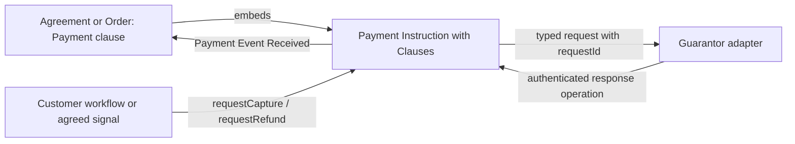

# Build connected applications with clauses

This is the guide to the single current clause package set in this repository. It replaces the earlier catalogue of overlapping, narrowly named clauses. Package sources live at the repository root. `PUBLIC-CLAUSES.json` selects the public families; `PACKAGES.json` pins their exact built identities.

The packages are unpublished candidates. The examples are real Blue source documents, accompanied by executable Java scenarios. Local scenario validation, authenticated multi-account integration, and AWS deployment are separate checks. A passing local example does not certify a banking integration or a production deployment.

## 1. The idea: describe a feature once, connect it where it belongs

An agreement is both readable terms and executable behavior. A clause gives a feature a meaningful name and a reusable implementation. Its parameters describe the policy. Its property bindings connect that policy to the document. Its action connections specify **when**, **who**, and **with what input** the feature runs.

An action is a collection of steps. It does not have to be a user workflow. The same `say` action can run when a person requests it, when an event is emitted, when a property changes, when a child document emits a matching event, or when a durable timer fires. The clause engine lowers those connections to ordinary Blue contracts. Authors of applications write clauses; authors of reusable clauses use the existing native BEX and Contracts semantics.

There is no JavaScript business-rule generator. The Java package builder assembles and verifies the `.blue` source files. The executable lowering logic is itself in the `Connections/Connected Clause` package definition. The application does not decide whether a customer has satisfied a payment condition: the document does.

This gives us one common process:

1. Choose a document type with clause support.
2. Define parties and acceptance with Activation.
3. Add meaningful features such as Product, Payment, Shipping, or a custom Feature.
4. Bind each reusable action to the relevant workflow or signal.
5. Validate the configuration, then execute deterministically and publish the resulting state and events.

An operation is admitted by its authenticated channel. A clause cannot turn a user-supplied party name into authority. A failed action rolls back its attempted state changes and emitted events. Replaying the same accepted input against the same exact package and document state must produce the same result and gas.

## 2. Hello World, including its entire clause definition

The following block is the complete authored definition of `Connections/Hello Clause`. It inherits the connection compiler from `Connections/Connected Clause`; it is not a replacement implementation of that engine.

{{HELLO_SOURCE}}

There are three important pieces. `bindingTypes.text` requires a valid property pointer. `say.defaults` supplies the default action input. The `do` steps validate the input, update the bound text property, and emit a typed event carrying the clause and connection names.

The configuration validator rejects unsupported connection kinds, malformed property paths, and conflicting contributions. At execution time the common connection wrapper checks Activation for ordinary business actions, evaluates the mapping, runs `before`, runs the reusable action, and runs `after`. A validation failure prevents the update and event from being committed. A connection marked `once` is consumed according to the action outcome contract, not merely because an unrelated event was seen.

For example, `before` can reject an unapproved greeting; `params.text` can take text from the incoming request; and `after` can append an audit entry. All three happen in the same document step. This is demonstrated by `00-hello`, including a rejected request and a replay check.

The complete connection engine is in [connected-clause.blue](../clause-connections/types/connected-clause.blue). It contributes contracts through the clause plan rather than letting every clause overwrite a shared `contracts` dictionary.

## 3. The connection vocabulary

| Connection | What starts the action | Typical use |
|---|---|---|
| `on: workflow`, `party: customer` | An authenticated operation request | Accept delivery, request a refund |
| `on: event`, `event: {...}` | A matching event in this document | Update status after payment confirmation |
| `on: change`, `path: /status` | A document update at the selected property | React to a material state change |
| `on: embedded`, `path: /shipment` | A matching event from one embedded document | Observe delivery confirmation |
| `on: collection`, `path: /orders` | A matching event from a member of an embedded collection | Reconcile order outcomes |
| `on: timer`, `timestamp: ...` | A durable absolute deadline | A fixed contractual deadline |
| `on: timer`, `afterEvent: ...`, `delayMs: ...` | A durable deadline anchored to a matching signal | Seven days after delivery |
| `on: initialized` | Initialization of this document | Initialize a feature or an agreed child |
| `on: channel` | An existing native channel selected by an advanced integration | Integrate with a pre-existing native document |

Public examples use the first eight forms and do not declare raw channels or contracts. The last form is an escape hatch for integration authors, not a requirement for ordinary document authors.

A binding contains an action name and a dictionary of named connections. Several connections may invoke the same reusable action. Each connection has its own trigger, parameter mapping, validation steps, completion steps and repetition policy.

```yaml
bindings:
  say:
    customerGreeting:
      on: workflow
      party: customer
      params:
        text: {$var: {name: trigger, path: /text}}
      before:
        - $failIf:
            cond: {$ne: [{$var: {name: trigger, path: /approved}}, true]}
            message: APPROVAL_REQUIRED
      after:
        - $appendChange:
            op: add
            path: /audit/-
            val: Greeting accepted
```

`trigger` is the selected request or event payload. `params` is the evaluated action input. Constants such as `bindings`, `parameters`, `clauseKey` and `connectionKey` belong to the compiled clause context. Whole-object request mappings are evaluated at execution time; they are not merged as literal BEX syntax into an action's defaults.

Use event patterns to express the intended signal precisely. For example, an Order Failed event with `reason: abc` is different from any Order Failed event. A collection listener observes all members of its configured collection, while an embedded listener observes only one path. A collection and a listener for one direct child may coexist: the assembly step combines their embedding declarations without registering the same child twice. Removing a contribution does not discard another clause's ownership of that dependency.

Timers use the native Time protocol and completeness rules. `policy: first` retains the first matching anchor; `policy: latest` replaces the pending anchor with a later match. `once: true` prevents repeated completed firings. `cancelOn` specifies a signal that cancels the pending timer. `delayMs` is milliseconds; the native absolute timestamp is microseconds. There is no reliance on JavaScript `setTimeout` for contractual deadlines.

Do not use an initialization trigger for work that requires acceptance by all parties. Initialization happens before those parties have approved. Prefer an explicit workflow or a later business event after Activation.

## 4. Activation: parties, representatives, keys and acceptance

Activation is the single public feature for membership, read access and acceptance. Agreement, Order, generic Document and Payment Instruction hosts all use the same clause.

A **party** is a role in this document, not a login session. It can represent a person or a business. Its **lead representative** manages that party. It may have any number of named **additional representatives**, subject to the host's resource limits. Each representative has its own authenticated timeline. A representative is not silently the lead and is not automatically authorized to use every lead-only workflow.

`Parties/Party` is the provider-neutral identity shape. `MyOS/MyOS Party` adds `myosAccountId`. A business descriptor is descriptive information; it is not proof of company registration or signing authority. MyOS resolves account IDs and email addresses against real accounts. When both are supplied, they must identify the same account.

```yaml
clauses:
  activation:
    type: Activation/Activation Clause
    parameters:
      parties:
        customer:
          type: MyOS/MyOS Party
          myosAccountId: CUSTOMER_ACCOUNT_ID
          displayName: Alice
        supplier:
          type: MyOS/MyOS Party
          myosAccountId: SUPPLIER_ACCOUNT_ID
          displayName: Example Services
          representatives:
            support:
              type: MyOS/MyOS Representative
              myosAccountId: SUPPORT_ACCOUNT_ID
      readers:
        auditor:
          myosAccountId: AUDITOR_ACCOUNT_ID
      required: [customer, supplier]
      allowNewParties: false
```

The host resolves these identities before creating timelines. It chooses an owned reader key for each required reader group, grants access to the relevant timelines, embeds the provider's confirmed Timeline Access documents, installs the authenticated transports, and registers the same initial document for the participating accounts. The public source contains no channels.

A group may provide several alternative reader keys. At least one acceptable key for **each required reader group** must be authorized by each relevant access document. This means “one of Alice's keys and one of Bob's keys,” not “any key from Alice or Bob.” Merely reading one timeline does not subscribe an account to unrelated timelines and does not give it an operation role.

The read-only auditor receives the state and input visibility required for independent execution. The auditor is not added as a workflow actor. A party whose key is missing cannot be treated as functional merely because another party can still read the data.

The browser operation form defaults to requiring the displayed document version. Leave this enabled for approvals. If the document changes before the input is processed, review the new version before submitting again.

Acceptance is explicit: each required lead calls `approve_<party>` against the exact reviewed document version and current Activation revision. Activation separates `functional` (required access is present) from `active` (functional and required approvals are present). Ordinary clause actions require active membership and current access. Observation and protocol recovery paths are treated separately so the application can still record authoritative outcomes and recover its state.

The lead can replace its own party definition through `updateParty_<party>`, using `replacement`, not the Blue reserved field `value`. A complete replacement includes the prepared authenticated representative transports and reader keys. Each replacement timeline must already be covered by an embedded access document, and the required keys must already be granted. This operation does not itself create new timelines or add new access-proof documents. Updating someone else's party is rejected. Adding a new party requires `allowNewParties`. A roster change resets acceptance for a new revision. Preparing a new representative's timeline and grants is a host operation; adding a name in YAML alone does not create access. The current launcher prepares the initial roster. A post-start account-picker flow that prepares new representatives is not implemented yet; the lower-level replacement operation requires already prepared transports and grants. Do not treat this as a completed self-service membership editor.

When a child is created, its selected parties and readers are a snapshot. Payment Instructions freeze that roster. Changes in an agreement do not silently expand the PI's membership or reader set. A new PI or an explicitly designed migration is required when its frozen membership must change.

## 5. Payment is one family; the instruction owns the protocol

A Payment clause represents one payment obligation. Its `start` action creates and embeds one Payment Instruction. Repeating the same creation intent is idempotent; a conflicting payment at the same destination is rejected.

The generic `Payment/Payment Clause` uses the provider-neutral protocol. `MyOS/MyOS Customer Payment`, `MyOS/MyOS Account to Account Payment`, `ACME/ACME Bank Payment` and `ManualPayments/Manual Bank Payment` specialize how that payment is initialized and confirmed. They share the same request-connection model.

**The Payment clause does not expose guarantor confirmations.** `requestCapture` requests capture. `completePayment` is an authoritative operation on the PI, available to its guarantor. An agreement cannot prove that money moved by emitting its own success event.

`PaymentInstruction/Payment Instruction` owns the payment state, correlated request ledger and named response operations. `PaymentInstruction/Payment Instruction with Clauses` extends it and adds the ordinary clause host. Clause support does not replace the standard protocol.

### The actual Payment clause source

The public Payment type selects a setup implementation. Its shared base creates the child, declares the embedded dependency and echoes typed events. The list of child actions contains requests, not the guarantor's result operations.

{{PAYMENT_SOURCE}}

The setup implementation is [Payment Setup](../clause-payment/types/conditional-setup.blue). It validates roles and terms, selects the party snapshot, separates local and agreement-sourced connections, and assembles the child before publishing it. It uses BEX throughout. It never edits a running child's type to turn it into another payment method.

Here is the complete host declaration that adds clauses to the standard PI:

{{PI_HOST_SOURCE}}

### Requests, responses and the event hierarchy

Every concrete payment request inherits `PaymentInstruction/Payment Request`, which inherits `Events/Request`, which inherits `Events/Event`. Concrete payment responses inherit `PaymentInstruction/Payment Response` → `Events/Response` → `Events/Event`. Shipping follows the same pattern with its own domain request and response bases.

For example, a capture request is represented by the protocol's `PaymentInstruction/Complete Payment Requested`. The public clause action is named `requestCapture`; the guarantor answers through `completePayment`, producing `PaymentInstruction/Payment Completed`. The protocol also distinguishes rejection, failure and an unknown result. An unknown external outcome must be reconciled; it is not safe to issue a second independent charge merely because a timeout occurred.

The request ID correlates the entire attempt. Repeating the same request does not reserve the amount twice. Reusing an ID for a conflicting amount is rejected. Capture and refund reservations protect against concurrent requests exceeding the available authorized or refundable amount. The ledger advances only on the corresponding authoritative response.



The arrow to the adapter is a protocol request, not a synchronous network call inside BEX. The adapter performs external work and submits the correlated result. The document can therefore distinguish requested, pending, failed, unknown and confirmed outcomes.

### Where the request logic runs

By default, request connections execute **inside the PI**. A customer workflow belongs there if it only needs the PI's state and the supplied request. The Payment clause observes the PI and emits `Payment/Payment Event Received` with the clause name, instruction path, original event reference and event kind. Other agreement clauses listen to that observation.

```yaml
payment:
  type: Payment/Payment Clause
  parameters:
    amountMinor: 10000
    currency: EUR
  bindings:
    instruction: /payment
    start:
      startPayment: {on: workflow, party: customer}
    requestCapture:
      confirmSatisfaction:
        on: workflow
        party: customer
        params: {requestId: capture-1, amountMinor: 10000}
        before:
          - $failIf:
              cond: {$ne: [{$var: {name: trigger, path: /satisfied}}, true]}
              message: SATISFACTION_REQUIRED
        after:
          - $appendEvent:
              $merge:
                - type: Events/Event
                - {kind: Customer Satisfaction, satisfied: true}
```

`confirmSatisfaction` is a PI workflow. The customer supplies `satisfied: true`. The action requests capture; it does not confirm capture. Its completion event is visible to the agreement through the Payment clause's observation. The agreement can update a satisfaction indicator without pretending that payment is complete.

When the condition comes from the agreement, add `in: agreement` to the connection. The PI embeds the agreement under `/sources/order` and observes it. The agreement already embeds the PI, so this is a deliberate cycle. The guarantor must therefore have visibility of the agreement's input domain. The selected Activation roster and access rules make this requirement explicit.

```yaml
requestCapture:
  acceptedDelivery:
    in: agreement
    on: event
    event: {type: Events/Event, kind: Delivery Accepted}
    params: {requestId: delivery-capture, amountMinor: 10000}
```

A local embedded path is similarly resolved through the agreement. A smart-home or Shipping event can request capture, and a collection of Orders can produce signals used by a parent payment policy. No mandatory third “proof document” is inserted between the agreement and the PI. Use an independent source document only when it already represents an actual subsystem or business fact.

### Common payment options

`amountMinor` and `currency` define the amount and denomination. Alternatively bind `amount` to a document property, such as `/product/totalMinor`; the creation action snapshots it. `payer`, `payee` and `guarantor` select party roles. `recipientApprovalRequired` adds recipient approval. `parties` and `readers` select the roster copied from Activation; an empty party selection reuses the current roster. `instructionClauses` allows additional explicit PI features.

Request actions include authorization, capture, refund, void/cancellation, recipient approval, payee assignment, transaction details updates, final amount resolution, and completion/reversal/details lock or unlock requests. They use the same `params`, `before`, `after` and trigger vocabulary. A requested lock does not become effective until the guarantor confirms it.

MyOS payment methods accept selected MyOS parties or matching account IDs. An ID must resolve to a declared party; it does not bypass Activation. A customer payment can request a payment session and record funding through its PI's provider operations. An account-to-account payment selects the payer and recipient accounts. These package examples define and test the protocol; connecting actual financial services remains an adapter responsibility.

Manual bank payment uses the recipient as the confirming authority. The payer can report a transfer, but that report does not mark the payment complete. ACME Bank illustrates a separate bank guarantor without coupling the family to a named commercial provider.

## 6. Other selected families

### Feature

Group custom steps under one business heading. Feature is appropriate for a smart-house check-in, a CRM conversation request, a delivery acceptance, or an agreement-specific calculation. Give the feature request and response events when it integrates with an external service. Put response listeners with the feature that owns the integration and exposes its state; let other clauses consume its meaningful events.

Feature is not permission to skip protocol authority. A response from a bank or carrier still needs an authenticated actor and correlated operation. Use a separate instruction document when the subsystem has its own parties, state and lifecycle.

### Product

Maintain a validated product quote: item name, quantity, unit price, currency and computed total. A lesson, a rental item, or a service order can all use it. Payment can bind to the resulting total and snapshot it when the PI starts. Changing the later quote does not retrospectively rewrite an already accepted PI.

### Status

One reusable state machine serves order progress, milestone acceptance, delivery state and other independent aspects. Declare allowed transitions and bind a property. Multiple Status clauses can govern different properties. Accepting the design milestone does not accept the delivery milestone; a paid order does not automatically become delivered.

### Documents

Create a named child from an agreed template, copy selected Activation parties/readers, and embed it in a collection. Repeating a creation key with the same intent is idempotent. Conflicting intent for the same key is rejected. Explicitly permitted fields may customize the template; the requester cannot replace arbitrary child code.

Use Documents for reseller orders, membership periods and bundles. Each child may itself contain Product, Payment and Shipping. Dependencies remain real embedded documents and must satisfy native completeness rules.

### Ledger

Maintain accrued obligations, reservations and confirmed settlements. An absolute target for a source replaces its earlier target. For example, a commission correction from 1,000 to 750 minor units subtracts 250; replaying the 750 target does not add it again. A reservation prevents promising the same obligation to two payouts. Confirming a settlement consumes the reserved amount and increments paid value.

Ledger does not move money. Bind settlement confirmation to an authoritative payout response. A reseller commission and the customer's purchase are separate obligations and normally separate PIs.

### Amendments

Propose an exact replacement at an allowed path and require the configured parties to approve the same proposal. The expected revision rejects stale edits. A proposal outside the permitted paths or approval for another proposal is rejected. Use this for booking changes or negotiated service terms. It does not silently alter frozen payment terms.

### Termination

Represent winding down separately from completed termination. A request can stop new business while outstanding work, disputes or payments finish. The final transition checks the bound completion condition. Bind new-work actions to the lifecycle policy as well; merely displaying “WindingDown” is not a substitute for enforcing it.

### Schedule

Expose a meaningful scheduled event using the same durable timer connections. Use it for renewal reminders, a reporting deadline or an inactivity signal. Cancellation, first/latest anchoring, and actual financial consequences remain explicit. A timer should not invent a bank confirmation.

### Shipping

Shipping has a separate standard instruction, an instruction with clauses, a request feature and a parent Shipping clause. It models shipment booking, cancellation and address changes as requests, then records carrier acceptance/rejection and delivery outcomes through carrier operations. Each request is correlated; conflicting duplicate IDs and contradictory decisions are rejected.

An address-change request does not change the confirmed destination. The carrier's confirmation does. Once dispatched, a cancellation or address change cannot be treated as a pre-dispatch action. The parent order observes the instruction's outcomes and can connect them to payment conditions.

### Representation

A listed representative may be assigned a workflow directly using its qualified role, for example `buyer__assistant`. Broader authority to act for the lead is a separate concept. The Representation clause prepares a fixed-target, fixed-operation native Operation Mandate. The holder must approve the mandate. The example verifies preparation and owner approval; the hosted provider append API does not yet accept delegated-authority selectors. Direct representative workflows work through their own timelines. The native `blue-mandates` package remains the authority for delegated execution and revocation; the wrapper does not reimplement it.

Do not infer authority from possession of a reader key. Reading, direct operation permission and delegated authority are three separate capabilities.

## 7. Composition rules and operational boundaries

Business clauses contribute plans. Plans declare owned state, contracts, embedded dependencies and read requirements. The host validates those plans before applying them. Conflicting owners and invalid dependencies fail instead of silently overwriting each other.

A cycle is allowed when the native runtime can execute its atomic component within the resource budget. It is not free. A wide or deeply cyclic graph may be expensive. Use a cycle because the PI needs agreement facts, not because every workflow must run in the agreement. A PI-local workflow avoids that dependency entirely.

Every example here is provider-neutral unless its type says otherwise. Test guarantor and carrier operations simulate authoritative responses. Production adapters need durable request delivery, idempotent external calls, reconciliation of unknown outcomes, and authenticated response submission. Deterministic document execution does not make a network payment exactly once by itself.

## 8. Running and auditing the examples

Each source below lives in `examples/apps/` beside a `.case.yaml` scenario, a `.native.yaml` scenario for native mandate authority, or a `.time.yaml` signed-time walkthrough. Scenarios specify the actor, target document, operation, request, expected state and rejected cases. The Java runner executes those sources and compares replay gas, receipt and snapshot identities. Selected cases also export/import a snapshot before replay.

The local Contracts runner uses explicit test transports. It tests business semantics and deterministic replay. The authenticated bootstrap integration separately verifies account lookup, reader-key grants, provider access documents and account routing. Timers require the native Time service; changing an operating-system clock or injecting a look-alike event is not an equivalent test.

The example launcher displays complete source and a step-by-step operation list. Starting it creates a real document, installs the exact verified declarative package closure in the participating workspaces, and redirects to that document. Sign-up retains the selected example. A user chooses the accounts for each role before starting. Using separate accounts is necessary to exercise genuine inter-account permissions; one account in several roles is only a convenient local walkthrough.

{{FAMILY_TABLE}}

## 9. Complete application documents

Applications 01–10 adapt the scenarios from the supplied `myos-examples.zip`. That archive identifies its blueprints as a design interchange format, not executable Blue. The table below states the scope of each executable adaptation; it is not a claim that every proposed feature in the archive is complete. Document 00 introduces Hello, and documents 11–29 isolate additional behaviors and payment methods.

| Archive scenario | Executable adaptation | Scope |
|---|---|---|
| Order and payment | 01 | Delivery, customer satisfaction in the PI, authorization and confirmed capture; the order observes the PI event. |
| Reseller and ledger | 02 | Commission from confirmed net collection, corrections after refunds and settlement of the resulting obligation. |
| Milestone payments | 03 | Separate acceptance and payment for design and delivery, with explicit agreement observation. |
| Bundle order | 04 | Independent child orders and payments; activity on an unrelated role does not satisfy another order. |
| Smart home | 05 | Matching check-in requests capture; bounded temperature requests and separate provider confirmation. |
| Membership | 06 | Trial attendance, explicit membership opt-in, independent paid periods and termination. |
| Booking amendment | 07 | Exact two-party amendment approval; an existing PI retains its original amount. |
| Participants and agents | 08 | Predeclared representative actions and lead-only actions. Post-start representative provisioning is still a separate integration task. |
| Evidence and mandate | 09 | Delivered-evidence validation and native fixed-scope mandate creation/approval. The archive's broader multi-evidence refund budget/freeze design and hosted delegated invocation are not implemented here. |
| Net settlement | 10 | Material statement revisions and settlement against the selected statement, with confirmed payment accounting. |

{{EXAMPLES}}

## 10. Source of truth and compatibility

Use the package identities from `PACKAGES.json`, not a similarly named package from an earlier preview. An authored name such as `Payment/Payment Clause` is resolved to an exact definition before execution. Existing deployed documents keep their historical exact packages. Replacing the current unpublished candidate does not migrate their state or revise previously accepted terms.

The native Language, BEX, Contracts, Coordination, Time and Mandates protocols remain distinct from these declarative business packages. The default gas limit is 10,000,000. This limit protects one processing step; it is not a promise that every enormous graph will be fast or fit in memory.
