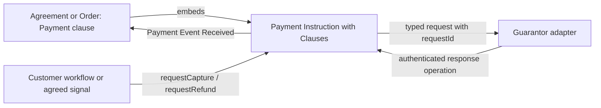

# Build connected applications with clauses

This is the guide to the single current clause package set in this repository. It replaces the earlier catalogue of overlapping, narrowly named clauses. Package sources live at the repository root. `PUBLIC-CLAUSES.json` selects the public families; `PACKAGES.json` pins their exact built identities.

The packages are unpublished candidates. The examples are real Blue source documents, accompanied by executable Java scenarios. Local scenario validation, authenticated multi-account integration, and AWS deployment are separate checks. A passing local example does not certify a banking integration or a production deployment.

## 1. The idea: describe a feature once, connect it where it belongs

An agreement is both readable terms and executable behavior. A clause gives a feature a meaningful name and a reusable implementation. Its parameters describe the policy. Its property bindings connect that policy to the document. Its action connections specify **when**, **who**, and **with what input** the feature runs.

An action is a collection of steps. It does not have to be a user workflow. The same `say` action can run when a person requests it, when an event is emitted, when a property changes, when a child document emits a matching event, or when a durable timer fires. The clause engine lowers those connections to ordinary Blue contracts. Authors of applications write clauses; authors of reusable clauses use the existing native BEX and Contracts semantics.

There is no JavaScript business-rule generator. The Java package builder assembles and verifies the `.blue` source files. The executable lowering logic is itself in the `Connections/Connected Clause` package definition. The application does not decide whether a customer has satisfied a payment condition: the document does.

This gives us one common process:

1. Choose a document type with clause support.
2. Define parties and acceptance with Activation.
3. Add meaningful features such as Product, Payment, Shipping, or a custom Feature.
4. Bind each reusable action to the relevant workflow or signal.
5. Validate the configuration, then execute deterministically and publish the resulting state and events.

An operation is admitted by its authenticated channel. A clause cannot turn a user-supplied party name into authority. A failed action rolls back its attempted state changes and emitted events. Replaying the same accepted input against the same exact package and document state must produce the same result and gas.

## 2. Hello World, including its entire clause definition

The following block is the complete authored definition of `Connections/Hello Clause`. It inherits the connection compiler from `Connections/Connected Clause`; it is not a replacement implementation of that engine.

```yaml
name: Hello Clause
type: Connections/Connected Clause
description: One reusable action; connection bindings determine how it is invoked.
bindingTypes:
  text: pointer
actions:
  say:
    defaults:
      text: Hello World
    do:
    - $failIf:
        cond:
          $not:
            $isKind:
              val:
                $var:
                  name: params
                  path: /text
              kind: text
        message: Hello text must be Text
    - $appendChange:
        op: replace
        path:
          $const:
            name: bindings
            path: /text
        val:
          $var:
            name: params
            path: /text
    - $appendEvent:
        $merge:
        - type: Connections/Hello Said
        - clause:
            $const: clauseKey
          connection:
            $const: connectionKey
          text:
            $var:
              name: params
              path: /text
```

There are three important pieces. `bindingTypes.text` requires a valid property pointer. `say.defaults` supplies the default action input. The `do` steps validate the input, update the bound text property, and emit a typed event carrying the clause and connection names.

The configuration validator rejects unsupported connection kinds, malformed property paths, and conflicting contributions. At execution time the common connection wrapper checks Activation for ordinary business actions, evaluates the mapping, runs `before`, runs the reusable action, and runs `after`. A validation failure prevents the update and event from being committed. A connection marked `once` is consumed according to the action outcome contract, not merely because an unrelated event was seen.

For example, `before` can reject an unapproved greeting; `params.text` can take text from the incoming request; and `after` can append an audit entry. All three happen in the same document step. This is demonstrated by `00-hello`, including a rejected request and a replay check.

The complete connection engine is in [connected-clause.blue](../clause-connections/types/connected-clause.blue). It contributes contracts through the clause plan rather than letting every clause overwrite a shared `contracts` dictionary.

## 3. The connection vocabulary

| Connection | What starts the action | Typical use |
|---|---|---|
| `on: workflow`, `party: customer` | An authenticated operation request | Accept delivery, request a refund |
| `on: event`, `event: {...}` | A matching event in this document | Update status after payment confirmation |
| `on: change`, `path: /status` | A document update at the selected property | React to a material state change |
| `on: embedded`, `path: /shipment` | A matching event from one embedded document | Observe delivery confirmation |
| `on: collection`, `path: /orders` | A matching event from a member of an embedded collection | Reconcile order outcomes |
| `on: timer`, `timestamp: ...` | A durable absolute deadline | A fixed contractual deadline |
| `on: timer`, `afterEvent: ...`, `delayMs: ...` | A durable deadline anchored to a matching signal | Seven days after delivery |
| `on: initialized` | Initialization of this document | Initialize a feature or an agreed child |
| `on: channel` | An existing native channel selected by an advanced integration | Integrate with a pre-existing native document |

Public examples use the first eight forms and do not declare raw channels or contracts. The last form is an escape hatch for integration authors, not a requirement for ordinary document authors.

A binding contains an action name and a dictionary of named connections. Several connections may invoke the same reusable action. Each connection has its own trigger, parameter mapping, validation steps, completion steps and repetition policy.

```yaml
bindings:
  say:
    customerGreeting:
      on: workflow
      party: customer
      params:
        text: {$var: {name: trigger, path: /text}}
      before:
        - $failIf:
            cond: {$ne: [{$var: {name: trigger, path: /approved}}, true]}
            message: APPROVAL_REQUIRED
      after:
        - $appendChange:
            op: add
            path: /audit/-
            val: Greeting accepted
```

`trigger` is the selected request or event payload. `params` is the evaluated action input. Constants such as `bindings`, `parameters`, `clauseKey` and `connectionKey` belong to the compiled clause context. Whole-object request mappings are evaluated at execution time; they are not merged as literal BEX syntax into an action's defaults.

Use event patterns to express the intended signal precisely. For example, an Order Failed event with `reason: abc` is different from any Order Failed event. A collection listener observes all members of its configured collection, while an embedded listener observes only one path. A collection and a listener for one direct child may coexist: the assembly step combines their embedding declarations without registering the same child twice. Removing a contribution does not discard another clause's ownership of that dependency.

Timers use the native Time protocol and completeness rules. `policy: first` retains the first matching anchor; `policy: latest` replaces the pending anchor with a later match. `once: true` prevents repeated completed firings. `cancelOn` specifies a signal that cancels the pending timer. `delayMs` is milliseconds; the native absolute timestamp is microseconds. There is no reliance on JavaScript `setTimeout` for contractual deadlines.

Do not use an initialization trigger for work that requires acceptance by all parties. Initialization happens before those parties have approved. Prefer an explicit workflow or a later business event after Activation.

## 4. Activation: parties, representatives, keys and acceptance

Activation is the single public feature for membership, read access and acceptance. Agreement, Order, generic Document and Payment Instruction hosts all use the same clause.

A **party** is a role in this document, not a login session. It can represent a person or a business. Its **lead representative** manages that party. It may have any number of named **additional representatives**, subject to the host's resource limits. Each representative has its own authenticated timeline. A representative is not silently the lead and is not automatically authorized to use every lead-only workflow.

`Parties/Party` is the provider-neutral identity shape. `MyOS/MyOS Party` adds `myosAccountId`. A business descriptor is descriptive information; it is not proof of company registration or signing authority. MyOS resolves account IDs and email addresses against real accounts. When both are supplied, they must identify the same account.

```yaml
clauses:
  activation:
    type: Activation/Activation Clause
    parameters:
      parties:
        customer:
          type: MyOS/MyOS Party
          myosAccountId: CUSTOMER_ACCOUNT_ID
          displayName: Alice
        supplier:
          type: MyOS/MyOS Party
          myosAccountId: SUPPLIER_ACCOUNT_ID
          displayName: Example Services
          representatives:
            support:
              type: MyOS/MyOS Representative
              myosAccountId: SUPPORT_ACCOUNT_ID
      readers:
        auditor:
          myosAccountId: AUDITOR_ACCOUNT_ID
      required: [customer, supplier]
      allowNewParties: false
```

The host resolves these identities before creating timelines. It chooses an owned reader key for each required reader group, grants access to the relevant timelines, embeds the provider's confirmed Timeline Access documents, installs the authenticated transports, and registers the same initial document for the participating accounts. The public source contains no channels.

A group may provide several alternative reader keys. At least one acceptable key for **each required reader group** must be authorized by each relevant access document. This means “one of Alice's keys and one of Bob's keys,” not “any key from Alice or Bob.” Merely reading one timeline does not subscribe an account to unrelated timelines and does not give it an operation role.

The read-only auditor receives the state and input visibility required for independent execution. The auditor is not added as a workflow actor. A party whose key is missing cannot be treated as functional merely because another party can still read the data.

The browser operation form defaults to requiring the displayed document version. Leave this enabled for approvals. If the document changes before the input is processed, review the new version before submitting again.

Acceptance is explicit: each required lead calls `approve_<party>` against the exact reviewed document version and current Activation revision. Activation separates `functional` (required access is present) from `active` (functional and required approvals are present). Ordinary clause actions require active membership and current access. Observation and protocol recovery paths are treated separately so the application can still record authoritative outcomes and recover its state.

The lead can replace its own party definition through `updateParty_<party>`, using `replacement`, not the Blue reserved field `value`. A complete replacement includes the prepared authenticated representative transports and reader keys. Each replacement timeline must already be covered by an embedded access document, and the required keys must already be granted. This operation does not itself create new timelines or add new access-proof documents. Updating someone else's party is rejected. Adding a new party requires `allowNewParties`. A roster change resets acceptance for a new revision. Preparing a new representative's timeline and grants is a host operation; adding a name in YAML alone does not create access. The current launcher prepares the initial roster. A post-start account-picker flow that prepares new representatives is not implemented yet; the lower-level replacement operation requires already prepared transports and grants. Do not treat this as a completed self-service membership editor.

When a child is created, its selected parties and readers are a snapshot. Payment Instructions freeze that roster. Changes in an agreement do not silently expand the PI's membership or reader set. A new PI or an explicitly designed migration is required when its frozen membership must change.

## 5. Payment is one family; the instruction owns the protocol

A Payment clause represents one payment obligation. Its `start` action creates and embeds one Payment Instruction. Repeating the same creation intent is idempotent; a conflicting payment at the same destination is rejected.

The generic `Payment/Payment Clause` uses the provider-neutral protocol. `MyOS/MyOS Customer Payment`, `MyOS/MyOS Account to Account Payment`, `ACME/ACME Bank Payment` and `ManualPayments/Manual Bank Payment` specialize how that payment is initialized and confirmed. They share the same request-connection model.

**The Payment clause does not expose guarantor confirmations.** `requestCapture` requests capture. `completePayment` is an authoritative operation on the PI, available to its guarantor. An agreement cannot prove that money moved by emitting its own success event.

`PaymentInstruction/Payment Instruction` owns the payment state, correlated request ledger and named response operations. `PaymentInstruction/Payment Instruction with Clauses` extends it and adds the ordinary clause host. Clause support does not replace the standard protocol.

### The actual Payment clause source

The public Payment type selects a setup implementation. Its shared base creates the child, declares the embedded dependency and echoes typed events. The list of child actions contains requests, not the guarantor's result operations.

```yaml
name: Payment Clause
type: Payment/Payment Base
actionDefinition:
  type: Payment/Standard Payment Setup
description: One payment. Named request bindings execute in its Payment Instruction; an explicit agreement
  source creates a cycle. Only the Payment Instruction exposes guarantor operations.
```

Its complete shared base:

```yaml
name: Payment Base
type: Connections/Connected Clause
description: Create and observe a standard PI. Capture connections execute inside PI; inputs and placement
  remain explicit.
bindingTypes:
  instruction: pointer
  amount: pointer
defaultBindings:
  instruction: /payment
  amount: /product/totalMinor
embeds:
- instruction
readParametersFromDocument: true
actions:
  start:
    do:
    - $set:
        name: actionResult
        expr:
          $call:
            function: build
    resultContract: outcome-v1
  observe:
    automatic:
      'on': embedded
      pathBinding: instruction
    do:
    - $if:
        cond:
          $not:
            $is:
              node:
                $event: /event
              pattern:
                type: Events/Event
        then:
        - $return: {}
    - $appendEvent:
        $merge:
        - type: Payment/Payment Event Received
        - kind:
            $var:
              name: trigger
              path: /kind
          clause:
            $const: clauseKey
          instructionPath:
            $const:
              name: bindings
              path: /instruction
          event:
            $objectSet:
              object: {}
              key: blueId
              val:
                $nodeBlueId:
                  $event: /event
    observation: true
childActions:
- approveRecipient
- requestCapture
- requestRefund
- requestVoid
- requestPayeeAssignment
- requestTransactionDetailsUpdate
- requestFinalAmountResolution
- requestPaymentCompletionLock
- requestPaymentCompletionUnlock
- requestPaymentReversalLock
- requestPaymentReversalUnlock
- requestTransactionDetailsUpdateLock
- requestTransactionDetailsUpdateUnlock
- requestAuthorize
```

The setup implementation is [Payment Setup](../clause-payment/types/conditional-setup.blue). It validates roles and terms, selects the party snapshot, separates local and agreement-sourced connections, and assembles the child before publishing it. It uses BEX throughout. It never edits a running child's type to turn it into another payment method.

Here is the complete host declaration that adds clauses to the standard PI:

```yaml
name: Payment Instruction with Clauses
type: PaymentInstruction/Payment Instruction
clauses: {}
contracts:
  __clausesAccepted:
    event:
      type: Clauses/Amendment Accepted
    type: Contracts/Triggered Event Channel
  __clausesBegin:
    channel: __clausesRequests
    steps:
    - type: Clauses/Begin Amendment Step
    - type: Clauses/Prepare Amendment Step
    type: Contracts/Sequential Workflow
  __clausesChangeListener:
    channel: __clausesChanges
    steps:
    - type: Clauses/Begin Amendment Step
    - type: Clauses/Prepare Amendment Step
    type: Contracts/Sequential Workflow
  __clausesChanges:
    event:
      type: Clauses/Clause Change Requested
    type: Contracts/Triggered Event Channel
  __clausesInit:
    channel: __clausesLife
    steps:
    - type: Clauses/Initialize Clauses Step
    - type: Clauses/Prepare Amendment Step
    type: Contracts/Sequential Workflow
  __clausesInitialized:
    event:
      type: Clauses/Clauses Initialized
    type: Contracts/Triggered Event Channel
  __clausesLife:
    event:
      type: Contracts/Document Processing Initiated
    type: Contracts/Lifecycle Event Channel
  __clausesRequests:
    event:
      type: Clauses/Amendment Requested
    type: Contracts/Triggered Event Channel
  __clausesRun:
    event:
      type: Clauses/Run Amendment
    type: Contracts/Triggered Event Channel
  __paymentAfterClauses:
    type: Contracts/Sequential Workflow
    channel: __clausesInitialized
    order: -1000
    steps:
    - type: PaymentInstruction/Initialize Payment Step
```

### Requests, responses and the event hierarchy

Every concrete payment request inherits `PaymentInstruction/Payment Request`, which inherits `Events/Request`, which inherits `Events/Event`. Concrete payment responses inherit `PaymentInstruction/Payment Response` → `Events/Response` → `Events/Event`. Shipping follows the same pattern with its own domain request and response bases.

For example, a capture request is represented by the protocol's `PaymentInstruction/Complete Payment Requested`. The public clause action is named `requestCapture`; the guarantor answers through `completePayment`, producing `PaymentInstruction/Payment Completed`. The protocol also distinguishes rejection, failure and an unknown result. An unknown external outcome must be reconciled; it is not safe to issue a second independent charge merely because a timeout occurred.

The request ID correlates the entire attempt. Repeating the same request does not reserve the amount twice. Reusing an ID for a conflicting amount is rejected. Capture and refund reservations protect against concurrent requests exceeding the available authorized or refundable amount. The ledger advances only on the corresponding authoritative response.



The arrow to the adapter is a protocol request, not a synchronous network call inside BEX. The adapter performs external work and submits the correlated result. The document can therefore distinguish requested, pending, failed, unknown and confirmed outcomes.

### Where the request logic runs

By default, request connections execute **inside the PI**. A customer workflow belongs there if it only needs the PI's state and the supplied request. The Payment clause observes the PI and emits `Payment/Payment Event Received` with the clause name, instruction path, original event reference and event kind. Other agreement clauses listen to that observation.

```yaml
payment:
  type: Payment/Payment Clause
  parameters:
    amountMinor: 10000
    currency: EUR
  bindings:
    instruction: /payment
    start:
      startPayment: {on: workflow, party: customer}
    requestCapture:
      confirmSatisfaction:
        on: workflow
        party: customer
        params: {requestId: capture-1, amountMinor: 10000}
        before:
          - $failIf:
              cond: {$ne: [{$var: {name: trigger, path: /satisfied}}, true]}
              message: SATISFACTION_REQUIRED
        after:
          - $appendEvent:
              $merge:
                - type: Events/Event
                - {kind: Customer Satisfaction, satisfied: true}
```

`confirmSatisfaction` is a PI workflow. The customer supplies `satisfied: true`. The action requests capture; it does not confirm capture. Its completion event is visible to the agreement through the Payment clause's observation. The agreement can update a satisfaction indicator without pretending that payment is complete.

When the condition comes from the agreement, add `in: agreement` to the connection. The PI embeds the agreement under `/sources/order` and observes it. The agreement already embeds the PI, so this is a deliberate cycle. The guarantor must therefore have visibility of the agreement's input domain. The selected Activation roster and access rules make this requirement explicit.

```yaml
requestCapture:
  acceptedDelivery:
    in: agreement
    on: event
    event: {type: Events/Event, kind: Delivery Accepted}
    params: {requestId: delivery-capture, amountMinor: 10000}
```

A local embedded path is similarly resolved through the agreement. A smart-home or Shipping event can request capture, and a collection of Orders can produce signals used by a parent payment policy. No mandatory third “proof document” is inserted between the agreement and the PI. Use an independent source document only when it already represents an actual subsystem or business fact.

### Common payment options

`amountMinor` and `currency` define the amount and denomination. Alternatively bind `amount` to a document property, such as `/product/totalMinor`; the creation action snapshots it. `payer`, `payee` and `guarantor` select party roles. `recipientApprovalRequired` adds recipient approval. `parties` and `readers` select the roster copied from Activation; an empty party selection reuses the current roster. `instructionClauses` allows additional explicit PI features.

Request actions include authorization, capture, refund, void/cancellation, recipient approval, payee assignment, transaction details updates, final amount resolution, and completion/reversal/details lock or unlock requests. They use the same `params`, `before`, `after` and trigger vocabulary. A requested lock does not become effective until the guarantor confirms it.

MyOS payment methods accept selected MyOS parties or matching account IDs. An ID must resolve to a declared party; it does not bypass Activation. A customer payment can request a payment session and record funding through its PI's provider operations. An account-to-account payment selects the payer and recipient accounts. These package examples define and test the protocol; connecting actual financial services remains an adapter responsibility.

Manual bank payment uses the recipient as the confirming authority. The payer can report a transfer, but that report does not mark the payment complete. ACME Bank illustrates a separate bank guarantor without coupling the family to a named commercial provider.

## 6. Other selected families

### Feature

Group custom steps under one business heading. Feature is appropriate for a smart-house check-in, a CRM conversation request, a delivery acceptance, or an agreement-specific calculation. Give the feature request and response events when it integrates with an external service. Put response listeners with the feature that owns the integration and exposes its state; let other clauses consume its meaningful events.

Feature is not permission to skip protocol authority. A response from a bank or carrier still needs an authenticated actor and correlated operation. Use a separate instruction document when the subsystem has its own parties, state and lifecycle.

### Product

Maintain a validated product quote: item name, quantity, unit price, currency and computed total. A lesson, a rental item, or a service order can all use it. Payment can bind to the resulting total and snapshot it when the PI starts. Changing the later quote does not retrospectively rewrite an already accepted PI.

### Status

One reusable state machine serves order progress, milestone acceptance, delivery state and other independent aspects. Declare allowed transitions and bind a property. Multiple Status clauses can govern different properties. Accepting the design milestone does not accept the delivery milestone; a paid order does not automatically become delivered.

### Documents

Create a named child from an agreed template, copy selected Activation parties/readers, and embed it in a collection. Repeating a creation key with the same intent is idempotent. Conflicting intent for the same key is rejected. Explicitly permitted fields may customize the template; the requester cannot replace arbitrary child code.

Use Documents for reseller orders, membership periods and bundles. Each child may itself contain Product, Payment and Shipping. Dependencies remain real embedded documents and must satisfy native completeness rules.

### Ledger

Maintain accrued obligations, reservations and confirmed settlements. An absolute target for a source replaces its earlier target. For example, a commission correction from 1,000 to 750 minor units subtracts 250; replaying the 750 target does not add it again. A reservation prevents promising the same obligation to two payouts. Confirming a settlement consumes the reserved amount and increments paid value.

Ledger does not move money. Bind settlement confirmation to an authoritative payout response. A reseller commission and the customer's purchase are separate obligations and normally separate PIs.

### Amendments

Propose an exact replacement at an allowed path and require the configured parties to approve the same proposal. The expected revision rejects stale edits. A proposal outside the permitted paths or approval for another proposal is rejected. Use this for booking changes or negotiated service terms. It does not silently alter frozen payment terms.

### Termination

Represent winding down separately from completed termination. A request can stop new business while outstanding work, disputes or payments finish. The final transition checks the bound completion condition. Bind new-work actions to the lifecycle policy as well; merely displaying “WindingDown” is not a substitute for enforcing it.

### Schedule

Expose a meaningful scheduled event using the same durable timer connections. Use it for renewal reminders, a reporting deadline or an inactivity signal. Cancellation, first/latest anchoring, and actual financial consequences remain explicit. A timer should not invent a bank confirmation.

### Shipping

Shipping has a separate standard instruction, an instruction with clauses, a request feature and a parent Shipping clause. It models shipment booking, cancellation and address changes as requests, then records carrier acceptance/rejection and delivery outcomes through carrier operations. Each request is correlated; conflicting duplicate IDs and contradictory decisions are rejected.

An address-change request does not change the confirmed destination. The carrier's confirmation does. Once dispatched, a cancellation or address change cannot be treated as a pre-dispatch action. The parent order observes the instruction's outcomes and can connect them to payment conditions.

### Representation

A listed representative may be assigned a workflow directly using its qualified role, for example `buyer__assistant`. Broader authority to act for the lead is a separate concept. The Representation clause prepares a fixed-target, fixed-operation native Operation Mandate. The holder must approve the mandate. The example verifies preparation and owner approval; the hosted provider append API does not yet accept delegated-authority selectors. Direct representative workflows work through their own timelines. The native `blue-mandates` package remains the authority for delegated execution and revocation; the wrapper does not reimplement it.

Do not infer authority from possession of a reader key. Reading, direct operation permission and delegated authority are three separate capabilities.

## 7. Composition rules and operational boundaries

Business clauses contribute plans. Plans declare owned state, contracts, embedded dependencies and read requirements. The host validates those plans before applying them. Conflicting owners and invalid dependencies fail instead of silently overwriting each other.

A cycle is allowed when the native runtime can execute its atomic component within the resource budget. It is not free. A wide or deeply cyclic graph may be expensive. Use a cycle because the PI needs agreement facts, not because every workflow must run in the agreement. A PI-local workflow avoids that dependency entirely.

Every example here is provider-neutral unless its type says otherwise. Test guarantor and carrier operations simulate authoritative responses. Production adapters need durable request delivery, idempotent external calls, reconciliation of unknown outcomes, and authenticated response submission. Deterministic document execution does not make a network payment exactly once by itself.

## 8. Running and auditing the examples

Each source below lives in `examples/apps/` beside a `.case.yaml` scenario, a `.native.yaml` scenario for native mandate authority, or a `.time.yaml` signed-time walkthrough. Scenarios specify the actor, target document, operation, request, expected state and rejected cases. The Java runner executes those sources and compares replay gas, receipt and snapshot identities. Selected cases also export/import a snapshot before replay.

The local Contracts runner uses explicit test transports. It tests business semantics and deterministic replay. The authenticated bootstrap integration separately verifies account lookup, reader-key grants, provider access documents and account routing. Timers require the native Time service; changing an operating-system clock or injecting a look-alike event is not an equivalent test.

An HTTP bootstrap uses `POST /api/blue/v1/documents/bootstrap` with the serialized `document` and an optional `packages` array of exact catalogue BlueIds. The launcher supplies those IDs; the YAML stays readable as `Package / Type`. The server installs the complete selected dependency closure before resolving names. Activation supplies the parties, so a separate `participants` object is not required for these examples. Keep the same idempotency key and identical body when resuming an interrupted start.

A successful bootstrap means the documents are registered; initial processing and access-proof propagation can still be running. Before approving, wait for the relevant document to become functional and finish processing, then review its current state. A concurrent update can invalidate that exact version. The correct response is to review again, not silently approve a newer state or disable the version check.

The example launcher displays complete source and a step-by-step operation list. Starting it creates a real document, installs the exact verified declarative package closure in the participating workspaces, and redirects to that document. Sign-up retains the selected example. A user chooses the accounts for each role before starting. Using separate accounts is necessary to exercise genuine inter-account permissions; one account in several roles is only a convenient local walkthrough.

| Family | Public types | Purpose | Complete examples in this guide |
|---|---|---|---|
| Hello World | `Connections/Hello Clause` | Bind a greeting action to workflows and document signals. | [00-hello](#00-hello), [08-participants-agents](#08-participants-agents), [11-hello-events](#11-hello-events), [12-hello-change](#12-hello-change) |
| Feature | `Features/Feature Clause` | Group native actions into a named business feature. | [01-order-payment](#01-order-payment), [05-smart-home](#05-smart-home), [06-membership](#06-membership), [09-evidence-mandate](#09-evidence-mandate) |
| Activation | `Activation/Activation Clause` | Parties, representatives, reader access and acceptance. | [00-hello](#00-hello), [01-order-payment](#01-order-payment), [02-reseller-ledger](#02-reseller-ledger), [03-milestone-payments](#03-milestone-payments) |
| Representation | `Representation/Representation Clause` | Explicit owner-approved operation delegation; not implied by a representative listing. | [09-evidence-mandate](#09-evidence-mandate) |
| Amendments | `Amendments/Amendments Clause` | Propose and approve changes to editable terms. | [07-booking-amendment](#07-booking-amendment), [18-amendments](#18-amendments) |
| Termination | `Termination/Termination Clause` | Request closure and finish after outstanding obligations permit it. | [06-membership](#06-membership), [17-termination](#17-termination) |
| Status | `State/Status Clause` | Validate named state transitions. | [03-milestone-payments](#03-milestone-payments), [09-evidence-mandate](#09-evidence-mandate), [20-status-branch](#20-status-branch) |
| Product | `Commerce/Product Clause` | Maintain a validated product quote. | [15-product](#15-product) |
| Documents | `Documents/Documents Clause` | Start named child documents and reuse party snapshots. | [02-reseller-ledger](#02-reseller-ledger), [04-bundle-order](#04-bundle-order), [05-smart-home](#05-smart-home), [06-membership](#06-membership) |
| Payment | `Payment/Payment Clause`, `MyOS/MyOS Customer Payment`, `MyOS/MyOS Account to Account Payment`, `ACME/ACME Bank Payment`, `ManualPayments/Manual Bank Payment` | Create one payment instruction with request connections; provider-specific variants share one family. | [01-order-payment](#01-order-payment), [02-reseller-ledger](#02-reseller-ledger), [03-milestone-payments](#03-milestone-payments), [04-bundle-order](#04-bundle-order) |
| Ledger | `Ledger/Ledger Clause` | Accrual targets, reservations and confirmed settlement accounting. | [02-reseller-ledger](#02-reseller-ledger), [10-net-settlement](#10-net-settlement), [16-ledger](#16-ledger) |
| Schedule | `Schedule/Schedule Clause` | Emit scheduled business signals using signed time completeness. | [26-timers](#26-timers) |
| Shipping | `Shipping/Shipping Clause` | Create a shipping instruction and relay correlated carrier requests and responses. | [25-shipping](#25-shipping) |

## 9. Complete application documents

Applications 01–10 adapt the scenarios from the supplied `myos-examples.zip`. That archive identifies its blueprints as a design interchange format, not executable Blue. The table below states the scope of each executable adaptation; it is not a claim that every proposed feature in the archive is complete. Document 00 introduces Hello, and documents 11–29 isolate additional behaviors and payment methods.

| Archive scenario | Executable adaptation | Scope |
|---|---|---|
| Order and payment | 01 | Delivery, customer satisfaction in the PI, authorization and confirmed capture; the order observes the PI event. |
| Reseller and ledger | 02 | Commission from confirmed net collection, corrections after refunds and settlement of the resulting obligation. |
| Milestone payments | 03 | Separate acceptance and payment for design and delivery, with explicit agreement observation. |
| Bundle order | 04 | Independent child orders and payments; activity on an unrelated role does not satisfy another order. |
| Smart home | 05 | Matching check-in requests capture; bounded temperature requests and separate provider confirmation. |
| Membership | 06 | Trial attendance, explicit membership opt-in, independent paid periods and termination. |
| Booking amendment | 07 | Exact two-party amendment approval; an existing PI retains its original amount. |
| Participants and agents | 08 | Predeclared representative actions and lead-only actions. Post-start representative provisioning is still a separate integration task. |
| Evidence and mandate | 09 | Delivered-evidence validation and native fixed-scope mandate creation/approval. The archive's broader multi-evidence refund budget/freeze design and hosted delegated invocation are not implemented here. |
| Net settlement | 10 | Material statement revisions and settlement against the selected statement, with confirmed payment accounting. |

### 00-hello

Source: [`00-hello.blue`](../examples/apps/00-hello.blue).

```yaml
name: Hello with consent and validation
type: Agreements/Agreement with Clauses
message: ''
audit: ''
clauses:
  activation:
    type: Activation/Activation Clause
    parameters:
      parties:
        owner:
          type: Parties/Party
          displayName: Owner
      required:
      - owner
  hello:
    type: Connections/Hello Clause
    bindings:
      text: /message
      say:
        sayHello:
          'on': workflow
          party: owner
          params:
            text:
              $var:
                name: trigger
                path: /text
          before:
          - $failIf:
              cond:
                $not:
                  $var:
                    name: trigger
                    path: /approved
              message: APPROVAL_REQUIRED
          after:
          - $appendChange:
              op: replace
              path: /audit
              val:
                $resultValue: /message
```

Walkthrough: [`00-hello.case.yaml`](../examples/apps/00-hello.case.yaml). Targets are relative to the main document; open the named child before invoking its operation.

| Step | Actor | Document | Operation or signal | Input | Expected result |
|---|---|---|---|---|---|
| 1 | owner | Main | approve_owner | `{"revision":1}` | Processed |
| 2 | owner | Main | sayHello | `{"text":"Hello Alice","approved":true}` | Processed; `{"/message":"Hello Alice","/audit":"Hello Alice"}` |
| 3 | owner | Main | sayHello | `{"text":"Rejected","approved":false}` | Rejected; no state change; `{"/message":"Hello Alice"}` |

### 01-order-payment

Source: [`01-order-payment.blue`](../examples/apps/01-order-payment.blue).

```yaml
name: An English lesson paid when the customer is satisfied
type: Orders/Order with Clauses
product:
  name: One English lesson
  quantity: 1
  unitPriceMinor: 10000
  currency: EUR
satisfied: false
clauses:
  activation:
    type: Activation/Activation Clause
    parameters:
      parties:
        customer:
          type: Parties/Party
          displayName: Customer
        seller:
          type: Parties/Party
          displayName: Seller
        guarantor:
          type: Parties/Party
          displayName: Guarantor
      required:
      - customer
      - seller
      - guarantor
  payment:
    type: Payment/Payment Clause
    parameters:
      amountMinor: 10000
      currency: EUR
      instructionClauses:
        delivery:
          type: Features/Feature Clause
          parameters:
            actions:
              report:
                do:
                - $appendChange:
                    op: add
                    path: /deliveryReported
                    val: true
                - $appendEvent:
                    $merge:
                    - type: Events/Event
                    - kind: Delivery Reported
          bindings:
            report:
              reportDelivery:
                'on': workflow
                party: seller
    bindings:
      instruction: /payment
      start:
        startPayment:
          'on': workflow
          party: customer
      requestAuthorize:
        authorize:
          'on': workflow
          party: customer
          params:
            $object:
              $var: trigger
      requestCapture:
        confirmSatisfaction:
          'on': workflow
          party: customer
          params:
            requestId: capture-1
            amountMinor: 10000
          before:
          - $failIf:
              cond:
                $ne:
                - $document: /deliveryReported
                - true
              message: DELIVERY_REPORT_REQUIRED
          - $failIf:
              cond:
                $ne:
                - $var:
                    name: trigger
                    path: /satisfied
                - true
              message: SATISFACTION_REQUIRED
          after:
          - $appendEvent:
              $merge:
              - type: Events/Event
              - kind: Customer Satisfaction
                satisfied: true
      requestRefund:
        refund:
          'on': workflow
          party: seller
          params:
            $object:
              $var: trigger
  satisfaction:
    type: Features/Feature Clause
    parameters:
      actions:
        remember:
          do:
          - $appendChange:
              op: replace
              path: /satisfied
              val: true
    bindings:
      remember:
        satisfied:
          'on': event
          event:
            type: Payment/Payment Event Received
            kind: Customer Satisfaction
```

Walkthrough: [`01-order-payment.case.yaml`](../examples/apps/01-order-payment.case.yaml). Targets are relative to the main document; open the named child before invoking its operation.

| Step | Actor | Document | Operation or signal | Input | Expected result |
|---|---|---|---|---|---|
| 1 | customer | Main | approve_customer | `{"revision":1}` | Processed |
| 2 | seller | Main | approve_seller | `{"revision":1}` | Processed |
| 3 | guarantor | Main | approve_guarantor | `{"revision":1}` | Processed |
| 4 | customer | Main | startPayment | `{}` | Processed; `{"/payment/activation/active":true}` |
| 5 | guarantor | /payment | acceptPaymentInstruction | `{}` | Processed |
| 6 | guarantor | /payment | recordTransactionInitiated | `{"transactionId":"lesson-transaction","railType":"test","attachmentPoint":"instruction","providerReference":"test-1"}` | Processed |
| 7 | customer | /payment | authorize | `{"requestId":"auth-1","amountMinor":10000}` | Processed |
| 8 | guarantor | /payment | secureFunds | `{"requestId":"auth-1","amountSecured":10000}` | Processed |
| 9 | customer | /payment | confirmSatisfaction | `{"satisfied":true}` | Rejected; no state change |
| 10 | seller | /payment | reportDelivery | `{}` | Processed |
| 11 | customer | /payment | confirmSatisfaction | `{"satisfied":false}` | Rejected; no state change |
| 12 | customer | /payment | confirmSatisfaction | `{"satisfied":true}` | Processed; `{"/satisfied":true,"/payment/payment/reserved/capture":10000}` |
| 13 | guarantor | /payment | completePayment | `{"requestId":"capture-1","amountCompleted":10000}` | Processed; `{"/payment/payment/completed":10000}` |
| 14 | seller | /payment | refund | `{"requestId":"refund-1","amountMinor":2500}` | Processed |
| 15 | guarantor | /payment | reverseAfterCompletion | `{"requestId":"refund-1","amountReversed":2500}` | Processed; `{"/payment/payment/reversed":2500}` |

### 02-reseller-ledger

Source: [`02-reseller-ledger.blue`](../examples/apps/02-reseller-ledger.blue).

```yaml
name: Reseller commission from net confirmed order payments
type: Agreements/Agreement with Clauses
clauses:
  activation:
    type: Activation/Activation Clause
    parameters:
      parties:
        customer:
          type: Parties/Party
          displayName: Customer
        seller:
          type: Parties/Party
          displayName: Seller
        guarantor:
          type: Parties/Party
          displayName: Guarantor
        partner:
          type: Parties/Party
          displayName: Partner
      required:
      - customer
      - seller
      - guarantor
      - partner
  orders:
    type: Documents/Documents Clause
    parameters:
      allowedFields: []
      parties: []
    bindings:
      template: /orderTemplate
      collection: /orders
      start:
        newOrder:
          'on': workflow
          party: customer
          params:
            $object:
              $var: trigger
  commission:
    type: Ledger/Ledger Clause
    bindings:
      state: /commission
      setTarget:
        confirmed:
          'on': collection
          path: /orders
          event:
            type: Payment/Payment Event Received
            event:
              type: PaymentInstruction/Payment Completed
          before: []
          params:
            key:
              $sliceAfter:
              - $event: /sourcePath
              - /orders/
            amountMinor:
              $call:
                function: roundBps
                args:
                  basis:
                    $subtract:
                    - $document:
                        $concat:
                        - $event: /sourcePath
                        - /payment/payment/completed
                    - $document:
                        $concat:
                        - $event: /sourcePath
                        - /payment/payment/reversed
                  bps: 1000
        reversed:
          'on': collection
          path: /orders
          event:
            type: Payment/Payment Event Received
            event:
              type: PaymentInstruction/Payment Reversed After Completion
          before: []
          params:
            key:
              $sliceAfter:
              - $event: /sourcePath
              - /orders/
            amountMinor:
              $call:
                function: roundBps
                args:
                  basis:
                    $subtract:
                    - $document:
                        $concat:
                        - $event: /sourcePath
                        - /payment/payment/completed
                    - $document:
                        $concat:
                        - $event: /sourcePath
                        - /payment/payment/reversed
                  bps: 1000
      reserve:
        opened:
          'on': event
          event:
            type: Events/Event
            kind: Commission Payout Opened
          params:
            key: payout-1
            amountMinor:
              $document: /commission/accrued
      settle:
        paid:
          'on': event
          event:
            type: Payment/Payment Event Received
            clause: payout
            event:
              type: PaymentInstruction/Payment Completed
          when:
            $eq:
            - $document: /payout/payment/completed
            - $document: /payout/paymentTerms/amountMinor
          params:
            key: payout-1
  payout:
    type: Payment/Payment Clause
    parameters:
      payer: seller
      payee: partner
      guarantor: guarantor
      currency: EUR
    bindings:
      amount: /commission/accrued
      instruction: /payout
      start:
        startPayout:
          'on': workflow
          party: seller
          after:
          - $appendEvent:
              $merge:
              - type: Events/Event
              - kind: Commission Payout Opened
      requestAuthorize:
        authorizePayout:
          'on': workflow
          party: seller
          params:
            requestId: payout-auth
            amountMinor: 750
      requestCapture:
        capturePayout:
          'on': workflow
          party: seller
          params:
            requestId: payout-capture
            amountMinor: 750
orders: {}
orderTemplate:
  name: Service order
  type: Orders/Order with Clauses
  product:
    name: One English lesson
    quantity: 1
    unitPriceMinor: 10000
    currency: EUR
  clauses:
    activation:
      type: Activation/Activation Clause
      parameters:
        parties: {}
        required: []
    payment:
      type: Payment/Payment Clause
      parameters:
        amountMinor: 10000
        currency: EUR
      bindings:
        instruction: /payment
        start:
          startPayment:
            'on': workflow
            party: customer
        requestAuthorize:
          authorize:
            'on': workflow
            party: customer
            params:
              $object:
                $var: trigger
        requestCapture:
          confirmSatisfaction:
            'on': workflow
            party: customer
            params:
              requestId: capture-1
              amountMinor: 10000
            before:
            - $failIf:
                cond:
                  $ne:
                  - $var:
                      name: trigger
                      path: /satisfied
                  - true
                message: SATISFACTION_REQUIRED
            after:
            - $appendEvent:
                $merge:
                - type: Events/Event
                - kind: Delivery Accepted
        requestRefund:
          refund:
            'on': workflow
            party: seller
            params:
              $object:
                $var: trigger
```

Walkthrough: [`02-reseller-ledger.case.yaml`](../examples/apps/02-reseller-ledger.case.yaml). Targets are relative to the main document; open the named child before invoking its operation.

| Step | Actor | Document | Operation or signal | Input | Expected result |
|---|---|---|---|---|---|
| 1 | customer | Main | approve_customer | `{"revision":1}` | Processed |
| 2 | seller | Main | approve_seller | `{"revision":1}` | Processed |
| 3 | guarantor | Main | approve_guarantor | `{"revision":1}` | Processed |
| 4 | partner | Main | approve_partner | `{"revision":1}` | Processed |
| 5 | customer | Main | newOrder | `{"key":"lesson"}` | Processed |
| 6 | customer | /orders/lesson | startPayment | `{}` | Processed |
| 7 | guarantor | /orders/lesson/payment | acceptPaymentInstruction | `{}` | Processed |
| 8 | guarantor | /orders/lesson/payment | recordTransactionInitiated | `{"transactionId":"orders-lesson-payment","railType":"test","attachmentPoint":"instruction","providerReference":"test"}` | Processed |
| 9 | customer | /orders/lesson/payment | authorize | `{"requestId":"auth-1","amountMinor":10000}` | Processed |
| 10 | guarantor | /orders/lesson/payment | secureFunds | `{"requestId":"auth-1","amountSecured":10000}` | Processed |
| 11 | customer | /orders/lesson/payment | confirmSatisfaction | `{"satisfied":true}` | Processed |
| 12 | guarantor | /orders/lesson/payment | completePayment | `{"requestId":"capture-1","amountCompleted":10000}` | Processed; `{"/commission/accrued":1000}` |
| 13 | seller | /orders/lesson/payment | refund | `{"requestId":"refund-1","amountMinor":2500}` | Processed |
| 14 | guarantor | /orders/lesson/payment | reverseAfterCompletion | `{"requestId":"refund-1","amountReversed":2500}` | Processed; `{"/commission/accrued":750}` |
| 15 | seller | Main | startPayout | `{}` | Processed; `{"/commission/reserved":750}` |
| 16 | guarantor | /payout | acceptPaymentInstruction | `{}` | Processed |
| 17 | guarantor | /payout | recordTransactionInitiated | `{"transactionId":"commission-payout","railType":"test","attachmentPoint":"instruction","providerReference":"test"}` | Processed |
| 18 | seller | /payout | authorizePayout | `{}` | Processed |
| 19 | guarantor | /payout | secureFunds | `{"requestId":"payout-auth","amountSecured":750}` | Processed |
| 20 | seller | /payout | capturePayout | `{}` | Processed |
| 21 | guarantor | /payout | completePayment | `{"requestId":"payout-capture","amountCompleted":750}` | Processed; `{"/commission/paid":750,"/commission/reserved":0}` |

### 03-milestone-payments

Source: [`03-milestone-payments.blue`](../examples/apps/03-milestone-payments.blue).

```yaml
name: Independent design and delivery milestones
type: Agreements/Agreement with Clauses
clauses:
  activation:
    type: Activation/Activation Clause
    parameters:
      parties:
        customer:
          type: Parties/Party
          displayName: Customer
        seller:
          type: Parties/Party
          displayName: Seller
        guarantor:
          type: Parties/Party
          displayName: Guarantor
      required:
      - customer
      - seller
      - guarantor
  design:
    type: State/Status Clause
    parameters:
      subject: Design
      transitions:
        pending:
        - accepted
        accepted: []
    bindings:
      state: /design
      transition:
        acceptDesign:
          'on': workflow
          party: customer
          params:
            to: accepted
  designPayment:
    type: Payment/Payment Clause
    parameters:
      amountMinor: 30000
      currency: EUR
    bindings:
      instruction: /designPayment
      start:
        startDesignpayment:
          'on': workflow
          party: customer
      requestAuthorize:
        authorize:
          'on': workflow
          party: customer
          params:
            $object:
              $var: trigger
      requestCapture:
        accepted:
          in: agreement
          'on': event
          event:
            type: Commerce/Domain Event
            kind: Design accepted
          params:
            requestId: design-capture
            amountMinor: 30000
  delivery:
    type: State/Status Clause
    parameters:
      subject: Delivery
      transitions:
        pending:
        - accepted
        accepted: []
    bindings:
      state: /delivery
      transition:
        acceptDelivery:
          'on': workflow
          party: customer
          params:
            to: accepted
  deliveryPayment:
    type: Payment/Payment Clause
    parameters:
      amountMinor: 70000
      currency: EUR
    bindings:
      instruction: /deliveryPayment
      start:
        startDeliverypayment:
          'on': workflow
          party: customer
      requestAuthorize:
        authorize:
          'on': workflow
          party: customer
          params:
            $object:
              $var: trigger
      requestCapture:
        accepted:
          in: agreement
          'on': event
          event:
            type: Commerce/Domain Event
            kind: Delivery accepted
          params:
            requestId: delivery-capture
            amountMinor: 70000
design: pending
delivery: pending
```

Walkthrough: [`03-milestone-payments.case.yaml`](../examples/apps/03-milestone-payments.case.yaml). Targets are relative to the main document; open the named child before invoking its operation.

| Step | Actor | Document | Operation or signal | Input | Expected result |
|---|---|---|---|---|---|
| 1 | customer | Main | approve_customer | `{"revision":1}` | Processed |
| 2 | seller | Main | approve_seller | `{"revision":1}` | Processed |
| 3 | guarantor | Main | approve_guarantor | `{"revision":1}` | Processed |
| 4 | customer | Main | startDesignpayment | `{}` | Processed |
| 5 | guarantor | /designPayment | acceptPaymentInstruction | `{}` | Processed |
| 6 | guarantor | /designPayment | recordTransactionInitiated | `{"transactionId":"designPayment","railType":"test","attachmentPoint":"instruction","providerReference":"test"}` | Processed |
| 7 | customer | /designPayment | authorize | `{"requestId":"auth-1","amountMinor":30000}` | Processed |
| 8 | guarantor | /designPayment | secureFunds | `{"requestId":"auth-1","amountSecured":30000}` | Processed |
| 9 | customer | Main | startDeliverypayment | `{}` | Processed |
| 10 | guarantor | /deliveryPayment | acceptPaymentInstruction | `{}` | Processed |
| 11 | guarantor | /deliveryPayment | recordTransactionInitiated | `{"transactionId":"deliveryPayment","railType":"test","attachmentPoint":"instruction","providerReference":"test"}` | Processed |
| 12 | customer | /deliveryPayment | authorize | `{"requestId":"auth-1","amountMinor":70000}` | Processed |
| 13 | guarantor | /deliveryPayment | secureFunds | `{"requestId":"auth-1","amountSecured":70000}` | Processed |
| 14 | customer | Main | acceptDesign | `{}` | Processed; `{"/designPayment/payment/reserved/capture":30000,"/deliveryPayment/payment/reserved/capture":0}` |
| 15 | guarantor | /designPayment | completePayment | `{"requestId":"design-capture","amountCompleted":30000}` | Processed |
| 16 | customer | Main | acceptDelivery | `{}` | Processed; `{"/deliveryPayment/payment/reserved/capture":70000}` |

### 04-bundle-order

Source: [`04-bundle-order.blue`](../examples/apps/04-bundle-order.blue).

```yaml
name: Weekend bundle with independent hotel and restaurant orders
type: Agreements/Agreement with Clauses
clauses:
  activation:
    type: Activation/Activation Clause
    parameters:
      parties:
        customer:
          type: Parties/Party
          displayName: Customer
        guarantor:
          type: Parties/Party
          displayName: Guarantor
        hotel:
          type: Parties/Party
          displayName: Hotel
        restaurant:
          type: Parties/Party
          displayName: Restaurant
      required:
      - customer
      - hotel
      - restaurant
      - guarantor
  hotel:
    type: Documents/Documents Clause
    parameters:
      allowedFields: []
      parties:
      - customer
      - hotel
      - guarantor
    bindings:
      template: /hotelTemplate
      collection: /orders
      start:
        bookHotel:
          'on': workflow
          party: customer
          params:
            key: hotel
  restaurant:
    type: Documents/Documents Clause
    parameters:
      allowedFields: []
      parties:
      - customer
      - restaurant
      - guarantor
    bindings:
      template: /restaurantTemplate
      collection: /orders
      start:
        bookRestaurant:
          'on': workflow
          party: customer
          params:
            key: dinner
orders: {}
hotelTemplate:
  name: Hotel weekend
  type: Orders/Order with Clauses
  product:
    name: Hotel weekend
    quantity: 1
    unitPriceMinor: 30000
    currency: EUR
  clauses:
    activation:
      type: Activation/Activation Clause
      parameters:
        parties: {}
        required: []
    payment:
      type: Payment/Payment Clause
      parameters:
        amountMinor: 30000
        currency: EUR
        payee: hotel
      bindings:
        instruction: /payment
        start:
          startPayment:
            'on': workflow
            party: customer
        requestAuthorize:
          authorize:
            'on': workflow
            party: customer
            params:
              $object:
                $var: trigger
        requestCapture:
          confirmSatisfaction:
            'on': workflow
            party: customer
            params:
              requestId: capture-1
              amountMinor: 30000
            before:
            - $failIf:
                cond:
                  $ne:
                  - $var:
                      name: trigger
                      path: /satisfied
                  - true
                message: SATISFACTION_REQUIRED
            after:
            - $appendEvent:
                $merge:
                - type: Events/Event
                - kind: Delivery Accepted
        requestRefund:
          refund:
            'on': workflow
            party: hotel
            params:
              $object:
                $var: trigger
restaurantTemplate:
  name: Dinner reservation
  type: Orders/Order with Clauses
  product:
    name: Dinner reservation
    quantity: 1
    unitPriceMinor: 8000
    currency: EUR
  clauses:
    activation:
      type: Activation/Activation Clause
      parameters:
        parties: {}
        required: []
    payment:
      type: Payment/Payment Clause
      parameters:
        amountMinor: 8000
        currency: EUR
        payee: restaurant
      bindings:
        instruction: /payment
        start:
          startPayment:
            'on': workflow
            party: customer
        requestAuthorize:
          authorize:
            'on': workflow
            party: customer
            params:
              $object:
                $var: trigger
        requestCapture:
          confirmSatisfaction:
            'on': workflow
            party: customer
            params:
              requestId: capture-1
              amountMinor: 8000
            before:
            - $failIf:
                cond:
                  $ne:
                  - $var:
                      name: trigger
                      path: /satisfied
                  - true
                message: SATISFACTION_REQUIRED
            after:
            - $appendEvent:
                $merge:
                - type: Events/Event
                - kind: Delivery Accepted
        requestRefund:
          refund:
            'on': workflow
            party: restaurant
            params:
              $object:
                $var: trigger
```

Walkthrough: [`04-bundle-order.case.yaml`](../examples/apps/04-bundle-order.case.yaml). Targets are relative to the main document; open the named child before invoking its operation.

| Step | Actor | Document | Operation or signal | Input | Expected result |
|---|---|---|---|---|---|
| 1 | customer | Main | approve_customer | `{"revision":1}` | Processed |
| 2 | hotel | Main | approve_hotel | `{"revision":1}` | Processed |
| 3 | restaurant | Main | approve_restaurant | `{"revision":1}` | Processed |
| 4 | guarantor | Main | approve_guarantor | `{"revision":1}` | Processed |
| 5 | customer | Main | bookHotel | `{}` | Processed |
| 6 | customer | Main | bookRestaurant | `{}` | Processed |
| 7 | customer | /orders/hotel | startPayment | `{}` | Processed |
| 8 | guarantor | /orders/hotel/payment | acceptPaymentInstruction | `{}` | Processed |
| 9 | guarantor | /orders/hotel/payment | recordTransactionInitiated | `{"transactionId":"hotel","railType":"test","attachmentPoint":"instruction","providerReference":"test"}` | Processed |
| 10 | customer | /orders/hotel/payment | authorize | `{"requestId":"auth-1","amountMinor":30000}` | Processed |
| 11 | guarantor | /orders/hotel/payment | secureFunds | `{"requestId":"auth-1","amountSecured":30000}` | Processed |
| 12 | customer | /orders/hotel/payment | confirmSatisfaction | `{"satisfied":true}` | Processed |
| 13 | guarantor | /orders/hotel/payment | completePayment | `{"requestId":"capture-1","amountCompleted":30000}` | Processed |
| 14 | customer | /orders/dinner | startPayment | `{}` | Processed |
| 15 | guarantor | /orders/dinner/payment | acceptPaymentInstruction | `{}` | Processed |
| 16 | guarantor | /orders/dinner/payment | recordTransactionInitiated | `{"transactionId":"dinner","railType":"test","attachmentPoint":"instruction","providerReference":"test"}` | Processed |
| 17 | customer | /orders/dinner/payment | authorize | `{"requestId":"auth-1","amountMinor":8000}` | Processed |
| 18 | guarantor | /orders/dinner/payment | secureFunds | `{"requestId":"auth-1","amountSecured":8000}` | Processed |
| 19 | customer | /orders/dinner/payment | confirmSatisfaction | `{"satisfied":true}` | Processed |
| 20 | guarantor | /orders/dinner/payment | completePayment | `{"requestId":"capture-1","amountCompleted":8000}` | Processed |
| 21 | hotel | /orders/dinner/payment | refund | `{"requestId":"not-yours","amountMinor":100}` | Processed; `{"/orders/dinner/payment/payment/reversed":0}` |

### 05-smart-home

Source: [`05-smart-home.blue`](../examples/apps/05-smart-home.blue).

```yaml
name: Rental capture after a matching smart-home check-in
type: Agreements/Agreement with Clauses
clauses:
  activation:
    type: Activation/Activation Clause
    parameters:
      parties:
        customer:
          type: Parties/Party
          displayName: Customer
          representatives:
            assistant:
              type: Parties/Representative
              displayName: Guest assistant
        seller:
          type: Parties/Party
          displayName: Seller
        guarantor:
          type: Parties/Party
          displayName: Guarantor
      required:
      - customer
      - seller
      - guarantor
  houses:
    type: Documents/Documents Clause
    parameters:
      allowedFields: []
    bindings:
      template: /houseTemplate
      collection: /houses
      start:
        openHouse:
          'on': workflow
          party: customer
          params:
            key: rental
  payment:
    type: Payment/Payment Clause
    parameters:
      amountMinor: 10000
      currency: EUR
    bindings:
      instruction: /payment
      start:
        startPayment:
          'on': workflow
          party: customer
      requestAuthorize:
        authorize:
          'on': workflow
          party: customer
          params:
            $object:
              $var: trigger
      requestCapture:
        checkIn:
          in: agreement
          'on': embedded
          path: /houses/rental
          event:
            type: Events/Event
            kind: Check In Confirmed
            reservation: rental-7
          params:
            requestId: check-in
            amountMinor: 10000
houses: {}
houseTemplate:
  name: Smart home
  type: Agreements/Agreement with Clauses
  reservation: rental-7
  checkedIn: false
  clauses:
    activation:
      type: Activation/Activation Clause
      parameters:
        parties: {}
        required: []
    access:
      type: Features/Feature Clause
      parameters:
        actions:
          checkIn:
            do:
            - $failIf:
                cond:
                  $ne:
                  - $var:
                      name: trigger
                      path: /reservation
                  - $document: /reservation
                message: RESERVATION_MISMATCH
            - $appendChange:
                op: add
                path: /checkedIn
                val: true
            - $appendEvent:
                $merge:
                - type: Events/Event
                - kind: Check In Confirmed
                  reservation:
                    $document: /reservation
      bindings:
        checkIn:
          checkIn:
            'on': workflow
            party: seller
    temperature:
      type: Features/Feature Clause
      parameters:
        actions:
          request:
            do:
            - $failIf:
                cond:
                  $ne:
                  - $document: /checkedIn
                  - true
                message: ACTIVE_STAY_REQUIRED
            - $failIf:
                cond:
                  $not:
                    $and:
                    - $isKind:
                        val:
                          $var:
                            name: trigger
                            path: /temperatureC
                        kind: integer
                    - $gte:
                      - $var:
                          name: trigger
                          path: /temperatureC
                      - 18
                    - $lte:
                      - $var:
                          name: trigger
                          path: /temperatureC
                      - 23
                message: TEMPERATURE_OUTSIDE_AGREED_RANGE
            - $failIf:
                cond:
                  $eq:
                  - $document: /temperatureRequest/status
                  - Pending
                message: TEMPERATURE_REQUEST_PENDING
            - $appendChange:
                op: add
                path: /temperatureRequest
                val:
                  requestId:
                    $var:
                      name: trigger
                      path: /requestId
                  temperatureC:
                    $var:
                      name: trigger
                      path: /temperatureC
                  status: Pending
            - $appendChange:
                op: add
                path: /requestedC
                val:
                  $var:
                    name: trigger
                    path: /temperatureC
            - $appendEvent:
                $merge:
                - type: Events/Request
                - kind: Temperature Change Requested
                  requestId:
                    $var:
                      name: trigger
                      path: /requestId
                  temperatureC:
                    $var:
                      name: trigger
                      path: /temperatureC
          confirm:
            do:
            - $failIf:
                cond:
                  $ne:
                  - $var:
                      name: trigger
                      path: /requestId
                  - $document: /temperatureRequest/requestId
                message: TEMPERATURE_REQUEST_MISMATCH
            - $failIf:
                cond:
                  $ne:
                  - $document: /temperatureRequest/status
                  - Pending
                message: TEMPERATURE_REQUEST_NOT_PENDING
            - $appendChange:
                op: add
                path: /reportedC
                val:
                  $document: /temperatureRequest/temperatureC
            - $appendChange:
                op: add
                path: /temperatureRequest/status
                val: Confirmed
            - $appendEvent:
                $merge:
                - type: Events/Response
                - kind: Temperature Change Confirmed
                  requestId:
                    $var:
                      name: trigger
                      path: /requestId
                  temperatureC:
                    $document: /reportedC
      bindings:
        request:
          requestTemperature:
            'on': workflow
            party: customer__assistant
        confirm:
          confirmTemperature:
            'on': workflow
            party: seller
  reportedC: 20
  requestedC: 20
  temperatureRequest: {}
```

Walkthrough: [`05-smart-home.case.yaml`](../examples/apps/05-smart-home.case.yaml). Targets are relative to the main document; open the named child before invoking its operation.

| Step | Actor | Document | Operation or signal | Input | Expected result |
|---|---|---|---|---|---|
| 1 | customer | Main | approve_customer | `{"revision":1}` | Processed |
| 2 | seller | Main | approve_seller | `{"revision":1}` | Processed |
| 3 | guarantor | Main | approve_guarantor | `{"revision":1}` | Processed |
| 4 | customer | Main | openHouse | `{}` | Processed |
| 5 | customer | Main | startPayment | `{}` | Processed |
| 6 | guarantor | /payment | acceptPaymentInstruction | `{}` | Processed |
| 7 | guarantor | /payment | recordTransactionInitiated | `{"transactionId":"payment","railType":"test","attachmentPoint":"instruction","providerReference":"test"}` | Processed |
| 8 | customer | /payment | authorize | `{"requestId":"auth-1","amountMinor":10000}` | Processed |
| 9 | guarantor | /payment | secureFunds | `{"requestId":"auth-1","amountSecured":10000}` | Processed |
| 10 | seller | /houses/rental | checkIn | `{"reservation":"wrong"}` | Rejected; no state change |
| 11 | seller | /houses/rental | checkIn | `{"reservation":"rental-7"}` | Processed; `{"/payment/payment/reserved/capture":10000}` |
| 12 | guarantor | /payment | completePayment | `{"requestId":"check-in","amountCompleted":10000}` | Processed; `{"/payment/payment/completed":10000}` |
| 13 | customer__assistant | /houses/rental | requestTemperature | `{"requestId":"too-hot","temperatureC":35}` | Rejected; no state change |
| 14 | customer__assistant | /houses/rental | requestTemperature | `{"requestId":"comfortable","temperatureC":22}` | Processed; `{"/houses/rental/requestedC":22,"/houses/rental/reportedC":20}` |
| 15 | seller | /houses/rental | confirmTemperature | `{"requestId":"unrelated"}` | Rejected; no state change |
| 16 | seller | /houses/rental | confirmTemperature | `{"requestId":"comfortable"}` | Processed; `{"/houses/rental/reportedC":22,"/houses/rental/temperatureRequest/status":"Confirmed"}` |

### 06-membership

Source: [`06-membership.blue`](../examples/apps/06-membership.blue).

```yaml
name: A free trial, explicit membership and separate period payments
type: Agreements/Agreement with Clauses
clauses:
  activation:
    type: Activation/Activation Clause
    parameters:
      parties:
        customer:
          type: Parties/Party
          displayName: Customer
        seller:
          type: Parties/Party
          displayName: Seller
        guarantor:
          type: Parties/Party
          displayName: Guarantor
      required:
      - customer
      - seller
      - guarantor
  periods:
    type: Documents/Documents Clause
    parameters:
      allowedFields: []
    bindings:
      template: /periodTemplate
      collection: /periods
      start:
        renew:
          'on': workflow
          party: customer
          params:
            $object:
              $var: trigger
          before:
          - $failIf:
              cond:
                $ne:
                - $document: /membership
                - Joined
              message: MEMBERSHIP_OPT_IN_REQUIRED
          - $failIf:
              cond:
                $ne:
                - $document: /lifecycle
                - Active
              message: MEMBERSHIP_CLOSED
  termination:
    type: Termination/Termination Clause
    bindings:
      request:
        requestTermination:
          'on': workflow
          party: customer
      finish:
        finishTermination:
          'on': workflow
          party: customer
  membership:
    type: Features/Feature Clause
    parameters:
      actions:
        attend:
          do:
          - $appendChange:
              op: add
              path: /trial
              val: Attended
          - $appendEvent:
              $merge:
              - type: Events/Event
              - kind: Trial Attended
        join:
          do:
          - $failIf:
              cond:
                $ne:
                - $document: /trial
                - Attended
              message: TRIAL_ATTENDANCE_REQUIRED
          - $appendChange:
              op: add
              path: /membership
              val: Joined
          - $appendEvent:
              $merge:
              - type: Events/Event
              - kind: Membership Joined
    bindings:
      attend:
        recordTrialAttendance:
          'on': workflow
          party: seller
      join:
        joinMembership:
          'on': workflow
          party: customer
periods: {}
periodTemplate:
  name: Service order
  type: Orders/Order with Clauses
  product:
    name: One English lesson
    quantity: 1
    unitPriceMinor: 10000
    currency: EUR
  clauses:
    activation:
      type: Activation/Activation Clause
      parameters:
        parties: {}
        required: []
    payment:
      type: Payment/Payment Clause
      parameters:
        amountMinor: 10000
        currency: EUR
      bindings:
        instruction: /payment
        start:
          startPayment:
            'on': workflow
            party: customer
        requestAuthorize:
          authorize:
            'on': workflow
            party: customer
            params:
              $object:
                $var: trigger
        requestCapture:
          confirmSatisfaction:
            'on': workflow
            party: customer
            params:
              requestId: capture-1
              amountMinor: 10000
            before:
            - $failIf:
                cond:
                  $ne:
                  - $var:
                      name: trigger
                      path: /satisfied
                  - true
                message: SATISFACTION_REQUIRED
            after:
            - $appendEvent:
                $merge:
                - type: Events/Event
                - kind: Delivery Accepted
        requestRefund:
          refund:
            'on': workflow
            party: seller
            params:
              $object:
                $var: trigger
lifecycle: Active
canTerminate: true
trial: Offered
membership: NotJoined
```

Walkthrough: [`06-membership.case.yaml`](../examples/apps/06-membership.case.yaml). Targets are relative to the main document; open the named child before invoking its operation.

| Step | Actor | Document | Operation or signal | Input | Expected result |
|---|---|---|---|---|---|
| 1 | customer | Main | approve_customer | `{"revision":1}` | Processed |
| 2 | seller | Main | approve_seller | `{"revision":1}` | Processed |
| 3 | guarantor | Main | approve_guarantor | `{"revision":1}` | Processed |
| 4 | customer | Main | renew | `{"key":"2027-01"}` | Rejected; no state change |
| 5 | seller | Main | recordTrialAttendance | `{}` | Processed; `{"/trial":"Attended","/periods":{}}` |
| 6 | customer | Main | joinMembership | `{}` | Processed; `{"/membership":"Joined"}` |
| 7 | customer | Main | renew | `{"key":"2027-01"}` | Processed |
| 8 | customer | /periods/2027-01 | startPayment | `{}` | Processed |
| 9 | guarantor | /periods/2027-01/payment | acceptPaymentInstruction | `{}` | Processed |
| 10 | guarantor | /periods/2027-01/payment | recordTransactionInitiated | `{"transactionId":"period-1","railType":"test","attachmentPoint":"instruction","providerReference":"test"}` | Processed |
| 11 | customer | /periods/2027-01/payment | authorize | `{"requestId":"auth-1","amountMinor":10000}` | Processed |
| 12 | guarantor | /periods/2027-01/payment | secureFunds | `{"requestId":"auth-1","amountSecured":10000}` | Processed |
| 13 | customer | /periods/2027-01/payment | confirmSatisfaction | `{"satisfied":true}` | Processed |
| 14 | guarantor | /periods/2027-01/payment | completePayment | `{"requestId":"capture-1","amountCompleted":10000}` | Processed; `{"/periods/2027-01/payment/payment/completed":10000}` |
| 15 | customer | Main | renew | `{"key":"2027-02"}` | Processed |
| 16 | customer | /periods/2027-02 | startPayment | `{}` | Processed; `{"/periods/2027-01/payment/payment/completed":10000,"/periods/2027-02/payment/payment/completed":0}` |
| 17 | customer | Main | requestTermination | `{}` | Processed |
| 18 | customer | Main | finishTermination | `{}` | Processed; `{"/lifecycle":"Terminated"}` |
| 19 | customer | Main | renew | `{"key":"2027-03"}` | Rejected; no state change |

### 07-booking-amendment

Source: [`07-booking-amendment.blue`](../examples/apps/07-booking-amendment.blue).

```yaml
name: Booking changes require agreement and preserve the existing payment
type: Agreements/Agreement with Clauses
termsEditable: true
booking:
  room: A
  priceMinor: 40000
clauses:
  activation:
    type: Activation/Activation Clause
    parameters:
      parties:
        guest:
          type: Parties/Party
          displayName: Guest
        host:
          type: Parties/Party
          displayName: Host
        guarantor:
          type: Parties/Party
          displayName: Guarantor
      required:
      - guest
      - host
      - guarantor
  amendments:
    type: Amendments/Amendments Clause
    parameters:
      approvers:
      - guest
      - host
      paths:
      - /booking
    bindings:
      propose:
        proposeBooking:
          'on': workflow
          party: guest
          params:
            $object:
              $var: trigger
      approve:
        guestApprove:
          'on': workflow
          party: guest
          params:
            $object:
              $var: trigger
        hostApprove:
          'on': workflow
          party: host
          params:
            $object:
              $var: trigger
  payment:
    type: Payment/Payment Clause
    parameters:
      payer: guest
      payee: host
      guarantor: guarantor
      currency: EUR
    bindings:
      amount: /booking/priceMinor
      instruction: /payment
      start:
        startPayment:
          'on': workflow
          party: guest
```

Walkthrough: [`07-booking-amendment.case.yaml`](../examples/apps/07-booking-amendment.case.yaml). Targets are relative to the main document; open the named child before invoking its operation.

| Step | Actor | Document | Operation or signal | Input | Expected result |
|---|---|---|---|---|---|
| 1 | guest | Main | approve_guest | `{"revision":1}` | Processed |
| 2 | host | Main | approve_host | `{"revision":1}` | Processed |
| 3 | guarantor | Main | approve_guarantor | `{"revision":1}` | Processed |
| 4 | guest | Main | startPayment | `{}` | Processed; `{"/payment/paymentTerms/amountMinor":40000}` |
| 5 | guest | Main | proposeBooking | `{"proposalId":"p1","expectedRevision":1,"path":"/booking","replacement":{"room":"B","priceMinor":45000}}` | Processed |
| 6 | guest | Main | guestApprove | `{"proposalId":"p1"}` | Processed; `{"/booking/room":"A"}` |
| 7 | host | Main | hostApprove | `{"proposalId":"wrong"}` | Rejected; no state change |
| 8 | host | Main | hostApprove | `{"proposalId":"p1"}` | Processed; `{"/booking/room":"B","/amendments/revision":2,"/payment/paymentTerms/amountMinor":40000}` |

### 08-participants-agents

Source: [`08-participants-agents.blue`](../examples/apps/08-participants-agents.blue).

```yaml
name: Party representatives have explicitly assigned actions
type: Agreements/Agreement with Clauses
clauses:
  activation:
    type: Activation/Activation Clause
    parameters:
      parties:
        buyer:
          type: Parties/Party
          displayName: Buyer
          representatives:
            assistant:
              type: Parties/Representative
              displayName: Purchasing assistant
        seller:
          type: Parties/Party
          displayName: Seller
      required:
      - buyer
      - seller
  hello:
    type: Connections/Hello Clause
    bindings:
      text: /message
      say:
        agentGreeting:
          'on': workflow
          party: buyer__assistant
          params:
            text: From the purchasing assistant
        leadGreeting:
          'on': workflow
          party: buyer
          params:
            text: From the buyer
message: ''
```

Walkthrough: [`08-participants-agents.case.yaml`](../examples/apps/08-participants-agents.case.yaml). Targets are relative to the main document; open the named child before invoking its operation.

| Step | Actor | Document | Operation or signal | Input | Expected result |
|---|---|---|---|---|---|
| 1 | buyer | Main | approve_buyer | `{"revision":1}` | Processed |
| 2 | seller | Main | approve_seller | `{"revision":1}` | Processed |
| 3 | buyer__assistant | Main | agentGreeting | `{}` | Processed; `{"/message":"From the purchasing assistant"}` |
| 4 | buyer__assistant | Main | leadGreeting | `{}` | Rejected; no state change; `{"/message":"From the purchasing assistant"}` |
| 5 | buyer | Main | leadGreeting | `{}` | Processed; `{"/message":"From the buyer"}` |

### 09-evidence-mandate

Source: [`09-evidence-mandate.blue`](../examples/apps/09-evidence-mandate.blue).

```yaml
name: Evidence-gated purchasing with an explicit operation mandate
type: Agreements/Agreement with Clauses
clauses:
  activation:
    type: Activation/Activation Clause
    parameters:
      parties:
        buyer:
          type: Parties/Party
          displayName: Buyer
          representatives:
            agent:
              type: Parties/Representative
              displayName: Purchasing agent
        supplier:
          type: Parties/Party
          displayName: Supplier
      required:
      - buyer
      - supplier
  evidence:
    type: Documents/Documents Clause
    parameters:
      allowedFields: []
    bindings:
      template: /evidenceTemplate
      collection: /evidence
      start:
        startEvidence:
          'on': workflow
          party: buyer
          params:
            key: shipment
  acceptance:
    type: Features/Feature Clause
    parameters:
      actions:
        accept:
          do:
          - $failIf:
              cond:
                $ne:
                - $document: /evidence/shipment/status
                - delivered
              message: DELIVERY_EVIDENCE_REQUIRED
          - $appendChange:
              op: add
              path: /accepted
              val: true
          - $appendEvent:
              $merge:
              - type: Events/Event
              - kind: Evidence Accepted
    bindings:
      accept:
        acceptEvidence:
          'on': workflow
          party: buyer
  delegation:
    type: Representation/Representation Clause
    parameters:
      owner: buyer
      delegate: buyer__agent
      target: ''
      operations:
      - acceptEvidence
    bindings:
      mandate: /mandate
      grant:
        prepareMandate:
          'on': workflow
          party: buyer
evidence: {}
evidenceTemplate:
  name: Delivery evidence
  type: Agreements/Agreement with Clauses
  status: pending
  clauses:
    activation:
      type: Activation/Activation Clause
      parameters:
        parties: {}
        required: []
    status:
      type: State/Status Clause
      parameters:
        subject: Delivery
        transitions:
          pending:
          - delivered
          - failed
          delivered: []
          failed: []
      bindings:
        state: /status
        transition:
          deliver:
            'on': workflow
            party: supplier
            params:
              to: delivered
accepted: false
```

Walkthrough: [`09-evidence-mandate.native.yaml`](../examples/apps/09-evidence-mandate.native.yaml). Targets are relative to the main document; open the named child before invoking its operation.

| Step | Actor | Document | Operation or signal | Input | Expected result |
|---|---|---|---|---|---|
| 1 | buyer | Main | approve_buyer | `{"revision":1}` | Processed |
| 2 | supplier | Main | approve_supplier | `{"revision":1}` | Processed |
| 3 | buyer | Main | startEvidence | `{}` | Processed |
| 4 | buyer | Main | acceptEvidence | `{}` | Rejected; no state change |
| 5 | supplier | /evidence/shipment | deliver | `{}` | Processed |
| 6 | buyer | Main | prepareMandate | `{}` | Processed; `{"/mandate/status":"Pending"}` |
| 7 | buyer | /mandate | approveMandate | `{}` | Processed; `{"/mandate/status":"Active"}` |
| 8 | buyer | Main | acceptEvidence | `{}` | Processed; `{"/accepted":true}` |

### 10-net-settlement

Source: [`10-net-settlement.blue`](../examples/apps/10-net-settlement.blue).

```yaml
name: Two approved settlement statements and a separate net payment
type: Agreements/Agreement with Clauses
clauses:
  activation:
    type: Activation/Activation Clause
    parameters:
      parties:
        customer:
          type: Parties/Party
          displayName: Hotel
        seller:
          type: Parties/Party
          displayName: Restaurant
        guarantor:
          type: Parties/Party
          displayName: Guarantor
      required:
      - customer
      - seller
      - guarantor
  ledger:
    type: Ledger/Ledger Clause
    bindings:
      setTarget:
        agreed:
          'on': event
          event:
            type: Events/Event
            kind: Net Settlement Approved
          params:
            key: net-1
            amountMinor:
              $document: /net/amountMinor
      reserve:
        opened:
          'on': event
          event:
            type: Events/Event
            kind: Net Payment Opened
          params:
            key: net-1
            amountMinor:
              $document: /net/amountMinor
      settle:
        confirmed:
          'on': event
          event:
            type: Payment/Payment Event Received
            event:
              type: PaymentInstruction/Payment Completed
          params:
            key: net-1
  payment:
    type: Payment/Payment Clause
    parameters:
      currency: EUR
    bindings:
      instruction: /payment
      start:
        startPayment:
          'on': workflow
          party: customer
          before:
          - $failIf:
              cond:
                $not:
                  $and:
                  - $and:
                    - $eq:
                      - $document: /net/hotelId
                      - $nodeBlueId:
                          $document: /statements/hotel/statement
                    - $eq:
                      - $document: /net/restaurantId
                      - $nodeBlueId:
                          $document: /statements/restaurant/statement
                  - $eq:
                    - $document: /net/approvals/customer
                    - true
                  - $eq:
                    - $document: /net/approvals/seller
                    - true
              message: APPROVED_CURRENT_STATEMENTS_REQUIRED
          after:
          - $appendEvent:
              $merge:
              - type: Events/Event
              - kind: Net Payment Opened
      requestAuthorize:
        authorize:
          'on': workflow
          party: customer
          params:
            $object:
              $var: trigger
      requestCapture:
        settle:
          'on': workflow
          party: customer
          params:
            requestId: net-1
            amountMinor: 3000
      amount: /net/amountMinor
  hotel:
    type: Documents/Documents Clause
    parameters:
      allowedFields: []
    bindings:
      template: /hotelTemplate
      collection: /statements
      start:
        publishHotel:
          'on': workflow
          party: customer
          params:
            key: hotel
  restaurant:
    type: Documents/Documents Clause
    parameters:
      allowedFields: []
    bindings:
      template: /restaurantTemplate
      collection: /statements
      start:
        publishRestaurant:
          'on': workflow
          party: seller
          params:
            key: restaurant
  agreement:
    type: Features/Feature Clause
    parameters:
      actions:
        propose:
          do:
          - $failIf:
              cond:
                $ne:
                - $document: /statements/hotel/statement/scope
                - $document: /statements/restaurant/statement/scope
              message: SETTLEMENT_SCOPE_MISMATCH
          - $failIf:
              cond:
                $ne:
                - $document: /statements/hotel/statement/currency
                - $document: /statements/restaurant/statement/currency
              message: CURRENCY_MISMATCH
          - $let:
              name: amount
              expr:
                $subtract:
                - $document: /statements/hotel/statement/amountMinor
                - $document: /statements/restaurant/statement/amountMinor
          - $failIf:
              cond:
                $lte:
                - $var: amount
                - 0
              message: POSITIVE_NET_REQUIRED
          - $appendChange:
              op: add
              path: /net
              val:
                hotelId:
                  $nodeBlueId:
                    $document: /statements/hotel/statement
                restaurantId:
                  $nodeBlueId:
                    $document: /statements/restaurant/statement
                scope:
                  $document: /statements/hotel/statement/scope
                amountMinor:
                  $var: amount
                approvals: {}
        approve:
          do:
          - $failIf:
              cond:
                $ne:
                - $binding: call/requireExactDocumentVersion
                - true
              message: EXACT_REVIEW_REQUIRED
          - $failIf:
              cond:
                $not:
                  $and:
                  - $eq:
                    - $document: /net/hotelId
                    - $nodeBlueId:
                        $document: /statements/hotel/statement
                  - $eq:
                    - $document: /net/restaurantId
                    - $nodeBlueId:
                        $document: /statements/restaurant/statement
              message: SETTLEMENT_SOURCE_CHANGED
          - $let:
              name: approvals
              expr:
                $objectSet:
                  object:
                    $document: /net/approvals
                  key:
                    $var:
                      name: params
                      path: /role
                  val: true
          - $appendChange:
              op: add
              path: /net/approvals
              val:
                $var: approvals
          - $if:
              cond:
                $and:
                - $eq:
                  - $var:
                      name: approvals
                      path: /customer
                  - true
                - $eq:
                  - $var:
                      name: approvals
                      path: /seller
                  - true
              then:
              - $appendEvent:
                  $merge:
                  - type: Events/Event
                  - kind: Net Settlement Approved
    bindings:
      propose:
        proposeNet:
          'on': workflow
          party: customer
      approve:
        customerApproveNet:
          'on': workflow
          party: customer
          params:
            role: customer
        sellerApproveNet:
          'on': workflow
          party: seller
          params:
            role: seller
statements: {}
net: {}
hotelTemplate:
  name: Hotel settlement statement
  type: Agreements/Agreement with Clauses
  clauses:
    activation:
      type: Activation/Activation Clause
      parameters:
        parties: {}
        required: []
    statement:
      type: Features/Feature Clause
      parameters:
        actions:
          revise:
            do:
            - $failIf:
                cond:
                  $not:
                    $and:
                    - $isKind:
                        val:
                          $var:
                            name: trigger
                            path: /amountMinor
                        kind: integer
                    - $gte:
                      - $var:
                          name: trigger
                          path: /amountMinor
                      - 0
                message: NONNEGATIVE_AMOUNT_REQUIRED
            - $appendChange:
                op: add
                path: /statement/amountMinor
                val:
                  $var:
                    name: trigger
                    path: /amountMinor
      bindings:
        revise:
          reviseStatement:
            'on': workflow
            party: customer
  statement:
    scope: 2026-10
    currency: EUR
    amountMinor: 12000
restaurantTemplate:
  name: Restaurant settlement statement
  type: Agreements/Agreement with Clauses
  clauses:
    activation:
      type: Activation/Activation Clause
      parameters:
        parties: {}
        required: []
    statement:
      type: Features/Feature Clause
      parameters:
        actions:
          revise:
            do:
            - $failIf:
                cond:
                  $not:
                    $and:
                    - $isKind:
                        val:
                          $var:
                            name: trigger
                            path: /amountMinor
                        kind: integer
                    - $gte:
                      - $var:
                          name: trigger
                          path: /amountMinor
                      - 0
                message: NONNEGATIVE_AMOUNT_REQUIRED
            - $appendChange:
                op: add
                path: /statement/amountMinor
                val:
                  $var:
                    name: trigger
                    path: /amountMinor
      bindings:
        revise:
          reviseStatement:
            'on': workflow
            party: seller
  statement:
    scope: 2026-10
    currency: EUR
    amountMinor: 8000
```

Walkthrough: [`10-net-settlement.case.yaml`](../examples/apps/10-net-settlement.case.yaml). Targets are relative to the main document; open the named child before invoking its operation.

| Step | Actor | Document | Operation or signal | Input | Expected result |
|---|---|---|---|---|---|
| 1 | customer | Main | approve_customer | `{"revision":1}` | Processed |
| 2 | seller | Main | approve_seller | `{"revision":1}` | Processed |
| 3 | guarantor | Main | approve_guarantor | `{"revision":1}` | Processed |
| 4 | customer | Main | publishHotel | `{}` | Processed |
| 5 | seller | Main | publishRestaurant | `{}` | Processed |
| 6 | customer | Main | proposeNet | `{}` | Processed |
| 7 | customer | Main | customerApproveNet | `{}` | Processed |
| 8 | seller | /statements/restaurant | reviseStatement | `{"amountMinor":9000}` | Processed |
| 9 | seller | Main | sellerApproveNet | `{}` | Rejected; no state change |
| 10 | customer | Main | startPayment | `{}` | Rejected; no state change |
| 11 | customer | Main | proposeNet | `{}` | Processed |
| 12 | customer | Main | customerApproveNet | `{}` | Processed |
| 13 | seller | Main | sellerApproveNet | `{}` | Processed; `{"/balance/accrued":3000}` |
| 14 | customer | Main | startPayment | `{}` | Processed |
| 15 | guarantor | /payment | acceptPaymentInstruction | `{}` | Processed |
| 16 | guarantor | /payment | recordTransactionInitiated | `{"transactionId":"payment","railType":"test","attachmentPoint":"instruction","providerReference":"test"}` | Processed |
| 17 | customer | /payment | authorize | `{"requestId":"auth-1","amountMinor":3000}` | Processed |
| 18 | guarantor | /payment | secureFunds | `{"requestId":"auth-1","amountSecured":3000}` | Processed |
| 19 | customer | /payment | settle | `{}` | Processed |
| 20 | guarantor | /payment | completePayment | `{"requestId":"net-1","amountCompleted":3000}` | Processed; `{"/balance/paid":3000,"/balance/reserved":0}` |

### 11-hello-events

Source: [`11-hello-events.blue`](../examples/apps/11-hello-events.blue).

```yaml
name: Hello when an Order fails
type: Agreements/Agreement with Clauses
message: ''
signals: 0
clauses:
  activation:
    type: Activation/Activation Clause
    parameters:
      parties:
        owner:
          type: Parties/Party
          displayName: Owner
      required:
      - owner
  signal:
    type: Features/Feature Clause
    parameters:
      actions:
        report:
          do:
          - $appendEvent:
              $merge:
              - type: Events/Event
              - kind: Order Failed
                reason:
                  $var:
                    name: trigger
                    path: /reason
    bindings:
      report:
        reportFailure:
          'on': workflow
          party: owner
  hello:
    type: Connections/Hello Clause
    bindings:
      text: /message
      say:
        failed:
          'on': event
          event:
            type: Events/Event
            kind: Order Failed
            reason: abc
          once: true
          params:
            text: The order needs attention
```

Walkthrough: [`11-hello-events.case.yaml`](../examples/apps/11-hello-events.case.yaml). Targets are relative to the main document; open the named child before invoking its operation.

| Step | Actor | Document | Operation or signal | Input | Expected result |
|---|---|---|---|---|---|
| 1 | owner | Main | approve_owner | `{"revision":1}` | Processed |
| 2 | owner | Main | reportFailure | `{"reason":"other"}` | Processed; `{"/message":""}` |
| 3 | owner | Main | reportFailure | `{"reason":"abc"}` | Processed; `{"/message":"The order needs attention"}` |

### 12-hello-change

Source: [`12-hello-change.blue`](../examples/apps/12-hello-change.blue).

```yaml
name: Hello when a document property changes
type: Agreements/Agreement with Clauses
message: ''
status: draft
clauses:
  activation:
    type: Activation/Activation Clause
    parameters:
      parties:
        owner:
          type: Parties/Party
          displayName: Owner
      required:
      - owner
  edit:
    type: Features/Feature Clause
    parameters:
      actions:
        setStatus:
          do:
          - $appendChange:
              op: replace
              path: /status
              val:
                $var:
                  name: trigger
                  path: /status
    bindings:
      setStatus:
        setStatus:
          'on': workflow
          party: owner
  hello:
    type: Connections/Hello Clause
    bindings:
      text: /message
      say:
        onDelivery:
          'on': change
          path: /status
          when:
            $eq:
            - $event: /after
            - delivered
          params:
            text: Delivery confirmed
```

Walkthrough: [`12-hello-change.case.yaml`](../examples/apps/12-hello-change.case.yaml). Targets are relative to the main document; open the named child before invoking its operation.

| Step | Actor | Document | Operation or signal | Input | Expected result |
|---|---|---|---|---|---|
| 1 | owner | Main | approve_owner | `{"revision":1}` | Processed |
| 2 | owner | Main | setStatus | `{"status":"pending"}` | Processed; `{"/message":""}` |
| 3 | owner | Main | setStatus | `{"status":"delivered"}` | Processed; `{"/message":"Delivery confirmed"}` |

### 13-hello-embedded

Source: [`13-hello-embedded.blue`](../examples/apps/13-hello-embedded.blue).

```yaml
name: Greetings propagated from one child
type: Agreements/Agreement with Clauses
message: ''
children: {}
childTemplate:
  name: Child greeting
  type: Orders/Order with Clauses
  message: ''
  clauses:
    activation:
      type: Activation/Activation Clause
      parameters:
        parties: {}
        required: []
    hello:
      type: Connections/Hello Clause
      bindings:
        text: /message
        say:
          greet:
            'on': workflow
            party: owner
            params:
              text:
                $var:
                  name: trigger
                  path: /text
clauses:
  activation:
    type: Activation/Activation Clause
    parameters:
      parties:
        owner:
          type: Parties/Party
          displayName: Owner
      required:
      - owner
  children:
    type: Documents/Documents Clause
    parameters:
      allowedFields: []
      parties: []
    bindings:
      template: /childTemplate
      collection: /children
      start:
        newChild:
          'on': workflow
          party: owner
          params:
            $object:
              $var: trigger
  hello:
    type: Connections/Hello Clause
    bindings:
      text: /message
      say:
        fromChild:
          'on': embedded
          path: /children/a
          event:
            type: Connections/Hello Said
          params:
            text:
              $concat:
              - 'Received: '
              - $var:
                  name: trigger
                  path: /text
```

Walkthrough: [`13-hello-embedded.case.yaml`](../examples/apps/13-hello-embedded.case.yaml). Targets are relative to the main document; open the named child before invoking its operation.

| Step | Actor | Document | Operation or signal | Input | Expected result |
|---|---|---|---|---|---|
| 1 | owner | Main | approve_owner | `{"revision":1}` | Processed |
| 2 | owner | Main | newChild | `{"key":"a"}` | Processed |
| 3 | owner | /children/a | greet | `{"text":"A"}` | Processed; `{"/message":"Received: A"}` |
| 4 | owner | Main | newChild | `{"key":"b"}` | Processed |
| 5 | owner | /children/b | greet | `{"text":"B"}` | Processed; `{"/message":"Received: A"}` |

### 14-hello-collection

Source: [`14-hello-collection.blue`](../examples/apps/14-hello-collection.blue).

```yaml
name: Greetings propagated from a collection
type: Agreements/Agreement with Clauses
message: ''
children: {}
childTemplate:
  name: Child greeting
  type: Orders/Order with Clauses
  message: ''
  clauses:
    activation:
      type: Activation/Activation Clause
      parameters:
        parties: {}
        required: []
    hello:
      type: Connections/Hello Clause
      bindings:
        text: /message
        say:
          greet:
            'on': workflow
            party: owner
            params:
              text:
                $var:
                  name: trigger
                  path: /text
clauses:
  activation:
    type: Activation/Activation Clause
    parameters:
      parties:
        owner:
          type: Parties/Party
          displayName: Owner
      required:
      - owner
  children:
    type: Documents/Documents Clause
    parameters:
      allowedFields: []
      parties: []
    bindings:
      template: /childTemplate
      collection: /children
      start:
        newChild:
          'on': workflow
          party: owner
          params:
            $object:
              $var: trigger
  hello:
    type: Connections/Hello Clause
    bindings:
      text: /message
      say:
        fromChild:
          'on': collection
          path: /children
          event:
            type: Connections/Hello Said
          params:
            text:
              $concat:
              - 'Received: '
              - $var:
                  name: trigger
                  path: /text
```

Walkthrough: [`14-hello-collection.case.yaml`](../examples/apps/14-hello-collection.case.yaml). Targets are relative to the main document; open the named child before invoking its operation.

| Step | Actor | Document | Operation or signal | Input | Expected result |
|---|---|---|---|---|---|
| 1 | owner | Main | approve_owner | `{"revision":1}` | Processed |
| 2 | owner | Main | newChild | `{"key":"a"}` | Processed |
| 3 | owner | /children/a | greet | `{"text":"A"}` | Processed; `{"/message":"Received: A"}` |
| 4 | owner | Main | newChild | `{"key":"b"}` | Processed |
| 5 | owner | /children/b | greet | `{"text":"B"}` | Processed; `{"/message":"Received: B"}` |

### 15-product

Source: [`15-product.blue`](../examples/apps/15-product.blue).

```yaml
name: A validated product quote
type: Orders/Order with Clauses
product: {}
clauses:
  activation:
    type: Activation/Activation Clause
    parameters:
      parties:
        buyer:
          type: Parties/Party
          displayName: Buyer
        seller:
          type: Parties/Party
          displayName: Seller
      required:
      - buyer
      - seller
  product:
    type: Commerce/Product Clause
    parameters:
      currency: EUR
    bindings:
      product: /product
      quote:
        quote:
          'on': workflow
          party: seller
          params:
            $object:
              $var: trigger
```

Walkthrough: [`15-product.case.yaml`](../examples/apps/15-product.case.yaml). Targets are relative to the main document; open the named child before invoking its operation.

| Step | Actor | Document | Operation or signal | Input | Expected result |
|---|---|---|---|---|---|
| 1 | buyer | Main | approve_buyer | `{"revision":1}` | Processed |
| 2 | seller | Main | approve_seller | `{"revision":1}` | Processed |
| 3 | seller | Main | quote | `{"quantity":3,"unitPriceMinor":2500}` | Processed; `{"/product/totalMinor":7500}` |
| 4 | seller | Main | quote | `{"quantity":0,"unitPriceMinor":2500}` | Rejected; no state change; `{"/product/totalMinor":7500}` |

### 16-ledger

Source: [`16-ledger.blue`](../examples/apps/16-ledger.blue).

```yaml
name: Commission corrections and settlement
type: Agreements/Agreement with Clauses
clauses:
  activation:
    type: Activation/Activation Clause
    parameters:
      parties:
        seller:
          type: Parties/Party
          displayName: Seller
        partner:
          type: Parties/Party
          displayName: Partner
      required:
      - seller
      - partner
  ledger:
    type: Ledger/Ledger Clause
    bindings:
      setTarget:
        setTarget:
          'on': workflow
          party: seller
          params:
            $object:
              $var: trigger
      reserve:
        reserve:
          'on': workflow
          party: seller
          params:
            $object:
              $var: trigger
      settle:
        settle:
          'on': workflow
          party: seller
          params:
            $object:
              $var: trigger
```

Walkthrough: [`16-ledger.case.yaml`](../examples/apps/16-ledger.case.yaml). Targets are relative to the main document; open the named child before invoking its operation.

| Step | Actor | Document | Operation or signal | Input | Expected result |
|---|---|---|---|---|---|
| 1 | seller | Main | approve_seller | `{"revision":1}` | Processed |
| 2 | partner | Main | approve_partner | `{"revision":1}` | Processed |
| 3 | seller | Main | setTarget | `{"key":"orderA","amountMinor":1000}` | Processed; `{"/balance/accrued":1000}` |
| 4 | seller | Main | setTarget | `{"key":"orderA","amountMinor":750}` | Processed; `{"/balance/accrued":750}` |
| 5 | seller | Main | reserve | `{"key":"payout1","amountMinor":500}` | Processed; `{"/balance/reserved":500}` |
| 6 | seller | Main | settle | `{"key":"payout1","outcome":"succeeded"}` | Processed; `{"/balance/paid":500,"/balance/reserved":0}` |
| 7 | seller | Main | reserve | `{"key":"tooMuch","amountMinor":300}` | Rejected; no state change |

### 17-termination

Source: [`17-termination.blue`](../examples/apps/17-termination.blue).

```yaml
name: Termination waits for outstanding work
type: Agreements/Agreement with Clauses
lifecycle: Active
canTerminate: false
clauses:
  activation:
    type: Activation/Activation Clause
    parameters:
      parties:
        owner:
          type: Parties/Party
          displayName: Owner
      required:
      - owner
  termination:
    type: Termination/Termination Clause
    bindings:
      request:
        requestTermination:
          'on': workflow
          party: owner
      finish:
        finishTermination:
          'on': workflow
          party: owner
  work:
    type: Features/Feature Clause
    parameters:
      actions:
        complete:
          do:
          - $appendChange:
              op: replace
              path: /canTerminate
              val: true
    bindings:
      complete:
        completeWork:
          'on': workflow
          party: owner
```

Walkthrough: [`17-termination.case.yaml`](../examples/apps/17-termination.case.yaml). Targets are relative to the main document; open the named child before invoking its operation.

| Step | Actor | Document | Operation or signal | Input | Expected result |
|---|---|---|---|---|---|
| 1 | owner | Main | approve_owner | `{"revision":1}` | Processed |
| 2 | owner | Main | requestTermination | `{}` | Processed; `{"/lifecycle":"WindingDown"}` |
| 3 | owner | Main | finishTermination | `{}` | Rejected; no state change |
| 4 | owner | Main | completeWork | `{}` | Processed |
| 5 | owner | Main | finishTermination | `{}` | Processed; `{"/lifecycle":"Terminated"}` |

### 18-amendments

Source: [`18-amendments.blue`](../examples/apps/18-amendments.blue).

```yaml
name: Two-party approval of a booking amendment
type: Agreements/Agreement with Clauses
termsEditable: true
booking:
  room: A
  priceMinor: 40000
clauses:
  activation:
    type: Activation/Activation Clause
    parameters:
      parties:
        guest:
          type: Parties/Party
          displayName: Guest
        host:
          type: Parties/Party
          displayName: Host
      required:
      - guest
      - host
  amendments:
    type: Amendments/Amendments Clause
    parameters:
      approvers:
      - guest
      - host
      paths:
      - /booking
    bindings:
      propose:
        proposeBooking:
          'on': workflow
          party: guest
          params:
            $object:
              $var: trigger
      approve:
        guestApprove:
          'on': workflow
          party: guest
          params:
            $object:
              $var: trigger
        hostApprove:
          'on': workflow
          party: host
          params:
            $object:
              $var: trigger
```

Walkthrough: [`18-amendments.case.yaml`](../examples/apps/18-amendments.case.yaml). Targets are relative to the main document; open the named child before invoking its operation.

| Step | Actor | Document | Operation or signal | Input | Expected result |
|---|---|---|---|---|---|
| 1 | guest | Main | approve_guest | `{"revision":1}` | Processed |
| 2 | host | Main | approve_host | `{"revision":1}` | Processed |
| 3 | guest | Main | proposeBooking | `{"proposalId":"p1","expectedRevision":1,"path":"/booking","replacement":{"room":"B","priceMinor":45000}}` | Processed |
| 4 | guest | Main | guestApprove | `{"proposalId":"p1"}` | Processed; `{"/booking/room":"A"}` |
| 5 | host | Main | hostApprove | `{"proposalId":"wrong"}` | Rejected; no state change |
| 6 | host | Main | hostApprove | `{"proposalId":"p1"}` | Processed; `{"/booking/room":"B","/amendments/revision":2}` |

### 19-instruction-with-clauses

Source: [`19-instruction-with-clauses.blue`](../examples/apps/19-instruction-with-clauses.blue).

```yaml
name: Payment Instruction with a customer greeting
type: PaymentInstruction/Payment Instruction with Clauses
paymentTerms:
  amountMinor: 10000
  limitMinor: 10000
  currency: EUR
  payerChannel: customer
  payeeChannel: seller
  guarantorChannel: guarantor
  allowedPayees:
  - seller
  recipientApprovalRequired: false
message: ''
clauses:
  activation:
    type: Activation/Activation Clause
    parameters:
      parties:
        customer:
          type: Parties/Party
          displayName: Customer
        seller:
          type: Parties/Party
          displayName: Seller
        guarantor:
          type: Parties/Party
          displayName: Guarantor
      required:
      - customer
      - seller
      - guarantor
  hello:
    type: Connections/Hello Clause
    bindings:
      text: /message
      say:
        greet:
          'on': workflow
          party: customer
```

Walkthrough: [`19-instruction-with-clauses.case.yaml`](../examples/apps/19-instruction-with-clauses.case.yaml). Targets are relative to the main document; open the named child before invoking its operation.

| Step | Actor | Document | Operation or signal | Input | Expected result |
|---|---|---|---|---|---|
| 1 | customer | Main | approve_customer | `{"revision":1}` | Processed |
| 2 | seller | Main | approve_seller | `{"revision":1}` | Processed |
| 3 | guarantor | Main | approve_guarantor | `{"revision":1}` | Processed |
| 4 | guarantor | Main | acceptPaymentInstruction | `{}` | Processed; `{"/payment/accepted":true}` |
| 5 | customer | Main | greet | `{}` | Processed; `{"/message":"Hello World"}` |
| 6 | customer | Main | updateParty_customer | `{"party":"customer","replacement":{"displayName":"Replacement"}}` | Rejected; no state change |

### 20-status-branch

Source: [`20-status-branch.blue`](../examples/apps/20-status-branch.blue).

```yaml
name: A repair job with two possible outcomes
type: Agreements/Agreement with Clauses
status: reported
clauses:
  activation:
    type: Activation/Activation Clause
    parameters:
      parties:
        customer:
          type: Parties/Party
          displayName: Customer
        technician:
          type: Parties/Party
          displayName: Technician
      required:
      - customer
      - technician
  status:
    type: State/Status Clause
    parameters:
      subject: Repair
      transitions:
        reported:
        - examining
        - cancelled
        examining:
        - repaired
        - unrepairable
        repaired: []
        unrepairable: []
        cancelled: []
    bindings:
      state: /status
      transition:
        advanceRepair:
          'on': workflow
          party: technician
          params:
            to:
              $var:
                name: trigger
                path: /to
            reason:
              $var:
                name: trigger
                path: /reason
```

Walkthrough: [`20-status-branch.case.yaml`](../examples/apps/20-status-branch.case.yaml). Targets are relative to the main document; open the named child before invoking its operation.

| Step | Actor | Document | Operation or signal | Input | Expected result |
|---|---|---|---|---|---|
| 1 | customer | Main | approve_customer | `{"revision":1}` | Processed |
| 2 | technician | Main | approve_technician | `{"revision":1}` | Processed |
| 3 | technician | Main | advanceRepair | `{"to":"examining","reason":"Received"}` | Processed; `{"/status":"examining"}` |
| 4 | technician | Main | advanceRepair | `{"to":"unrepairable","reason":"Part unavailable"}` | Processed; `{"/status":"unrepairable"}` |
| 5 | technician | Main | advanceRepair | `{"to":"repaired","reason":"Not allowed"}` | Rejected; no state change; `{"/status":"unrepairable"}` |

### 21-myos-customer

Source: [`21-myos-customer.blue`](../examples/apps/21-myos-customer.blue).

```yaml
name: MyOS Customer Payment for a lesson
type: Orders/Order with Clauses
product:
  name: One English lesson
  quantity: 1
  unitPriceMinor: 10000
  currency: EUR
satisfied: false
clauses:
  activation:
    type: Activation/Activation Clause
    parameters:
      parties:
        customer:
          type: MyOS/MyOS Party
          displayName: Customer
          myosAccountId: test-customer
        seller:
          type: MyOS/MyOS Party
          displayName: Seller
          myosAccountId: test-seller
        guarantor:
          type: MyOS/MyOS Party
          displayName: Guarantor
          myosAccountId: test-guarantor
      required:
      - customer
      - seller
      - guarantor
  payment:
    type: MyOS/MyOS Customer Payment
    parameters:
      amountMinor: 10000
      currency: EUR
      recipient: seller
    bindings:
      instruction: /payment
      start:
        startPayment:
          'on': workflow
          party: customer
      requestAuthorize:
        authorize:
          'on': workflow
          party: customer
          params:
            $object:
              $var: trigger
      requestCapture:
        confirmSatisfaction:
          'on': workflow
          party: customer
          params:
            requestId: capture-1
            amountMinor: 10000
          before:
          - $failIf:
              cond:
                $ne:
                - $var:
                    name: trigger
                    path: /satisfied
                - true
              message: SATISFACTION_REQUIRED
          after:
          - $appendEvent:
              $merge:
              - type: Events/Event
              - kind: Customer Satisfaction
                satisfied: true
      requestRefund:
        refund:
          'on': workflow
          party: seller
          params:
            $object:
              $var: trigger
  satisfaction:
    type: Features/Feature Clause
    parameters:
      actions:
        remember:
          do:
          - $appendChange:
              op: replace
              path: /satisfied
              val: true
    bindings:
      remember:
        satisfied:
          'on': event
          event:
            type: Payment/Payment Event Received
            kind: Customer Satisfaction
```

Walkthrough: [`21-myos-customer.case.yaml`](../examples/apps/21-myos-customer.case.yaml). Targets are relative to the main document; open the named child before invoking its operation.

| Step | Actor | Document | Operation or signal | Input | Expected result |
|---|---|---|---|---|---|
| 1 | customer | Main | approve_customer | `{"revision":1}` | Processed |
| 2 | seller | Main | approve_seller | `{"revision":1}` | Processed |
| 3 | guarantor | Main | approve_guarantor | `{"revision":1}` | Processed |
| 4 | customer | Main | startPayment | `{}` | Processed; `{"/payment/activation/active":true}` |
| 5 | guarantor | /payment | acceptPaymentInstruction | `{}` | Processed |
| 6 | guarantor | /payment | provideSession | `{"sessionId":"test-session"}` | Processed |
| 7 | guarantor | /payment | confirmFunding | `{"sessionId":"test-session"}` | Processed |
| 8 | guarantor | /payment | recordTransactionInitiated | `{"transactionId":"lesson-transaction","railType":"test","attachmentPoint":"instruction","providerReference":"test-1"}` | Processed |
| 9 | customer | /payment | authorize | `{"requestId":"auth-1","amountMinor":10000}` | Processed |
| 10 | guarantor | /payment | secureFunds | `{"requestId":"auth-1","amountSecured":10000}` | Processed |
| 11 | customer | /payment | confirmSatisfaction | `{"satisfied":false}` | Rejected; no state change |
| 12 | customer | /payment | confirmSatisfaction | `{"satisfied":true}` | Processed; `{"/satisfied":true,"/payment/payment/reserved/capture":10000}` |
| 13 | guarantor | /payment | completePayment | `{"requestId":"capture-1","amountCompleted":10000}` | Processed; `{"/payment/payment/completed":10000}` |
| 14 | seller | /payment | refund | `{"requestId":"refund-1","amountMinor":2500}` | Processed |
| 15 | guarantor | /payment | reverseAfterCompletion | `{"requestId":"refund-1","amountReversed":2500}` | Processed; `{"/payment/payment/reversed":2500}` |

### 22-myos-account

Source: [`22-myos-account.blue`](../examples/apps/22-myos-account.blue).

```yaml
name: MyOS Account to Account Payment for a lesson
type: Orders/Order with Clauses
product:
  name: One English lesson
  quantity: 1
  unitPriceMinor: 10000
  currency: EUR
satisfied: false
clauses:
  activation:
    type: Activation/Activation Clause
    parameters:
      parties:
        customer:
          type: MyOS/MyOS Party
          displayName: Customer
          myosAccountId: test-customer
        seller:
          type: MyOS/MyOS Party
          displayName: Seller
          myosAccountId: test-seller
        guarantor:
          type: MyOS/MyOS Party
          displayName: Guarantor
          myosAccountId: test-guarantor
      required:
      - customer
      - seller
      - guarantor
  payment:
    type: MyOS/MyOS Account to Account Payment
    parameters:
      amountMinor: 10000
      currency: EUR
      recipient: seller
      payer: customer
    bindings:
      instruction: /payment
      start:
        startPayment:
          'on': workflow
          party: customer
      requestAuthorize:
        authorize:
          'on': workflow
          party: customer
          params:
            $object:
              $var: trigger
      requestCapture:
        confirmSatisfaction:
          'on': workflow
          party: customer
          params:
            requestId: capture-1
            amountMinor: 10000
          before:
          - $failIf:
              cond:
                $ne:
                - $var:
                    name: trigger
                    path: /satisfied
                - true
              message: SATISFACTION_REQUIRED
          after:
          - $appendEvent:
              $merge:
              - type: Events/Event
              - kind: Customer Satisfaction
                satisfied: true
      requestRefund:
        refund:
          'on': workflow
          party: seller
          params:
            $object:
              $var: trigger
  satisfaction:
    type: Features/Feature Clause
    parameters:
      actions:
        remember:
          do:
          - $appendChange:
              op: replace
              path: /satisfied
              val: true
    bindings:
      remember:
        satisfied:
          'on': event
          event:
            type: Payment/Payment Event Received
            kind: Customer Satisfaction
```

Walkthrough: [`22-myos-account.case.yaml`](../examples/apps/22-myos-account.case.yaml). Targets are relative to the main document; open the named child before invoking its operation.

| Step | Actor | Document | Operation or signal | Input | Expected result |
|---|---|---|---|---|---|
| 1 | customer | Main | approve_customer | `{"revision":1}` | Processed |
| 2 | seller | Main | approve_seller | `{"revision":1}` | Processed |
| 3 | guarantor | Main | approve_guarantor | `{"revision":1}` | Processed |
| 4 | customer | Main | startPayment | `{}` | Processed; `{"/payment/activation/active":true}` |
| 5 | guarantor | /payment | acceptPaymentInstruction | `{}` | Processed |
| 6 | guarantor | /payment | recordTransactionInitiated | `{"transactionId":"lesson-transaction","railType":"test","attachmentPoint":"instruction","providerReference":"test-1"}` | Processed |
| 7 | customer | /payment | authorize | `{"requestId":"auth-1","amountMinor":10000}` | Processed |
| 8 | guarantor | /payment | secureFunds | `{"requestId":"auth-1","amountSecured":10000}` | Processed |
| 9 | customer | /payment | confirmSatisfaction | `{"satisfied":false}` | Rejected; no state change |
| 10 | customer | /payment | confirmSatisfaction | `{"satisfied":true}` | Processed; `{"/satisfied":true,"/payment/payment/reserved/capture":10000}` |
| 11 | guarantor | /payment | completePayment | `{"requestId":"capture-1","amountCompleted":10000}` | Processed; `{"/payment/payment/completed":10000}` |
| 12 | seller | /payment | refund | `{"requestId":"refund-1","amountMinor":2500}` | Processed |
| 13 | guarantor | /payment | reverseAfterCompletion | `{"requestId":"refund-1","amountReversed":2500}` | Processed; `{"/payment/payment/reversed":2500}` |

### 23-manual-bank

Source: [`23-manual-bank.blue`](../examples/apps/23-manual-bank.blue).

```yaml
name: Manual Bank Payment for a lesson
type: Orders/Order with Clauses
product:
  name: One English lesson
  quantity: 1
  unitPriceMinor: 10000
  currency: EUR
satisfied: false
clauses:
  activation:
    type: Activation/Activation Clause
    parameters:
      parties:
        customer:
          type: Parties/Party
          displayName: Customer
        seller:
          type: Parties/Party
          displayName: Seller
      required:
      - customer
      - seller
  payment:
    type: ManualPayments/Manual Bank Payment
    parameters:
      amountMinor: 10000
      currency: EUR
    bindings:
      instruction: /payment
      start:
        startPayment:
          'on': workflow
          party: customer
      requestAuthorize:
        authorize:
          'on': workflow
          party: customer
          params:
            $object:
              $var: trigger
      requestCapture:
        confirmSatisfaction:
          'on': workflow
          party: customer
          params:
            requestId: capture-1
            amountMinor: 10000
          before:
          - $failIf:
              cond:
                $ne:
                - $var:
                    name: trigger
                    path: /satisfied
                - true
              message: SATISFACTION_REQUIRED
          after:
          - $appendEvent:
              $merge:
              - type: Events/Event
              - kind: Customer Satisfaction
                satisfied: true
      requestRefund:
        refund:
          'on': workflow
          party: seller
          params:
            $object:
              $var: trigger
  satisfaction:
    type: Features/Feature Clause
    parameters:
      actions:
        remember:
          do:
          - $appendChange:
              op: replace
              path: /satisfied
              val: true
    bindings:
      remember:
        satisfied:
          'on': event
          event:
            type: Payment/Payment Event Received
            kind: Customer Satisfaction
```

Walkthrough: [`23-manual-bank.case.yaml`](../examples/apps/23-manual-bank.case.yaml). Targets are relative to the main document; open the named child before invoking its operation.

| Step | Actor | Document | Operation or signal | Input | Expected result |
|---|---|---|---|---|---|
| 1 | customer | Main | approve_customer | `{"revision":1}` | Processed |
| 2 | seller | Main | approve_seller | `{"revision":1}` | Processed |
| 3 | customer | Main | startPayment | `{}` | Processed; `{"/payment/activation/active":true}` |
| 4 | seller | /payment | acceptPaymentInstruction | `{}` | Processed |
| 5 | seller | /payment | recordTransactionInitiated | `{"transactionId":"lesson-transaction","railType":"test","attachmentPoint":"instruction","providerReference":"test-1"}` | Processed |
| 6 | customer | /payment | authorize | `{"requestId":"auth-1","amountMinor":10000}` | Processed |
| 7 | seller | /payment | secureFunds | `{"requestId":"auth-1","amountSecured":10000}` | Processed |
| 8 | customer | /payment | confirmSatisfaction | `{"satisfied":false}` | Rejected; no state change |
| 9 | customer | /payment | confirmSatisfaction | `{"satisfied":true}` | Processed; `{"/satisfied":true,"/payment/payment/reserved/capture":10000}` |
| 10 | seller | /payment | completePayment | `{"requestId":"capture-1","amountCompleted":10000}` | Processed; `{"/payment/payment/completed":10000}` |
| 11 | seller | /payment | refund | `{"requestId":"refund-1","amountMinor":2500}` | Processed |
| 12 | seller | /payment | reverseAfterCompletion | `{"requestId":"refund-1","amountReversed":2500}` | Processed; `{"/payment/payment/reversed":2500}` |

### 24-acme-bank

Source: [`24-acme-bank.blue`](../examples/apps/24-acme-bank.blue).

```yaml
name: ACME Bank Payment for a lesson
type: Orders/Order with Clauses
product:
  name: One English lesson
  quantity: 1
  unitPriceMinor: 10000
  currency: EUR
satisfied: false
clauses:
  activation:
    type: Activation/Activation Clause
    parameters:
      parties:
        customer:
          type: Parties/Party
          displayName: Customer
        seller:
          type: Parties/Party
          displayName: Seller
        guarantor:
          type: Parties/Party
          displayName: Guarantor
      required:
      - customer
      - seller
      - guarantor
  payment:
    type: ACME/ACME Bank Payment
    parameters:
      amountMinor: 10000
      currency: EUR
    bindings:
      instruction: /payment
      start:
        startPayment:
          'on': workflow
          party: customer
      requestAuthorize:
        authorize:
          'on': workflow
          party: customer
          params:
            $object:
              $var: trigger
      requestCapture:
        confirmSatisfaction:
          'on': workflow
          party: customer
          params:
            requestId: capture-1
            amountMinor: 10000
          before:
          - $failIf:
              cond:
                $ne:
                - $var:
                    name: trigger
                    path: /satisfied
                - true
              message: SATISFACTION_REQUIRED
          after:
          - $appendEvent:
              $merge:
              - type: Events/Event
              - kind: Customer Satisfaction
                satisfied: true
      requestRefund:
        refund:
          'on': workflow
          party: seller
          params:
            $object:
              $var: trigger
  satisfaction:
    type: Features/Feature Clause
    parameters:
      actions:
        remember:
          do:
          - $appendChange:
              op: replace
              path: /satisfied
              val: true
    bindings:
      remember:
        satisfied:
          'on': event
          event:
            type: Payment/Payment Event Received
            kind: Customer Satisfaction
```

Walkthrough: [`24-acme-bank.case.yaml`](../examples/apps/24-acme-bank.case.yaml). Targets are relative to the main document; open the named child before invoking its operation.

| Step | Actor | Document | Operation or signal | Input | Expected result |
|---|---|---|---|---|---|
| 1 | customer | Main | approve_customer | `{"revision":1}` | Processed |
| 2 | seller | Main | approve_seller | `{"revision":1}` | Processed |
| 3 | guarantor | Main | approve_guarantor | `{"revision":1}` | Processed |
| 4 | customer | Main | startPayment | `{}` | Processed; `{"/payment/activation/active":true}` |
| 5 | guarantor | /payment | acceptPaymentInstruction | `{}` | Processed |
| 6 | guarantor | /payment | recordTransactionInitiated | `{"transactionId":"lesson-transaction","railType":"test","attachmentPoint":"instruction","providerReference":"test-1"}` | Processed |
| 7 | customer | /payment | authorize | `{"requestId":"auth-1","amountMinor":10000}` | Processed |
| 8 | guarantor | /payment | secureFunds | `{"requestId":"auth-1","amountSecured":10000}` | Processed |
| 9 | customer | /payment | confirmSatisfaction | `{"satisfied":false}` | Rejected; no state change |
| 10 | customer | /payment | confirmSatisfaction | `{"satisfied":true}` | Processed; `{"/satisfied":true,"/payment/payment/reserved/capture":10000}` |
| 11 | guarantor | /payment | completePayment | `{"requestId":"capture-1","amountCompleted":10000}` | Processed; `{"/payment/payment/completed":10000}` |
| 12 | seller | /payment | refund | `{"requestId":"refund-1","amountMinor":2500}` | Processed |
| 13 | guarantor | /payment | reverseAfterCompletion | `{"requestId":"refund-1","amountReversed":2500}` | Processed; `{"/payment/payment/reversed":2500}` |

### 25-shipping

Source: [`25-shipping.blue`](../examples/apps/25-shipping.blue).

```yaml
name: A physical order with carrier-confirmed shipping
type: Orders/Order with Clauses
destination: 22 Blue Street
shippingTemplate:
  name: Parcel delivery
  type: Shipping/Shipping Instruction with Clauses
  destination: 22 Blue Street
  clauses:
    activation:
      type: Activation/Activation Clause
      parameters:
        parties: {}
        required: []
    requests:
      type: Shipping/Shipping Request Actions
      bindings:
        requestShipment:
          bookShipment:
            'on': workflow
            party: seller
            params:
              $object:
                $var: trigger
        requestCancellation:
          cancelShipment:
            'on': workflow
            party: seller
            params:
              $object:
                $var: trigger
        requestAddressChange:
          changeAddress:
            'on': workflow
            party: seller
            params:
              $object:
                $var: trigger
delivered: false
clauses:
  activation:
    type: Activation/Activation Clause
    parameters:
      parties:
        seller:
          type: Parties/Party
          displayName: Seller
        customer:
          type: Parties/Party
          displayName: Customer
        carrier:
          type: Parties/Party
          displayName: Carrier
      required:
      - seller
      - customer
      - carrier
  shipping:
    type: Shipping/Shipping Clause
    bindings:
      template: /shippingTemplate
      instruction: /shipment
      start:
        startShipping:
          'on': workflow
          party: seller
  delivery:
    type: Features/Feature Clause
    parameters:
      actions:
        confirm:
          do:
          - $appendChange:
              op: replace
              path: /delivered
              val: true
    bindings:
      confirm:
        delivered:
          'on': embedded
          path: /shipment
          event:
            type: Shipping/Shipment Delivered
```

Walkthrough: [`25-shipping.case.yaml`](../examples/apps/25-shipping.case.yaml). Targets are relative to the main document; open the named child before invoking its operation.

| Step | Actor | Document | Operation or signal | Input | Expected result |
|---|---|---|---|---|---|
| 1 | seller | Main | approve_seller | `{"revision":1}` | Processed |
| 2 | customer | Main | approve_customer | `{"revision":1}` | Processed |
| 3 | carrier | Main | approve_carrier | `{"revision":1}` | Processed |
| 4 | seller | Main | startShipping | `{}` | Processed |
| 5 | seller | /shipment | bookShipment | `{"requestId":"ship-1"}` | Processed |
| 6 | carrier | /shipment | confirmShipment | `{"requestId":"ship-1","trackingId":"TEST123"}` | Processed; `{"/shipment/shipment/status":"accepted"}` |
| 7 | carrier | /shipment | confirmDelivery | `{"requestId":"ship-1"}` | Rejected; no state change |
| 8 | seller | /shipment | changeAddress | `{"requestId":"address-1","address":"24 Blue Street"}` | Processed |
| 9 | carrier | /shipment | confirmAddressChange | `{"requestId":"address-1"}` | Processed; `{"/shipment/destination":"24 Blue Street"}` |
| 10 | carrier | /shipment | rejectAddressChange | `{"requestId":"address-1"}` | Rejected; no state change |
| 11 | carrier | /shipment | recordDispatched | `{"requestId":"ship-1"}` | Processed; `{"/shipment/shipment/status":"dispatched"}` |
| 12 | carrier | /shipment | confirmDelivery | `{"requestId":"ship-1"}` | Processed; `{"/delivered":true,"/shipment/shipment/status":"delivered"}` |

### 26-timers

Source: [`26-timers.blue`](../examples/apps/26-timers.blue).

```yaml
name: One reminder from the first report and a resettable latest reminder
type: Agreements/Agreement with Clauses
message: ''
log: []
clauses:
  activation:
    type: Activation/Activation Clause
    parameters:
      parties:
        owner:
          type: Parties/Party
          displayName: Owner
      required:
      - owner
  report:
    type: Features/Feature Clause
    parameters:
      actions:
        report:
          do:
          - $appendEvent:
              $merge:
              - type: Events/Event
              - kind: Delivery Reported
                text:
                  $var:
                    name: trigger
                    path: /text
        cancel:
          do:
          - $appendEvent:
              $merge:
              - type: Events/Event
              - kind: Cancel Reminder
        remind:
          do:
          - $appendEvent:
              $merge:
              - type: Events/Event
              - kind: Reminder Requested
    bindings:
      report:
        report:
          'on': workflow
          party: owner
      cancel:
        cancel:
          'on': workflow
          party: owner
      remind:
        remind:
          'on': workflow
          party: owner
  hello:
    type: Connections/Hello Clause
    bindings:
      text: /message
      say:
        first:
          'on': timer
          afterEvent:
            'on': event
            event:
              type: Events/Event
              kind: Delivery Reported
          delayMs: 2000
          policy: first
          once: true
          cancelOn:
            'on': event
            event:
              type: Events/Event
              kind: Cancel Reminder
          params:
            text:
              $concat:
              - 'first: '
              - $var:
                  name: trigger
                  path: /text
          after:
          - $appendChange:
              op: add
              path: /log/-
              val: first
        latest:
          'on': timer
          afterEvent:
            'on': event
            event:
              type: Events/Event
              kind: Delivery Reported
          delayMs: 2000
          policy: latest
          once: true
          cancelOn:
            'on': event
            event:
              type: Events/Event
              kind: Cancel Reminder
          params:
            text:
              $concat:
              - 'latest: '
              - $var:
                  name: trigger
                  path: /text
          after:
          - $appendChange:
              op: add
              path: /log/-
              val: latest
        cancellable:
          'on': timer
          afterEvent:
            'on': event
            event:
              type: Events/Event
              kind: Reminder Requested
          delayMs: 2000
          policy: latest
          cancelOn:
            'on': event
            event:
              type: Events/Event
              kind: Cancel Reminder
          params:
            text: Should be cancelled
          after:
          - $appendChange:
              op: add
              path: /log/-
              val: cancelled-timer-fired
  schedule:
    type: Schedule/Schedule Clause
    parameters:
      key: follow-up
    bindings:
      fire:
        followUp:
          'on': timer
          afterEvent:
            'on': event
            event:
              type: Events/Event
              kind: Delivery Reported
          delayMs: 4000
          policy: first
          once: true
          after:
          - $appendChange:
              op: add
              path: /log/-
              val: schedule
```

Signed-time walkthrough:

```yaml
document: 26-timers.blue
nativeTime: true
steps:
- operation: approve_owner
  channel: owner
  request:
    revision: 1
- operation: report
  channel: owner
  request:
    text: A
- operation: report
  channel: owner
  request:
    text: B
- clock: First fires two seconds after A; latest fires two seconds after B; follow-up
    fires four seconds after A.
- operation: remind
  channel: owner
  request: {}
- operation: cancel
  channel: owner
  request: {}
```

### 27-payment-protocol

Source: [`27-payment-protocol.blue`](../examples/apps/27-payment-protocol.blue).

```yaml
name: Payment protocol requests, outcomes and reconciliation
type: PaymentInstruction/Payment Instruction with Clauses
instanceKey: protocol-demo
paymentTerms:
  currency: EUR
  amountMinor: 10000
  limitMinor: 12000
  payerChannel: customer
  payeeChannel: seller
  guarantorChannel: guarantor
  allowedPayees:
  - seller
  - seller2
  recipientApprovalRequired: false
clauses:
  activation:
    type: Activation/Activation Clause
    parameters:
      parties:
        customer:
          type: Parties/Party
          displayName: Customer
        seller:
          type: Parties/Party
          displayName: Seller
        seller2:
          type: Parties/Party
          displayName: Seller2
        guarantor:
          type: Parties/Party
          displayName: Guarantor
      required:
      - customer
      - seller
      - seller2
      - guarantor
  requests:
    type: PaymentInstruction/Payment Request Actions
    bindings:
      requestAuthorize:
        requestSecureFunds:
          'on': workflow
          params:
            $object:
              $var: trigger
          party: customer
      requestCapture:
        requestCompletePayment:
          'on': workflow
          params:
            $object:
              $var: trigger
          party: customer
      requestRefund:
        requestReverseAfterCompletion:
          'on': workflow
          params:
            $object:
              $var: trigger
          party: customer
      requestVoid:
        requestCancelBeforeCompletion:
          'on': workflow
          params:
            $object:
              $var: trigger
          party: customer
      requestPayeeAssignment:
        requestPayeeAssignment:
          'on': workflow
          params:
            $object:
              $var: trigger
          party: customer
      requestTransactionDetailsUpdate:
        requestTransactionDetailsUpdate:
          'on': workflow
          params:
            $object:
              $var: trigger
          party: customer
      requestFinalAmountResolution:
        requestFinalAmountResolution:
          'on': workflow
          params:
            $object:
              $var: trigger
          party: customer
      requestPaymentCompletionLock:
        requestPaymentCompletionLock:
          'on': workflow
          params:
            $object:
              $var: trigger
          party: customer
      requestPaymentCompletionUnlock:
        requestPaymentCompletionUnlock:
          'on': workflow
          params:
            $object:
              $var: trigger
          party: customer
      requestPaymentReversalLock:
        requestPaymentReversalLock:
          'on': workflow
          params:
            $object:
              $var: trigger
          party: customer
      requestPaymentReversalUnlock:
        requestPaymentReversalUnlock:
          'on': workflow
          params:
            $object:
              $var: trigger
          party: customer
      requestTransactionDetailsUpdateLock:
        requestTransactionDetailsUpdateLock:
          'on': workflow
          params:
            $object:
              $var: trigger
          party: customer
      requestTransactionDetailsUpdateUnlock:
        requestTransactionDetailsUpdateUnlock:
          'on': workflow
          params:
            $object:
              $var: trigger
          party: customer
      approveRecipient:
        approveRecipient:
          'on': workflow
          party: seller
```

Walkthrough: [`27-payment-protocol.case.yaml`](../examples/apps/27-payment-protocol.case.yaml). Targets are relative to the main document; open the named child before invoking its operation.

| Step | Actor | Document | Operation or signal | Input | Expected result |
|---|---|---|---|---|---|
| 1 | customer | Main | approve_customer | `{"revision":1}` | Processed |
| 2 | seller | Main | approve_seller | `{"revision":1}` | Processed |
| 3 | seller2 | Main | approve_seller2 | `{"revision":1}` | Processed |
| 4 | guarantor | Main | approve_guarantor | `{"revision":1}` | Processed |
| 5 | guarantor | Main | acceptPaymentInstruction | `{}` | Processed |
| 6 | guarantor | Main | recordTransactionInitiated | `{"transactionId":"protocol-transaction","railType":"test","attachmentPoint":"instruction","providerReference":"provider-1"}` | Processed |
| 7 | customer | Main | requestSecureFunds | `{"requestId":"secure-declined","amount":10000,"reason":"Protocol walkthrough"}` | Processed |
| 8 | guarantor | Main | completePayment | `{"requestId":"secure-declined"}` | Rejected; no state change |
| 9 | customer | Main | requestTransactionDetailsUpdate | `{"requestId":"secure-declined","transactionDetails":{}}` | Rejected; no state change |
| 10 | guarantor | Main | declineSecureFunds | `{"requestId":"secure-declined","reason":"Provider declined"}` | Processed |
| 11 | guarantor | Main | declineSecureFunds | `{"requestId":"secure-declined","reason":"Provider declined"}` | Processed |
| 12 | customer | Main | requestSecureFunds | `{"requestId":"secure-failed","amount":10000,"reason":"Protocol walkthrough"}` | Processed |
| 13 | guarantor | Main | failSecureFunds | `{"requestId":"secure-failed","reason":"Provider failed"}` | Processed |
| 14 | guarantor | Main | failSecureFunds | `{"requestId":"secure-failed","reason":"Provider failed"}` | Processed |
| 15 | customer | Main | requestSecureFunds | `{"requestId":"secure-unknown","amount":10000,"reason":"Protocol walkthrough"}` | Processed |
| 16 | guarantor | Main | recordFundsSecuringUnknown | `{"requestId":"secure-unknown","reason":"Provider unknown"}` | Processed; `{"/payment/reserved/secure":10000}` |
| 17 | guarantor | Main | recordFundsSecuringUnknown | `{"requestId":"secure-unknown","reason":"Provider unknown"}` | Processed |
| 18 | guarantor | Main | secureFunds | `{"requestId":"secure-unknown","amountSecured":999}` | Rejected; no state change; `{"/payment/reserved/secure":10000}` |
| 19 | guarantor | Main | secureFunds | `{"requestId":"secure-unknown"}` | Processed |
| 20 | guarantor | Main | secureFunds | `{"requestId":"secure-unknown"}` | Processed |
| 21 | guarantor | Main | recordFundsSecuringUnknown | `{"requestId":"secure-unknown","reason":"Provider unknown"}` | Rejected; no state change |
| 22 | customer | Main | requestCompletePayment | `{"requestId":"capture-declined","amount":4000,"reason":"Protocol walkthrough"}` | Processed |
| 23 | guarantor | Main | declineCompletePayment | `{"requestId":"capture-declined","reason":"Provider declined"}` | Processed |
| 24 | guarantor | Main | declineCompletePayment | `{"requestId":"capture-declined","reason":"Provider declined"}` | Processed |
| 25 | customer | Main | requestCompletePayment | `{"requestId":"capture-failed","amount":4000,"reason":"Protocol walkthrough"}` | Processed |
| 26 | guarantor | Main | failCompletePayment | `{"requestId":"capture-failed","reason":"Provider failed"}` | Processed |
| 27 | guarantor | Main | failCompletePayment | `{"requestId":"capture-failed","reason":"Provider failed"}` | Processed |
| 28 | customer | Main | requestCompletePayment | `{"requestId":"capture-unknown","amount":4000,"reason":"Protocol walkthrough"}` | Processed |
| 29 | guarantor | Main | recordPaymentCompletionUnknown | `{"requestId":"capture-unknown","reason":"Provider unknown"}` | Processed; `{"/payment/reserved/capture":4000}` |
| 30 | guarantor | Main | recordPaymentCompletionUnknown | `{"requestId":"capture-unknown","reason":"Provider unknown"}` | Processed |
| 31 | guarantor | Main | completePayment | `{"requestId":"capture-unknown"}` | Processed |
| 32 | guarantor | Main | completePayment | `{"requestId":"capture-unknown"}` | Processed |
| 33 | guarantor | Main | recordPaymentCompletionUnknown | `{"requestId":"capture-unknown","reason":"Provider unknown"}` | Rejected; no state change |
| 34 | customer | Main | requestReverseAfterCompletion | `{"requestId":"refund-declined","amount":1000,"reason":"Protocol walkthrough"}` | Processed |
| 35 | guarantor | Main | declineReverseAfterCompletion | `{"requestId":"refund-declined","reason":"Provider declined"}` | Processed |
| 36 | guarantor | Main | declineReverseAfterCompletion | `{"requestId":"refund-declined","reason":"Provider declined"}` | Processed |
| 37 | customer | Main | requestReverseAfterCompletion | `{"requestId":"refund-failed","amount":1000,"reason":"Protocol walkthrough"}` | Processed |
| 38 | guarantor | Main | failReverseAfterCompletion | `{"requestId":"refund-failed","reason":"Provider failed"}` | Processed |
| 39 | guarantor | Main | failReverseAfterCompletion | `{"requestId":"refund-failed","reason":"Provider failed"}` | Processed |
| 40 | customer | Main | requestReverseAfterCompletion | `{"requestId":"refund-unknown","amount":1000,"reason":"Protocol walkthrough"}` | Processed |
| 41 | guarantor | Main | recordPaymentReversalUnknown | `{"requestId":"refund-unknown","reason":"Provider unknown"}` | Processed; `{"/payment/reserved/refund":1000}` |
| 42 | guarantor | Main | recordPaymentReversalUnknown | `{"requestId":"refund-unknown","reason":"Provider unknown"}` | Processed |
| 43 | guarantor | Main | reverseAfterCompletion | `{"requestId":"refund-unknown"}` | Processed |
| 44 | guarantor | Main | reverseAfterCompletion | `{"requestId":"refund-unknown"}` | Processed |
| 45 | guarantor | Main | recordPaymentReversalUnknown | `{"requestId":"refund-unknown","reason":"Provider unknown"}` | Rejected; no state change |
| 46 | customer | Main | requestCancelBeforeCompletion | `{"requestId":"void-declined","reason":"Protocol walkthrough"}` | Processed |
| 47 | guarantor | Main | declineCancelBeforeCompletion | `{"requestId":"void-declined","reason":"Provider declined"}` | Processed |
| 48 | guarantor | Main | declineCancelBeforeCompletion | `{"requestId":"void-declined","reason":"Provider declined"}` | Processed |
| 49 | customer | Main | requestCancelBeforeCompletion | `{"requestId":"void-failed","reason":"Protocol walkthrough"}` | Processed |
| 50 | guarantor | Main | failCancelBeforeCompletion | `{"requestId":"void-failed","reason":"Provider failed"}` | Processed |
| 51 | guarantor | Main | failCancelBeforeCompletion | `{"requestId":"void-failed","reason":"Provider failed"}` | Processed |
| 52 | customer | Main | requestCancelBeforeCompletion | `{"requestId":"void-unknown","reason":"Protocol walkthrough"}` | Processed |
| 53 | guarantor | Main | recordPaymentCancellationUnknown | `{"requestId":"void-unknown","reason":"Provider unknown"}` | Processed; `{"/payment/reserved/void":6000}` |
| 54 | guarantor | Main | recordPaymentCancellationUnknown | `{"requestId":"void-unknown","reason":"Provider unknown"}` | Processed |
| 55 | guarantor | Main | cancelBeforeCompletion | `{"requestId":"void-unknown"}` | Processed |
| 56 | guarantor | Main | cancelBeforeCompletion | `{"requestId":"void-unknown"}` | Processed |
| 57 | guarantor | Main | recordPaymentCancellationUnknown | `{"requestId":"void-unknown","reason":"Provider unknown"}` | Rejected; no state change |

### 28-payment-controls

Source: [`28-payment-controls.blue`](../examples/apps/28-payment-controls.blue).

```yaml
name: Payment protocol requests, outcomes and reconciliation
type: PaymentInstruction/Payment Instruction with Clauses
instanceKey: protocol-demo
paymentTerms:
  currency: EUR
  amountMinor: 10000
  limitMinor: 12000
  payerChannel: customer
  payeeChannel: seller
  guarantorChannel: guarantor
  allowedPayees:
  - seller
  - seller2
  recipientApprovalRequired: false
clauses:
  activation:
    type: Activation/Activation Clause
    parameters:
      parties:
        customer:
          type: Parties/Party
          displayName: Customer
        seller:
          type: Parties/Party
          displayName: Seller
        seller2:
          type: Parties/Party
          displayName: Seller2
        guarantor:
          type: Parties/Party
          displayName: Guarantor
      required:
      - customer
      - seller
      - seller2
      - guarantor
  requests:
    type: PaymentInstruction/Payment Request Actions
    bindings:
      requestAuthorize:
        requestSecureFunds:
          'on': workflow
          params:
            $object:
              $var: trigger
          party: customer
      requestCapture:
        requestCompletePayment:
          'on': workflow
          params:
            $object:
              $var: trigger
          party: customer
      requestRefund:
        requestReverseAfterCompletion:
          'on': workflow
          params:
            $object:
              $var: trigger
          party: customer
      requestVoid:
        requestCancelBeforeCompletion:
          'on': workflow
          params:
            $object:
              $var: trigger
          party: customer
      requestPayeeAssignment:
        requestPayeeAssignment:
          'on': workflow
          params:
            $object:
              $var: trigger
          party: customer
      requestTransactionDetailsUpdate:
        requestTransactionDetailsUpdate:
          'on': workflow
          params:
            $object:
              $var: trigger
          party: customer
      requestFinalAmountResolution:
        requestFinalAmountResolution:
          'on': workflow
          params:
            $object:
              $var: trigger
          party: customer
      requestPaymentCompletionLock:
        requestPaymentCompletionLock:
          'on': workflow
          params:
            $object:
              $var: trigger
          party: customer
      requestPaymentCompletionUnlock:
        requestPaymentCompletionUnlock:
          'on': workflow
          params:
            $object:
              $var: trigger
          party: customer
      requestPaymentReversalLock:
        requestPaymentReversalLock:
          'on': workflow
          params:
            $object:
              $var: trigger
          party: customer
      requestPaymentReversalUnlock:
        requestPaymentReversalUnlock:
          'on': workflow
          params:
            $object:
              $var: trigger
          party: customer
      requestTransactionDetailsUpdateLock:
        requestTransactionDetailsUpdateLock:
          'on': workflow
          params:
            $object:
              $var: trigger
          party: customer
      requestTransactionDetailsUpdateUnlock:
        requestTransactionDetailsUpdateUnlock:
          'on': workflow
          params:
            $object:
              $var: trigger
          party: customer
      approveRecipient:
        approveRecipient:
          'on': workflow
          party: seller
```

Walkthrough: [`28-payment-controls.case.yaml`](../examples/apps/28-payment-controls.case.yaml). Targets are relative to the main document; open the named child before invoking its operation.

| Step | Actor | Document | Operation or signal | Input | Expected result |
|---|---|---|---|---|---|
| 1 | customer | Main | approve_customer | `{"revision":1}` | Processed |
| 2 | seller | Main | approve_seller | `{"revision":1}` | Processed |
| 3 | seller2 | Main | approve_seller2 | `{"revision":1}` | Processed |
| 4 | guarantor | Main | approve_guarantor | `{"revision":1}` | Processed |
| 5 | guarantor | Main | acceptPaymentInstruction | `{}` | Processed |
| 6 | customer | Main | requestPayeeAssignment | `{"requestId":"payee-declined","payeeRef":"seller2"}` | Processed; `{"/payment/payeeChannel":"seller"}` |
| 7 | guarantor | Main | rejectPayeeAssignment | `{"requestId":"payee-declined","reason":"Provider declined"}` | Processed |
| 8 | guarantor | Main | rejectPayeeAssignment | `{"requestId":"payee-declined","reason":"Provider declined"}` | Processed |
| 9 | guarantor | Main | confirmPayeeAssignment | `{"requestId":"payee-declined"}` | Rejected; no state change |
| 10 | customer | Main | requestPayeeAssignment | `{"requestId":"payee-succeeded","payeeRef":"seller2"}` | Processed; `{"/payment/payeeChannel":"seller"}` |
| 11 | guarantor | Main | confirmPayeeAssignment | `{"requestId":"payee-succeeded"}` | Processed |
| 12 | guarantor | Main | confirmPayeeAssignment | `{"requestId":"payee-succeeded"}` | Processed; `{"/payment/payeeChannel":"seller2"}` |
| 13 | customer | Main | requestTransactionDetailsUpdate | `{"requestId":"details-declined","transactionDetails":{"merchantReference":"shop-1","displayLabel":"My merchant"}}` | Processed |
| 14 | guarantor | Main | rejectTransactionDetailsUpdate | `{"requestId":"details-declined","reason":"Provider declined"}` | Processed |
| 15 | guarantor | Main | rejectTransactionDetailsUpdate | `{"requestId":"details-declined","reason":"Provider declined"}` | Processed |
| 16 | guarantor | Main | confirmTransactionDetailsUpdated | `{"requestId":"details-declined"}` | Rejected; no state change |
| 17 | customer | Main | requestTransactionDetailsUpdate | `{"requestId":"details-failed","transactionDetails":{"merchantReference":"shop-1","displayLabel":"My merchant"}}` | Processed |
| 18 | guarantor | Main | failTransactionDetailsUpdate | `{"requestId":"details-failed","reason":"Provider failed"}` | Processed |
| 19 | guarantor | Main | failTransactionDetailsUpdate | `{"requestId":"details-failed","reason":"Provider failed"}` | Processed |
| 20 | guarantor | Main | confirmTransactionDetailsUpdated | `{"requestId":"details-failed"}` | Rejected; no state change |
| 21 | customer | Main | requestTransactionDetailsUpdate | `{"requestId":"details-succeeded","transactionDetails":{"merchantReference":"shop-1","displayLabel":"My merchant"}}` | Processed |
| 22 | guarantor | Main | confirmTransactionDetailsUpdated | `{"requestId":"details-succeeded"}` | Processed |
| 23 | guarantor | Main | confirmTransactionDetailsUpdated | `{"requestId":"details-succeeded"}` | Processed; `{"/payment/details/merchantReference":"shop-1"}` |
| 24 | customer | Main | requestFinalAmountResolution | `{"requestId":"finalAmount-declined","finalAmount":9000,"reason":"Actual total"}` | Processed |
| 25 | guarantor | Main | rejectFinalAmountResolution | `{"requestId":"finalAmount-declined","reason":"Provider declined"}` | Processed |
| 26 | guarantor | Main | rejectFinalAmountResolution | `{"requestId":"finalAmount-declined","reason":"Provider declined"}` | Processed |
| 27 | guarantor | Main | resolveFinalAmount | `{"requestId":"finalAmount-declined"}` | Rejected; no state change |
| 28 | customer | Main | requestFinalAmountResolution | `{"requestId":"finalAmount-succeeded","finalAmount":9000,"reason":"Actual total"}` | Processed |
| 29 | guarantor | Main | resolveFinalAmount | `{"requestId":"finalAmount-succeeded"}` | Processed |
| 30 | guarantor | Main | resolveFinalAmount | `{"requestId":"finalAmount-succeeded"}` | Processed; `{"/payment/targetMinor":9000}` |
| 31 | customer | Main | requestPaymentCompletionLock | `{"requestId":"completionLock-failed","reason":"Review control"}` | Processed; `{"/payment/locks/capture":false}` |
| 32 | guarantor | Main | failPaymentCompletionLockChange | `{"requestId":"completionLock-failed","reason":"Operator failed"}` | Processed; `{"/payment/locks/capture":false}` |
| 33 | guarantor | Main | failPaymentCompletionLockChange | `{"requestId":"completionLock-failed","reason":"Operator failed"}` | Processed |
| 34 | customer | Main | requestPaymentCompletionLock | `{"requestId":"completionLock-ok","reason":"Review control"}` | Processed; `{"/payment/locks/capture":false}` |
| 35 | guarantor | Main | lockPaymentCompletion | `{"requestId":"completionLock-ok"}` | Processed; `{"/payment/locks/capture":true}` |
| 36 | guarantor | Main | lockPaymentCompletion | `{"requestId":"completionLock-ok"}` | Processed |
| 37 | customer | Main | requestPaymentCompletionUnlock | `{"requestId":"completionUnlock-failed","reason":"Review control"}` | Processed; `{"/payment/locks/capture":true}` |
| 38 | guarantor | Main | failPaymentCompletionLockChange | `{"requestId":"completionUnlock-failed","reason":"Operator failed"}` | Processed; `{"/payment/locks/capture":true}` |
| 39 | guarantor | Main | failPaymentCompletionLockChange | `{"requestId":"completionUnlock-failed","reason":"Operator failed"}` | Processed |
| 40 | customer | Main | requestPaymentCompletionUnlock | `{"requestId":"completionUnlock-ok","reason":"Review control"}` | Processed; `{"/payment/locks/capture":true}` |
| 41 | guarantor | Main | unlockPaymentCompletion | `{"requestId":"completionUnlock-ok"}` | Processed; `{"/payment/locks/capture":false}` |
| 42 | guarantor | Main | unlockPaymentCompletion | `{"requestId":"completionUnlock-ok"}` | Processed |
| 43 | customer | Main | requestPaymentReversalLock | `{"requestId":"reversalLock-failed","reason":"Review control"}` | Processed; `{"/payment/locks/refund":false}` |
| 44 | guarantor | Main | failPaymentReversalLockChange | `{"requestId":"reversalLock-failed","reason":"Operator failed"}` | Processed; `{"/payment/locks/refund":false}` |
| 45 | guarantor | Main | failPaymentReversalLockChange | `{"requestId":"reversalLock-failed","reason":"Operator failed"}` | Processed |
| 46 | customer | Main | requestPaymentReversalLock | `{"requestId":"reversalLock-ok","reason":"Review control"}` | Processed; `{"/payment/locks/refund":false}` |
| 47 | guarantor | Main | lockPaymentReversal | `{"requestId":"reversalLock-ok"}` | Processed; `{"/payment/locks/refund":true}` |
| 48 | guarantor | Main | lockPaymentReversal | `{"requestId":"reversalLock-ok"}` | Processed |
| 49 | customer | Main | requestPaymentReversalUnlock | `{"requestId":"reversalUnlock-failed","reason":"Review control"}` | Processed; `{"/payment/locks/refund":true}` |
| 50 | guarantor | Main | failPaymentReversalLockChange | `{"requestId":"reversalUnlock-failed","reason":"Operator failed"}` | Processed; `{"/payment/locks/refund":true}` |
| 51 | guarantor | Main | failPaymentReversalLockChange | `{"requestId":"reversalUnlock-failed","reason":"Operator failed"}` | Processed |
| 52 | customer | Main | requestPaymentReversalUnlock | `{"requestId":"reversalUnlock-ok","reason":"Review control"}` | Processed; `{"/payment/locks/refund":true}` |
| 53 | guarantor | Main | unlockPaymentReversal | `{"requestId":"reversalUnlock-ok"}` | Processed; `{"/payment/locks/refund":false}` |
| 54 | guarantor | Main | unlockPaymentReversal | `{"requestId":"reversalUnlock-ok"}` | Processed |
| 55 | customer | Main | requestTransactionDetailsUpdateLock | `{"requestId":"detailsUpdateLock-failed","reason":"Review control"}` | Processed; `{"/payment/locks/details":false}` |
| 56 | guarantor | Main | failTransactionDetailsUpdateLockChange | `{"requestId":"detailsUpdateLock-failed","reason":"Operator failed"}` | Processed; `{"/payment/locks/details":false}` |
| 57 | guarantor | Main | failTransactionDetailsUpdateLockChange | `{"requestId":"detailsUpdateLock-failed","reason":"Operator failed"}` | Processed |
| 58 | customer | Main | requestTransactionDetailsUpdateLock | `{"requestId":"detailsUpdateLock-ok","reason":"Review control"}` | Processed; `{"/payment/locks/details":false}` |
| 59 | guarantor | Main | lockTransactionDetailsUpdate | `{"requestId":"detailsUpdateLock-ok"}` | Processed; `{"/payment/locks/details":true}` |
| 60 | guarantor | Main | lockTransactionDetailsUpdate | `{"requestId":"detailsUpdateLock-ok"}` | Processed |
| 61 | customer | Main | requestTransactionDetailsUpdate | `{"requestId":"while-locked","transactionDetails":{"merchantReference":"bad"}}` | Processed |
| 62 | guarantor | Main | confirmTransactionDetailsUpdated | `{"requestId":"while-locked"}` | Rejected; no state change; `{"/payment/details/merchantReference":"shop-1"}` |
| 63 | customer | Main | requestTransactionDetailsUpdateUnlock | `{"requestId":"detailsUpdateUnlock-failed","reason":"Review control"}` | Processed; `{"/payment/locks/details":true}` |
| 64 | guarantor | Main | failTransactionDetailsUpdateLockChange | `{"requestId":"detailsUpdateUnlock-failed","reason":"Operator failed"}` | Processed; `{"/payment/locks/details":true}` |
| 65 | guarantor | Main | failTransactionDetailsUpdateLockChange | `{"requestId":"detailsUpdateUnlock-failed","reason":"Operator failed"}` | Processed |
| 66 | customer | Main | requestTransactionDetailsUpdateUnlock | `{"requestId":"detailsUpdateUnlock-ok","reason":"Review control"}` | Processed; `{"/payment/locks/details":true}` |
| 67 | guarantor | Main | unlockTransactionDetailsUpdate | `{"requestId":"detailsUpdateUnlock-ok"}` | Processed; `{"/payment/locks/details":false}` |
| 68 | guarantor | Main | unlockTransactionDetailsUpdate | `{"requestId":"detailsUpdateUnlock-ok"}` | Processed |
| 69 | guarantor | Main | recordTransactionInitiationFailed | `{"requestId":"attempt-1","reason":"Provider unavailable"}` | Processed |
| 70 | guarantor | Main | recordTransactionInitiationFailed | `{"requestId":"attempt-1","reason":"Provider unavailable"}` | Processed |
| 71 | guarantor | Main | recordTransactionInitiated | `{"transactionId":"eventual-transaction"}` | Processed |

### 29-payment-rejection

Source: [`29-payment-rejection.blue`](../examples/apps/29-payment-rejection.blue).

```yaml
name: Payment protocol requests, outcomes and reconciliation
type: PaymentInstruction/Payment Instruction with Clauses
instanceKey: protocol-demo
paymentTerms:
  currency: EUR
  amountMinor: 10000
  limitMinor: 12000
  payerChannel: customer
  payeeChannel: seller
  guarantorChannel: guarantor
  allowedPayees:
  - seller
  - seller2
  recipientApprovalRequired: false
clauses:
  activation:
    type: Activation/Activation Clause
    parameters:
      parties:
        customer:
          type: Parties/Party
          displayName: Customer
        seller:
          type: Parties/Party
          displayName: Seller
        seller2:
          type: Parties/Party
          displayName: Seller2
        guarantor:
          type: Parties/Party
          displayName: Guarantor
      required:
      - customer
      - seller
      - seller2
      - guarantor
  requests:
    type: PaymentInstruction/Payment Request Actions
    bindings:
      requestAuthorize:
        requestSecureFunds:
          'on': workflow
          params:
            $object:
              $var: trigger
          party: customer
      requestCapture:
        requestCompletePayment:
          'on': workflow
          params:
            $object:
              $var: trigger
          party: customer
      requestRefund:
        requestReverseAfterCompletion:
          'on': workflow
          params:
            $object:
              $var: trigger
          party: customer
      requestVoid:
        requestCancelBeforeCompletion:
          'on': workflow
          params:
            $object:
              $var: trigger
          party: customer
      requestPayeeAssignment:
        requestPayeeAssignment:
          'on': workflow
          params:
            $object:
              $var: trigger
          party: customer
      requestTransactionDetailsUpdate:
        requestTransactionDetailsUpdate:
          'on': workflow
          params:
            $object:
              $var: trigger
          party: customer
      requestFinalAmountResolution:
        requestFinalAmountResolution:
          'on': workflow
          params:
            $object:
              $var: trigger
          party: customer
      requestPaymentCompletionLock:
        requestPaymentCompletionLock:
          'on': workflow
          params:
            $object:
              $var: trigger
          party: customer
      requestPaymentCompletionUnlock:
        requestPaymentCompletionUnlock:
          'on': workflow
          params:
            $object:
              $var: trigger
          party: customer
      requestPaymentReversalLock:
        requestPaymentReversalLock:
          'on': workflow
          params:
            $object:
              $var: trigger
          party: customer
      requestPaymentReversalUnlock:
        requestPaymentReversalUnlock:
          'on': workflow
          params:
            $object:
              $var: trigger
          party: customer
      requestTransactionDetailsUpdateLock:
        requestTransactionDetailsUpdateLock:
          'on': workflow
          params:
            $object:
              $var: trigger
          party: customer
      requestTransactionDetailsUpdateUnlock:
        requestTransactionDetailsUpdateUnlock:
          'on': workflow
          params:
            $object:
              $var: trigger
          party: customer
      approveRecipient:
        approveRecipient:
          'on': workflow
          party: seller
```

Walkthrough: [`29-payment-rejection.case.yaml`](../examples/apps/29-payment-rejection.case.yaml). Targets are relative to the main document; open the named child before invoking its operation.

| Step | Actor | Document | Operation or signal | Input | Expected result |
|---|---|---|---|---|---|
| 1 | customer | Main | approve_customer | `{"revision":1}` | Processed |
| 2 | seller | Main | approve_seller | `{"revision":1}` | Processed |
| 3 | seller2 | Main | approve_seller2 | `{"revision":1}` | Processed |
| 4 | guarantor | Main | approve_guarantor | `{"revision":1}` | Processed |
| 5 | guarantor | Main | rejectPaymentInstruction | `{"reason":"Unsupported instruction"}` | Processed; `{"/payment/rejected":true}` |
| 6 | guarantor | Main | acceptPaymentInstruction | `{}` | Rejected; no state change |
| 7 | guarantor | Main | recordTransactionInitiated | `{"transactionId":"forbidden"}` | Rejected; no state change |

## 10. Source of truth and compatibility

Use the package identities from `PACKAGES.json`, not a similarly named package from an earlier preview. An authored name such as `Payment/Payment Clause` is resolved to an exact definition before execution. Existing deployed documents keep their historical exact packages. Replacing the current unpublished candidate does not migrate their state or revise previously accepted terms.

The native Language, BEX, Contracts, Coordination, Time and Mandates protocols remain distinct from these declarative business packages. The default gas limit is 10,000,000. This limit protects one processing step; it is not a promise that every enormous graph will be fast or fit in memory.
