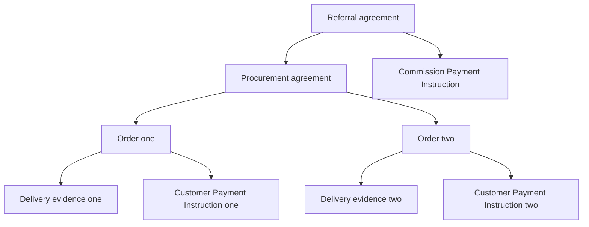

# Build executable agreements from reusable clauses

A practical handbook for the current Blue clause packages

**Write the business relationship once. Run it as a document. Reuse its behavior everywhere.**

An Order can describe a product, accept a customer's approval, start its Payment Instruction, observe delivery and calculate what remains payable. A referral agreement can create many such Orders, calculate commission from confirmed outcomes and start a separate payout. The same payment family can serve an English lesson, a design milestone or a property booking. The domain changes; the composition mechanism stays recognizable.

That is the proposition of clauses: small, named pieces of business behavior that contribute to an executable document. Their configuration belongs beside the business terms. Their implementations belong in reusable, identified packages. Their effects can be inspected and replayed.

This handbook describes the **current, unpublished `0.5.0-preview.2` package candidate**. It is a guide to implemented capabilities and executable examples, not a promise that a production payment service or every proposed governance feature already exists. Names such as `DocumentsV3` and `AmendmentsV3` are current namespace labels retained for compatibility, not separate source editions. The current sources live at the repository root.

## Read this in three passes

1. Start with the small Hello and lesson documents. Understand an action, a connection and a binding.
2. Browse the reference for the business capabilities you need. It covers all **38 exported clause types: 35 concrete or specialized clauses and three bases**. Internal payment helpers are identified as such.
3. Follow the complete applications and local execution instructions. Each `.case.yaml` file is an executable walkthrough containing requests, expected state, expected failures and, where appropriate, expected events.

Code blocks labelled **fragment** need their surrounding document. Code blocks labelled **complete document** can be read as complete authoring sources. Fixture channels are local test inputs, not authenticated user identities. The access template additionally needs signed provider data supplied by its native test fixture.

## 1. Your first executable clause

The smallest useful example has a field, a clause instance and an admitted input channel.

<!-- source:examples/clause-tutorial/05-first-clause.blue# -->

**Complete document** — [examples/clause-tutorial/05-first-clause.blue](../examples/clause-tutorial/05-first-clause.blue)

```yaml
name: Hello with one callable action
type: Agreements/Agreement with Clauses
message: ''
clauses:
  hello:
    type: Connections/Hello Clause
    bindings:
      text: /message
      say:
        greet:
          'on': workflow
          channel: owner
contracts:
  owner:
    type: Contracts/External Channel
    event:
      source: owner
```


`hello` is the instance name. `Connections/Hello Clause` identifies the reusable type. `text: /message` binds the clause to a location in this document. `say` is the action supplied by the clause. `greet` is this document's name for the connection that exposes it as a callable operation. `channel: owner` determines which admitted channel may invoke it.

Calling `greet` runs the clause's `say` steps, updates `/message` to the default greeting and emits `Connections/Hello Said`. The document does not contain a copy of the greeting implementation.

The familiar `Package/Type` spelling is an authoring convenience. Execution uses exact resolved package/type identities. Selecting a newer package does not silently rewrite an already identified document or its history.

A local case can express a call succinctly:

```yaml
operation: greet
channel: owner
expect:
  /message: Hello World
```

This is **test-runner input**, not a new Blue operation-request schema. The runner builds the actual `Contracts/Operation Request`, including the current target document identity. Native tests use signed timeline inputs instead.

## 2. What a clause is, and what it is not

A clause is a reusable participant in document construction and behavior. Its type can contribute state, input channels, handlers, embedded-document processing, validation and business actions. The clause-enabled host coordinates those contributions.

A useful way to design one is:

| Part | Question it answers | Example |
| --- | --- | --- |
| Parameters | What policy or fixed configuration applies here? | Currency, transition graph, required approval channels. |
| Bindings | Which document locations or contracts does it use? | `/message`, `/product`, `/payment`, an actor channel. |
| Actions | What reusable behavior does it provide? | Say hello, propose an amendment, request capture. |
| Connections | When, by whom and with what input does an action run? | A customer operation, a delivery event, a deadline. |
| Validation | What makes configuration or a transition acceptable? | A valid pointer, an allowed transition, an unchanged expected value. |
| Outputs | What can other clauses observe? | State, typed events, a new independently identified document. |

These are design responsibilities. They are not six mandatory YAML fields on every type. The connected-clause family exposes `actions` in type definitions and uses `bindings` for connections. Older root-hook clauses such as `Participants Clause` and `Composable Clause` expose a different, still supported contribution interface. Consult the actual reference rather than adding an unsupported `on` field to an arbitrary clause.

The host keeps authored configuration in `/clauses`. Its clause-change protocol validates proposed additions, updates and removals, asks the affected clauses to validate their transitions, and applies an accepted contribution plan. That is different from allowing an arbitrary workflow to overwrite its own executable contracts. Removal can have lifecycle consequences: who owns the state, whether an outstanding obligation may be abandoned, and what handlers remain must be part of the clause's rules. The short examples mostly configure clauses at initialization; they do not claim that every possible live upgrade has been qualified.

A clause is also not necessarily a child document. Hello, counters and state machines normally operate in the host. Payment creates and observes a distinct Payment Instruction. A document factory creates independently identified children. This separation lets the domain author choose boundaries deliberately.

## 3. One action, many ways to connect it

The connected-clause form is:

```yaml
clauses:
  hello:
    type: Connections/Hello Clause
    bindings:
      text: /message
      say:
        greet:
          on: workflow
          channel: owner
```

`greet` is not the reusable implementation. It is one installation of the reusable `say` action. Add another named connection under `say` to reuse those steps with a different trigger. Omitting a connection does not automatically expose a callable operation. Some types also declare automatic internal connections for required lifecycle behavior.

### The supported trigger forms

| `on` | Trigger | Essential configuration | A common use |
| --- | --- | --- | --- |
| `workflow` | An admitted operation request | `channel`; optional typed `request` | Customer confirms satisfaction. |
| `event` | An event emitted within the document | Optional `event` pattern | React to `Order Failed` with `reason: abc`. |
| `embedded` | Delivery from one embedded document | `path`; optional `event` pattern | Observe one Payment Instruction. |
| `collection` | Delivery from children of an embedded collection | `path`; optional `event` pattern | Observe every Order under `/orders`. |
| `change` | A change to a selected local document path | `path`; optional `when` | React when `/status` becomes delivered. |
| `initialized` | Initialization of this document | Often `once: true` | Read evidence that already exists at startup. |
| `timer` | A durable deadline | `timestamp`, or `afterEvent` plus `delayMs` | Release an authorization after a waiting window. |
| `channel` | Input delivered through a named channel | `channel`; optional `event` pattern | Read a sensor's admitted signal. |

An event pattern is a structural match, not an arbitrary JavaScript predicate. Use `when` with BEX when the selection requires computed logic. Collection scope follows an embedded path boundary: `/orders` does not mean `/ordersArchive`. It is a processing relationship, not a global subscription to all similarly named documents.

The following **clause fragment** installs requests, typed events, filtered events, changes and an external channel in one actual example:

<!-- source:examples/clause-tutorial/01-hello.blue#/clauses/hello -->

**Fragment** — [examples/clause-tutorial/01-hello.blue](../examples/clause-tutorial/01-hello.blue) · `/clauses/hello`

```yaml
type: Connections/Hello Clause
bindings:
  text: /message
  say:
    acceptDelivery:
      'on': workflow
      channel: owner
      request:
        type: Connections/Greeting Request
      params:
        text:
          $binding: call/request/text
      before:
      - $failIf:
          cond:
            $not:
              $binding: call/request/approved
          message: Approval required
      after:
      - $appendChange:
          op: replace
          path: /observed
          val:
            $resultValue: /message
    typedPing:
      'on': event
      event:
        type: Connections/Ping
      params:
        text:
          $event: /text
    onceApproved:
      'on': event
      event:
        kind: Order Approved
      once: true
      params:
        text: Approved once
    whenFailed:
      'on': event
      event:
        kind: Order Failed
        reason: abc
      params:
        text:
          $concat:
          - 'Failed: '
          - $event: /reason
    statusChanged:
      'on': change
      path: /status
      when:
        $eq:
        - $event: /after
        - delivered
      params:
        text: Status is delivered
    externalSignal:
      'on': channel
      channel: signals
      event:
        kind: External Hello
      params:
        text:
          $event: /text
```


The complete [Hello walkthrough](../examples/clause-tutorial/01-hello.case.yaml) proves successful approval, rejected approval, matching and nonmatching failure reasons, one-time delivery, path changes, typed events and wrong request-type rejection.

### Map input first; validate before; react after

Three similarly named concepts must stay distinct:

- `parameters` configure the installed clause: for example a transition graph or payment currency.
- A connection's `params` compute arguments for this particular action invocation.
- A workflow request is the caller's input. It must be validated and mapped; its contents are not automatically trusted policy.

Connected actions expose the normalized input as `$var: {name: trigger, path: ...}`. A workflow also offers `$binding: call/request/...`. `$event` refers to the delivered event; embedded delivery can include an envelope, so prefer the documented normalized trigger when writing a reusable mapping. `$resultValue` reads the action's published result in an `after` hook.

`when` skips a connection when its condition is false. `before` runs after parameters are mapped and can reject the attempt with `$failIf`. The action then performs its own mandatory checks and effects. `after` adds local follow-up behavior. A failed transactional attempt does not publish its attempted state changes or events.

The Hello walkthrough checks rejection before the action. The [atomic walkthrough](../examples/clause-tutorial/03-atomic.case.yaml) checks failure after the action: neither leaks a partial greeting. It also checks a skipped condition and one-time execution.

Do not assume every action has identical duplicate semantics. Financial actions and other `outcome-v1` actions distinguish a new accepted command from a duplicate; their `after` hook runs for `acceptedNew`. An ordinary repeatable greeting can run repeatedly. `once: true` is connection state, not an external payment idempotency protocol.

### Use native workflow steps when the shortcut is not enough

The short connection syntax is an authoring layer over ordinary Blue behavior. A document can also define `Contracts/Sequential Workflow Operation` with several native steps. The [native-steps document](../examples/clause-tutorial/04-native-steps.blue) validates a request, invokes the reusable action through the existing mechanism and continues with further work.

You do not need a new special-purpose clause for every small sequence. Use a domain clause for stable business meaning; use an ordinary workflow or `Composable Clause` for document-specific glue. Put substantial repeated behavior into a package, rather than repeating it across ten `before` hooks.

### Timers: first, latest, fixed and cancelled

A timer can use an absolute timestamp or be armed by another connection. `policy: first` preserves the first qualifying event for the waiting window. `policy: latest` moves the deadline and captured trigger to the latest qualifying event. `cancelOn` removes the pending timer when its configured signal arrives. Use the explicit one-time option when lifetime behavior must be unambiguous.

<!-- source:examples/clause-tutorial/14-timers.blue#/clauses/hello/bindings/say -->

**Fragment** — [examples/clause-tutorial/14-timers.blue](../examples/clause-tutorial/14-timers.blue) · `/clauses/hello/bindings/say`

```yaml
fixedDeadline:
  'on': timer
  timestamp: 30000000
  params:
    text: Fixed deadline
  after:
  - $appendChange:
      op: add
      path: /log/-
      val:
        connection: fixed
        at:
          $binding: timestamp
firstReminder:
  'on': timer
  afterEvent:
    'on': event
    event:
      kind: Delivery Reported
  delayMs: 2000
  policy: first
  params:
    text:
      $concat:
      - 'First report: '
      - $var:
          name: trigger
          path: /text
  after:
  - $appendChange:
      op: add
      path: /log/-
      val:
        connection: first
        at:
          $binding: timestamp
latestReminder:
  'on': timer
  afterEvent:
    'on': event
    event:
      kind: Delivery Reported
  delayMs: 2000
  policy: latest
  once: true
  params:
    text:
      $concat:
      - 'Latest report: '
      - $var:
          name: trigger
          path: /text
  after:
  - $appendChange:
      op: add
      path: /log/-
      val:
        connection: latest
        at:
          $binding: timestamp
cancelledReminder:
  'on': timer
  afterEvent:
    'on': event
    event:
      kind: Cancel Example
  delayMs: 3000
  cancelOn:
    'on': event
    event:
      kind: Cancel Reminder
  params:
    text: This timer must be cancelled
  after:
  - $appendChange:
      op: add
      path: /log/-
      val:
        connection: cancelled
        at:
          $binding: timestamp
```


Here absolute timestamps and the processing clock are in **microseconds**; `delayMs` is in **milliseconds**. The tiny absolute timestamp belongs to the controlled test clock, not a calendar date for a live deployment.

Timers need a host that supplies time and sufficient signed timeline completeness. A scheduler must not jump past an earlier input that could cancel or change the decision. The native tutorial test advances the clock, imports signed provider ranges and checks first/latest behavior, cancellation and the final fixed deadline. It does not simulate a deadline by directly injecting a business event.

## 4. Payment makes the boundary concrete

A Payment clause represents one payment and observes one Payment Instruction (PI). The host describes why the payment matters. The PI owns the financial lifecycle, permissions, accepted details, outstanding requests and confirmed outcomes.

The small lesson below asks the customer to confirm satisfaction. Its workflow is installed **inside the PI**. Calling it there records the condition; the host Payment clause relays PI events with the clause/instruction context. Other host components can listen to the relayed event. The built-in relay selects `PaymentInstruction/Payment Event`; it does not automatically echo every arbitrary untyped event. In this example the local `Satisfaction Audit` hook remains a PI-local event, while the typed evidence and conditions events are relayed. Use the typed event contract or an explicit listener when adding a custom host-visible notification.

<!-- source:examples/clause-tutorial/12-english-lesson.blue# -->

**Complete document** — [examples/clause-tutorial/12-english-lesson.blue](../examples/clause-tutorial/12-english-lesson.blue)

```yaml
name: 'English lesson: payment after customer satisfaction'
type: Orders/Order with Clauses
product:
  name: One English conversation lesson
  currency: EUR
  unitPriceMinor: 4000
  quantity: 1
afterCount: 0
clauses:
  payment:
    type: Payment/Conditional Payment
    parameters:
      requireAll:
        confirmSatisfaction:
          'on': workflow
          channel: customer
          after:
          - $appendEvent:
              kind: Satisfaction Audit
contracts:
  customer:
    type: Contracts/External Channel
    event:
      source: customer
  seller:
    type: Contracts/External Channel
    event:
      source: seller
  guarantor:
    type: Contracts/External Channel
    event:
      source: guarantor
```


The test calls the condition twice to prove duplicate handling, asks the test guarantor to accept and initiate the instruction, then supplies separate authorization and capture confirmations. The amount is €40: `4000` minor units, not a floating-point `40.00`.

### Three relationships with the host

| Relationship | Configuration | Result |
| --- | --- | --- |
| PI-local behavior | A workflow condition in `requireAll`, or explicit PI clause connections | The operation lives in the PI; no parent cycle is necessary. |
| PI depends on its host | Explicit `includeOrder` in a preset, or `hostSource` in general Payment | PI embeds an identified host reference; because the host embeds PI, this is a cycle. |
| PI depends on shared evidence | Explicit `sources` or general Payment `sourcePaths` | PI observes an independently identified document; the host can observe the same source. |

The payment preset also offers conveniences around these connections. For example, `requireAll.checkIn.observe` can name a `source`, a `path` and an expected value with `equals`; setup turns that state requirement into initialization and later observation behavior. `observe` in this position is payment-specific configuration, not a ninth generic `on` mode. `autoStart: false` plus an explicit `bindings.start` connection postpones PI creation until the chosen operation or event.

The implementation does not guess that arbitrary code should move between documents. Configuration determines where it is installed and which sources it receives. A PI-local workflow's document reads refer to PI state. Referring to `/delivery` in the host requires an explicit source relationship; identical-looking paths do not imply shared state.

The following explicit PI fragment maps request amounts and adds preparation and accepted-new effects:

<!-- source:examples/payment-family/11-custom-hooks.blue#/paymentTemplate/clauses/payment/bindings/requestCapture -->

**Fragment** — [examples/payment-family/11-custom-hooks.blue](../examples/payment-family/11-custom-hooks.blue) · `/paymentTemplate/clauses/payment/bindings/requestCapture`

```yaml
capture:
  'on': workflow
  channel: customer
  params:
    requestId:
      $var:
        name: trigger
        path: /requestId
    amountMinor:
      $var:
        name: trigger
        path: /requestedMinor
  before:
  - $failIf:
      cond:
        $not:
          $and:
          - $isKind:
              val:
                $var:
                  name: params
                  path: /amountMinor
              kind: integer
          - $gt:
            - $var:
                name: params
                path: /amountMinor
            - 0
          - $lte:
            - $var:
                name: params
                path: /amountMinor
            - 10000
      message: CAPTURE_OUTSIDE_LOCAL_LIMIT
  after:
  - $appendChange:
      op: replace
      path: /captureNoticeCount
      val:
        $add:
        - $document: /captureNoticeCount
        - 1
  - $appendChange:
      op: replace
      path: /lastCaptureNote
      val:
        $pointerGet:
          object:
            $var: trigger
          path: /note
          default: ''
  - $failIf:
      cond:
        $eq:
        - $pointerGet:
            object:
              $var: trigger
            path: /abortAfter
            default: false
        - true
      message: DELIBERATE_AFTER_FAILURE
  - $appendEvent:
      $merge:
      - type: Commerce/Domain Event
      - kind: Capture Request Recorded
        clause:
          $const: clauseKey
        amountMinor:
          $var:
            name: params
            path: /amountMinor
```


The [custom-service example](../examples/payment-family/02-custom-service.blue) shows the long form: an explicit PI template, a delivery document, a host acceptance state and partial capture requests. The [smart-property example](../examples/payment-family/06-smart-property.blue) shows preset source configuration. The former is the more useful source to study when you need exact control over lifecycle actions.

### Requests and confirmations are different facts

`requestCapture` admits a command and reserves the corresponding capacity. It does not move money. A separately admitted operator confirmation records the outcome. Pending and unknown operations remain reserved until reconciliation; they are not safe grounds for issuing another transfer.

The supplied MyOS, ACME and manual methods are executable **protocols**. ACME is an illustrative bank. MyOS Customer Payment models the session/funding handshake. None of these examples supplies a live bank adapter or checkout website. External executors need durable command discovery, idempotent execution and reconciliation.

If an authorization expires without capture, the appropriate operation is generally **void/release**. If captured money must be returned, it is **refund**. The compensation example tests the difficult case: an Order fails while capture is unresolved, then capture succeeds late; the PI must request a refund.

## 5. Parties, channels and readers are separate

A business Party answers “who is involved?” An admitted channel answers “who can supply this operation?” A reader key answers “who can obtain these timeline entries?” None automatically implies the other two.

`Parties/Party` describes a business participant. `MyOS/MyOS Party` additionally carries `myosAccountId`. In authenticated bootstrap that account must match the resolved participant. The sample IDs and `External Channel` objects in local examples are fixtures, not identity proofs.

`Participants/Participants Clause` contributes validated named participant channels. `AccessParticipants/Participants with Access Clause` additionally checks embedded provider access documents. The protected workflow must explicitly use `AccessParticipants/Require Participant Access` before its business steps. Installing the clause does not magically prepend a guard to every arbitrary handler.

The access example demonstrates an initially usable agreement, revocation blocking a guarded operation, and restoration permitting it again. The test still retains enough reader access to fetch the revocation. Complete loss of transport access is a separate provider/import availability concern.

A PI copies its selected party snapshot when created. Editing a parent's labels or roster does not silently grant a new person PI authority or access. The full proposed system of lead representatives, delegates, multiple alternative keys and party-managed membership is **not implemented by these two participant clauses**. Mandates is a separate package and is not implicitly installed by Payment.

## 6. Clause reference

The examples below are extracted from checked-in authoring sources or executable walkthrough inputs. Follow their source links for the complete context. Base types are shown through concrete specializations. Internal PI helper clauses are shown through the preset and requests that install or exercise them; application authors normally do not install a second copy themselves.


| Clause | Reference |
| --- | --- |
| `Connections/Hello Clause` | [Examples and contract](#clause-01) |
| `Commerce/Status Clause` | [Examples and contract](#clause-02) |
| `State/State Machine Clause` | [Examples and contract](#clause-03) |
| `Commerce/Counter Clause` | [Examples and contract](#clause-04) |
| `Commerce/Text Clause` | [Examples and contract](#clause-05) |
| `Commerce/Product Clause` | [Examples and contract](#clause-06) |
| `Features/Delivery Instructions Clause` | [Examples and contract](#clause-07) |
| `Activation/Activation Clause` | [Examples and contract](#clause-08) |
| `AmendmentsV3/Amendments Clause` | [Examples and contract](#clause-09) |
| `Termination/Termination Clause` | [Examples and contract](#clause-10) |
| `Balance/Balance Clause` | [Examples and contract](#clause-11) |
| `DocumentsV3/Document Factory Clause` | [Examples and contract](#clause-12) |
| `Commerce/Document Factory Clause` | [Examples and contract](#clause-13) |
| `Clauses/Document Factory Clause` | [Examples and contract](#clause-14) |
| `Clauses/Collection Clause` | [Examples and contract](#clause-15) |
| `Clauses/Listener Clause` | [Examples and contract](#clause-16) |
| `Clauses/Composable Clause` | [Examples and contract](#clause-17) |
| `Participants/Participants Clause` | [Examples and contract](#clause-18) |
| `AccessParticipants/Participants with Access Clause` | [Examples and contract](#clause-19) |
| `Payment/Payment Clause` | [Examples and contract](#clause-20) |
| `Payment/Conditional Payment` | [Examples and contract](#clause-21) |
| `PaymentInstruction/Payment Lifecycle Clause` | [Examples and contract](#clause-22) |
| `PaymentInstruction/Conditional Policy` | [Examples and contract](#clause-23) |
| `MyOS/MyOS Customer Payment` | [Examples and contract](#clause-24) |
| `MyOS/MyOS Account to Account Payment` | [Examples and contract](#clause-25) |
| `ACME/ACME Bank Payment` | [Examples and contract](#clause-26) |
| `ManualPayments/Manual Bank Payment` | [Examples and contract](#clause-27) |
| `MyOS/Customer Session Clause` | [Examples and contract](#clause-28) |
| `MyOS/Payment Method Events` | [Examples and contract](#clause-29) |
| `ACME/Bank Method Events` | [Examples and contract](#clause-30) |
| `ManualPayments/Manual Transfer Policy` | [Examples and contract](#clause-31) |
| `Referrals/Order Summary Clause` | [Examples and contract](#clause-32) |
| `Referrals/Procurement Summary Clause` | [Examples and contract](#clause-33) |
| `Referrals/Commission Clause` | [Examples and contract](#clause-34) |
| `Schedule/Schedule Clause` | [Examples and contract](#clause-35) |
| `Clauses/Clause` | [Examples and contract](#clause-36) |
| `Connections/Connected Clause` | [Examples and contract](#clause-37) |
| `Payment/Conditional Payment Base` | [Examples and contract](#clause-38) |


<a id="clause-01"></a>


### 6.1. `Connections/Hello Clause`

A deliberately small business action: write a greeting to a bound text field and emit `Connections/Hello Said`. This is the best place to learn composition because the action itself has almost no domain complexity.

**Configure it:** `bindings.text` names the destination. `bindings.say` contains named connections. Map `params.text` for a custom greeting; otherwise the default is `Hello World`. The action result exposes the message for an `after` hook.

**Boundary:** A greeting is not inherently one-time or authorized for everyone. The chosen connection determines its channel, filters and repetition policy.

[Package definition](../clause-connections/types/hello-clause.blue).


**Declared or inherited actions:** `say`.


#### A named operation

Expose `greet` on the owner channel. No custom steps are needed.

<!-- source:examples/clause-tutorial/05-first-clause.blue#/clauses/hello -->

**Fragment** — [examples/clause-tutorial/05-first-clause.blue](../examples/clause-tutorial/05-first-clause.blue) · `/clauses/hello`

```yaml
type: Connections/Hello Clause
bindings:
  text: /message
  say:
    greet:
      'on': workflow
      channel: owner
```


#### Observe an embedded supplier or any Order

The same `say` action reacts to an individual embedded document and a collection. The case checks that the archive collection does not leak into the `/orders` scope.

<!-- source:examples/clause-tutorial/02-embedded.blue#/clauses/hello -->

**Fragment** — [examples/clause-tutorial/02-embedded.blue](../examples/clause-tutorial/02-embedded.blue) · `/clauses/hello`

```yaml
type: Connections/Hello Clause
bindings:
  text: /message
  say:
    ready:
      'on': initialized
      params:
        text: Connections ready
    supplierReady:
      'on': embedded
      path: /supplier
      event:
        kind: Ready
      params:
        text:
          $event: /event/text
    anyOrderUnknown:
      'on': collection
      path: /orders
      event:
        kind: Order Unknown
      params:
        text:
          $concat:
          - $event: /sourcePath
          - ': '
          - $var:
              name: trigger
              path: /text
    childFieldIsNotALocalChange:
      'on': change
      path: /supplier/status
      params:
        text: This must never run
```


#### Join a longer workflow

A native workflow prepares a greeting event; the clause reacts and marks the host as processed. This keeps formatting and the reusable action separate.

<!-- source:examples/clause-tutorial/04-native-steps.blue#/clauses/hello -->

**Fragment** — [examples/clause-tutorial/04-native-steps.blue](../examples/clause-tutorial/04-native-steps.blue) · `/clauses/hello`

```yaml
type: Connections/Hello Clause
bindings:
  text: /message
  say:
    preparedGreeting:
      'on': event
      event:
        kind: Greeting Prepared
      params:
        text:
          $event: /text
      after:
      - $appendChange:
          op: replace
          path: /processed
          val: true
```


<a id="clause-02"></a>


### 6.2. `Commerce/Status Clause`

Maintain a named business state with an allowed transition graph. This is useful for a simple lifecycle such as Draft → Published → Archived.

**Configure it:** `parameters.subject` names the event subject and `parameters.transitions` lists allowed destinations. Bind `state`, then connect `transition` with `params.to` and optional `reason`.

**Boundary:** This is the simpler status implementation. Prefer `State/State Machine Clause` when the explicit repeat/no-op outcome behavior is important. A status field by itself does not prevent unrelated operations; add the appropriate guards.

[Package definition](../clause-commerce/types/status-clause.blue).


**Declared or inherited actions:** `transition`.


#### Publish an offer

The `publish` connection chooses Published; the transition table controls whether that move is allowed.

<!-- source:examples/clause-tutorial/06-service-desk.blue#/clauses/status -->

**Fragment** — [examples/clause-tutorial/06-service-desk.blue](../examples/clause-tutorial/06-service-desk.blue) · `/clauses/status`

```yaml
type: Commerce/Status Clause
parameters:
  subject: Offer
  transitions:
    Draft:
    - Published
    Published:
    - Archived
bindings:
  state: /status
  transition:
    publish:
      'on': workflow
      channel: owner
      params:
        to: Published
    archive:
      'on': workflow
      channel: owner
      params:
        to: Archived
```


#### Retire an offer and notify another feature

The Schedule clause observes `Offer Archived`. One clause owns the lifecycle; another reacts to its result.

<!-- source:examples/clause-tutorial/06-service-desk.blue#/clauses/archiveNotice -->

**Fragment** — [examples/clause-tutorial/06-service-desk.blue](../examples/clause-tutorial/06-service-desk.blue) · `/clauses/archiveNotice`

```yaml
type: Schedule/Schedule Clause
parameters:
  key: archive-review
bindings:
  fire:
    afterArchive:
      'on': event
      event:
        type: Commerce/Domain Event
        kind: Offer Archived
```


<a id="clause-03"></a>


### 6.3. `State/State Machine Clause`

Represent one independently changing aspect of the business with explicit outcomes. Use several instances for separate concerns instead of overloading one enormous status field.

**Configure it:** Bind `state`; configure `subject` and `transitions`; connect `transition`. The implementation uses `outcome-v1`, so repeating a completed transition can be a no-op without repeating follow-up effects.

**Boundary:** An allowed transition is not proof of a real-world event. Choose the actor channel and evidence required before accepting it.

[Package definition](../clause-state-machine/types/clause.blue).


**Declared or inherited actions:** `transition`.


#### A milestone alongside an offer lifecycle

The milestone can become Accepted while the separate offer status remains Published. The case repeats approval and checks there are no new events.

<!-- source:examples/clause-tutorial/06-service-desk.blue#/clauses/milestone -->

**Fragment** — [examples/clause-tutorial/06-service-desk.blue](../examples/clause-tutorial/06-service-desk.blue) · `/clauses/milestone`

```yaml
type: State/State Machine Clause
parameters:
  subject: Milestone
  transitions:
    Open:
    - Accepted
    - Rejected
bindings:
  state: /milestone
  transition:
    approveMilestone:
      'on': workflow
      channel: owner
      params:
        to: Accepted
```


#### Delivery evidence in its own document

A carrier reports Delivered or Failed. Payment observes this independently identified source.

<!-- source:examples/payment-family/02-custom-service.blue#/delivery/clauses/progress -->

**Fragment** — [examples/payment-family/02-custom-service.blue](../examples/payment-family/02-custom-service.blue) · `/delivery/clauses/progress`

```yaml
type: State/State Machine Clause
parameters:
  subject: Delivery
  transitions:
    Open:
    - Delivered
    - Failed
    Delivered:
    - Failed
bindings:
  state: /status
  transition:
    deliver:
      'on': workflow
      channel: carrier
      params:
        to: Delivered
    failDelivery:
      'on': workflow
      channel: carrier
      params:
        to: Failed
        reason:
          $var:
            name: trigger
            path: /reason
```


#### Customer acceptance

Customer acceptance and physical delivery are separate state machines and separate payment prerequisites.

<!-- source:examples/payment-family/02-custom-service.blue#/clauses/acceptance -->

**Fragment** — [examples/payment-family/02-custom-service.blue](../examples/payment-family/02-custom-service.blue) · `/clauses/acceptance`

```yaml
type: State/State Machine Clause
parameters:
  subject: Acceptance
  transitions:
    Pending:
    - Accepted
    - Declined
bindings:
  state: /acceptance
  transition:
    acceptDelivery:
      'on': workflow
      channel: customer
      params:
        to: Accepted
    declineDelivery:
      'on': workflow
      channel: customer
      params:
        to: Declined
```


<a id="clause-04"></a>


### 6.4. `Commerce/Counter Clause`

Adjust a bounded integer through a reusable action. Inventory and usage counts share the arithmetic while keeping distinct state and limits.

**Configure it:** Bind `count`; set `minimum` and `maximum`; connect `adjust` with a mapped `delta`. The default delta is one. The operation checks integer arithmetic and bounds.

**Boundary:** It is not a financial ledger and it does not deduplicate business commands by an external request ID. Use Balance or Payment for those responsibilities.

[Package definition](../clause-commerce/types/counter-clause.blue).


**Declared or inherited actions:** `adjust`.


#### Consume available stock

The case reduces stock from five to three, then rejects a subtraction that would make it negative.

<!-- source:examples/clause-tutorial/06-service-desk.blue#/clauses/stock -->

**Fragment** — [examples/clause-tutorial/06-service-desk.blue](../examples/clause-tutorial/06-service-desk.blue) · `/clauses/stock`

```yaml
type: Commerce/Counter Clause
parameters:
  minimum: 0
  maximum: 10
bindings:
  count: /stock
  adjust:
    stockAdjust:
      'on': workflow
      channel: owner
      params:
        delta:
          $var:
            name: trigger
            path: /delta
```


#### Count completed visits

A second instance uses a different state pointer and a larger bound. Its updates do not affect stock.

<!-- source:examples/clause-tutorial/06-service-desk.blue#/clauses/visits -->

**Fragment** — [examples/clause-tutorial/06-service-desk.blue](../examples/clause-tutorial/06-service-desk.blue) · `/clauses/visits`

```yaml
type: Commerce/Counter Clause
parameters:
  minimum: 0
  maximum: 100
bindings:
  count: /visits
  adjust:
    visitsAdjust:
      'on': workflow
      channel: owner
      params:
        delta:
          $var:
            name: trigger
            path: /delta
```


<a id="clause-05"></a>


### 6.5. `Commerce/Text Clause`

Change a text field while checking the value the caller expected to replace. This gives a compact stale-edit guard for ordinary editable text.

**Configure it:** Bind `text`; connect `amend`; map `expected` and the new `text`. Both validation and the mutation stay in the reusable action.

**Boundary:** This is optimistic text replacement, not multi-party approval. Use Amendments for changes that require agreement from several participants.

[Package definition](../clause-commerce/types/text-clause.blue).


**Declared or inherited actions:** `amend`.


#### Edit payment wording

The first edit replaces Original terms; repeating an edit with that old expected value is rejected.

<!-- source:examples/clause-tutorial/06-service-desk.blue#/clauses/terms -->

**Fragment** — [examples/clause-tutorial/06-service-desk.blue](../examples/clause-tutorial/06-service-desk.blue) · `/clauses/terms`

```yaml
type: Commerce/Text Clause
bindings:
  text: /terms
  amend:
    termsAmend:
      'on': workflow
      channel: owner
      params:
        expected:
          $var:
            name: trigger
            path: /expected
        text:
          $var:
            name: trigger
            path: /text
```


#### Edit a service-desk introduction

The same behavior writes a different field, independently of contractual terms.

<!-- source:examples/clause-tutorial/06-service-desk.blue#/clauses/copy -->

**Fragment** — [examples/clause-tutorial/06-service-desk.blue](../examples/clause-tutorial/06-service-desk.blue) · `/clauses/copy`

```yaml
type: Commerce/Text Clause
bindings:
  text: /message
  amend:
    copyAmend:
      'on': workflow
      channel: owner
      params:
        expected:
          $var:
            name: trigger
            path: /expected
        text:
          $var:
            name: trigger
            path: /text
```


<a id="clause-06"></a>


### 6.6. `Commerce/Product Clause`

Calculate a small product/line-item quote from integer unit price, quantity and currency. Keep exact minor-unit amounts in the document.

**Configure it:** Bind `product`; configure the currency; connect `quote` and map `unitPriceMinor` and `quantity`. The current action bounds price and quantity and computes `totalMinor`.

**Boundary:** The action replaces the bound quote object. It does not preserve arbitrary extra product metadata such as a name; keep descriptive data outside that object or bind an appropriate quote field. Taxes, discounts and multi-line cart arithmetic are not implied.

[Package definition](../clause-commerce/types/product-clause.blue).


**Declared or inherited actions:** `quote`.


#### Quote two service units

Two units at 5000 minor units produce 10000. The case also rejects a negative unit price.

<!-- source:examples/clause-tutorial/06-service-desk.blue#/clauses/serviceQuote -->

**Fragment** — [examples/clause-tutorial/06-service-desk.blue](../examples/clause-tutorial/06-service-desk.blue) · `/clauses/serviceQuote`

```yaml
type: Commerce/Product Clause
parameters:
  currency: EUR
bindings:
  product: /product
  quote:
    serviceQuote:
      'on': workflow
      channel: owner
      params:
        unitPriceMinor:
          $var:
            name: trigger
            path: /price
        quantity:
          $var:
            name: trigger
            path: /quantity
```


#### Quote materials separately

Three units at 750 produce 2250 in a separate quote object.

<!-- source:examples/clause-tutorial/06-service-desk.blue#/clauses/materialsQuote -->

**Fragment** — [examples/clause-tutorial/06-service-desk.blue](../examples/clause-tutorial/06-service-desk.blue) · `/clauses/materialsQuote`

```yaml
type: Commerce/Product Clause
parameters:
  currency: EUR
bindings:
  product: /materials
  quote:
    materialsQuote:
      'on': workflow
      channel: owner
      params:
        unitPriceMinor:
          $var:
            name: trigger
            path: /price
        quantity:
          $var:
            name: trigger
            path: /quantity
```


<a id="clause-07"></a>


### 6.7. `Features/Delivery Instructions Clause`

Expose an editable business feature whose availability depends on lifecycle state. The feature is meaningful to users: instructions can change while the work is still editable.

**Configure it:** Bind `text` and `lifecycle`; list `editableStates`; connect `amend` with `params.text`. Repeated identical updates use explicit outcome semantics.

**Boundary:** Changing instructions does not alter the separate delivery state. This clause is an example of grouping policy and mutation into a business feature rather than presenting users with low-level update primitives.

[Package definition](../clause-features/types/clause.blue).


**Declared or inherited actions:** `amend`.


#### Edit only before publication

The case changes Front door to Side door in Draft, then rejects another edit after publication.

<!-- source:examples/clause-tutorial/06-service-desk.blue#/clauses/instructions -->

**Fragment** — [examples/clause-tutorial/06-service-desk.blue](../examples/clause-tutorial/06-service-desk.blue) · `/clauses/instructions`

```yaml
type: Features/Delivery Instructions Clause
parameters:
  editableStates:
  - Draft
bindings:
  text: /instructions
  lifecycle: /status
  amend:
    changeInstructions:
      'on': workflow
      channel: owner
      params:
        text:
          $var:
            name: trigger
            path: /text
```


#### Edit while delivery is Open

The same feature binds to a nested delivery document state in the custom service Order.

<!-- source:examples/payment-family/02-custom-service.blue#/clauses/instructions -->

**Fragment** — [examples/payment-family/02-custom-service.blue](../examples/payment-family/02-custom-service.blue) · `/clauses/instructions`

```yaml
type: Features/Delivery Instructions Clause
parameters:
  editableStates:
  - Open
bindings:
  text: /instructions
  lifecycle: /delivery/status
  amend:
    changeInstructions:
      'on': workflow
      channel: customer
      params:
        text:
          $var:
            name: trigger
            path: /text
```


<a id="clause-08"></a>


### 6.8. `Activation/Activation Clause`

Collect required approvals for an exact terms revision. It produces a shared activation state that other features can inspect before admitting business work.

**Configure it:** `parameters.required` lists approving channels and `parameters.revision` identifies the revision to approve. `bindings.state` defaults to `/activation`. Connect `approve` to the allowed participant workflows and map the requested revision.

**Boundary:** Activation does not automatically guard every operation. Factory and business connections must use it in their own admission checks. An approval of an old revision must not activate new terms.

[Package definition](../clause-activation/types/clause.blue).


**Declared or inherited actions:** `initialize`, `approve`.


#### Accept consulting terms

Customer and seller approve the consulting agreement. The case exercises stale revisions and the resulting activation state.

<!-- source:examples/clause-tutorial/11-consulting-terms.blue#/clauses/activation -->

**Fragment** — [examples/clause-tutorial/11-consulting-terms.blue](../examples/clause-tutorial/11-consulting-terms.blue) · `/clauses/activation`

```yaml
type: Activation/Activation Clause
parameters:
  required:
  - customer
  - seller
  revision: 1
bindings:
  approve:
    approve_customer:
      'on': workflow
      channel: customer
      params:
        revision:
          $var:
            name: trigger
            path: /revision
    approve_seller:
      'on': workflow
      channel: seller
      params:
        revision:
          $var:
            name: trigger
            path: /revision
```


#### Activate a referral partnership

Seller and referrer approve the outer commercial relationship; procurement has its own activation instance for different parties.

<!-- source:examples/payment-family/20-partnership.blue#/clauses/activation -->

**Fragment** — [examples/payment-family/20-partnership.blue](../examples/payment-family/20-partnership.blue) · `/clauses/activation`

```yaml
type: Activation/Activation Clause
parameters:
  required:
  - seller
  - referrer
  revision: 1
bindings:
  approve:
    approve_seller:
      'on': workflow
      channel: seller
      params:
        revision:
          $var:
            name: trigger
            path: /revision
    approve_referrer:
      'on': workflow
      channel: referrer
      params:
        revision:
          $var:
            name: trigger
            path: /revision
```


<a id="clause-09"></a>


### 6.9. `AmendmentsV3/Amendments Clause`

Propose governed changes to allowlisted terms and collect the required approvals before applying them. This is the higher-level alternative to directly replacing text.

**Configure it:** The clause has `initialize`, `propose` and `approve` actions. `parameters.paths` allowlists editable paths and `parameters.approvers` lists approving channels. The state and editability bindings default to `/amendments` and `/termsEditable`. A proposal maps `proposalId`, `expectedRevision`, `path` and `replacement`.

**Boundary:** This particular clause governs its declared business terms. It is not unrestricted permission to rewrite contracts, participants or arbitrary executable code. Do not infer broad governance from the name.

[Package definition](../clause-amendments/types/clause.blue).


**Declared or inherited actions:** `initialize`, `propose`, `approve`.


#### Change a booking subject to mutual approval

The booking walkthrough proposes a change and requires both approvers; stale requests are rejected.

<!-- source:examples/payment-family/05-booking-amendments.blue#/clauses/amendments -->

**Fragment** — [examples/payment-family/05-booking-amendments.blue](../examples/payment-family/05-booking-amendments.blue) · `/clauses/amendments`

```yaml
type: AmendmentsV3/Amendments Clause
parameters:
  approvers:
  - customer
  - seller
  paths:
  - /terms
bindings:
  propose:
    proposeChange:
      'on': workflow
      channel: seller
      params:
        proposalId:
          $var:
            name: trigger
            path: /proposalId
        expectedRevision:
          $var:
            name: trigger
            path: /expectedRevision
        path: /terms
        replacement:
          $var:
            name: trigger
            path: /replacement
  approve:
    approveChangeCustomer:
      'on': workflow
      channel: customer
      params:
        proposalId:
          $var:
            name: trigger
            path: /proposalId
    approveChangeSeller:
      'on': workflow
      channel: seller
      params:
        proposalId:
          $var:
            name: trigger
            path: /proposalId
```


#### Expand consulting scope

A separate agreement changes its scope from one service to two. The first approval leaves terms untouched; the final required approval applies them.

<!-- source:examples/clause-tutorial/11-consulting-terms.blue#/clauses/amendments -->

**Fragment** — [examples/clause-tutorial/11-consulting-terms.blue](../examples/clause-tutorial/11-consulting-terms.blue) · `/clauses/amendments`

```yaml
type: AmendmentsV3/Amendments Clause
parameters:
  approvers:
  - customer
  - seller
  paths:
  - /terms
bindings:
  propose:
    proposeChange:
      'on': workflow
      channel: seller
      params:
        proposalId:
          $var:
            name: trigger
            path: /proposalId
        expectedRevision:
          $var:
            name: trigger
            path: /expectedRevision
        path: /terms
        replacement:
          $var:
            name: trigger
            path: /replacement
  approve:
    approveChangeCustomer:
      'on': workflow
      channel: customer
      params:
        proposalId:
          $var:
            name: trigger
            path: /proposalId
    approveChangeSeller:
      'on': workflow
      channel: seller
      params:
        proposalId:
          $var:
            name: trigger
            path: /proposalId
```


<a id="clause-10"></a>


### 6.10. `Termination/Termination Clause`

Model orderly wind-down separately from immediate disappearance. Stop new business while allowing existing obligations to finish.

**Configure it:** `request` moves Active to WindingDown. `finish` requires WindingDown and a true readiness binding before reaching Terminated. Bind `state` and `ready`, and connect the actions to appropriate actors.

**Boundary:** The state is a policy input. All admission paths that must stop during wind-down need an explicit check. Termination must not erase debt, outstanding captures or refunds.

[Package definition](../clause-termination/types/clause.blue).


**Declared or inherited actions:** `request`, `finish`.


#### Finish a booking after obligations are clear

The readiness condition prevents premature final termination.

<!-- source:examples/payment-family/05-booking-amendments.blue#/clauses/termination -->

**Fragment** — [examples/payment-family/05-booking-amendments.blue](../examples/payment-family/05-booking-amendments.blue) · `/clauses/termination`

```yaml
type: Termination/Termination Clause
bindings:
  request:
    cancel:
      'on': workflow
      channel: customer
  finish:
    close:
      'on': workflow
      channel: seller
```


#### Stop creating Orders while procurement settles

The partnership case enters wind-down and then rejects a new Order; the existing graph remains available.

<!-- source:examples/payment-family/20-partnership.blue#/procurementTemplate/clauses/termination -->

**Fragment** — [examples/payment-family/20-partnership.blue](../examples/payment-family/20-partnership.blue) · `/procurementTemplate/clauses/termination`

```yaml
type: Termination/Termination Clause
bindings:
  request:
    windDown:
      'on': workflow
      channel: customer
  finish:
    close:
      'on': workflow
      channel: seller
```


<a id="clause-11"></a>


### 6.11. `Balance/Balance Clause`

Track attributed obligations, reservations and settled payments without pretending to hold external money. Targets can be corrected without rewriting confirmed history.

**Configure it:** Bind the balance state. `setTarget` names the business contribution; `reserve` names a payout reservation and amount; `settle` consumes that reservation into paid. Repeated matching commands have explicit outcomes.

**Boundary:** A downward correction can leave paid greater than accrued. That is a real business condition to resolve, not a reason to delete the historical payout. This clause is not a bank-account balance or an automatic debt-recovery engine.

[Package definition](../clause-balance/types/clause.blue).


**Declared or inherited actions:** `initialize`, `setTarget`, `reserve`, `settle`.


#### Reserve and settle part of an obligation

The standalone ledger sets a target of 1001, reserves 800 and rejects another reservation that would exceed the remainder.

<!-- source:examples/payment-family/10-ledger.blue#/clauses/balance -->

**Fragment** — [examples/payment-family/10-ledger.blue](../examples/payment-family/10-ledger.blue) · `/clauses/balance`

```yaml
type: Balance/Balance Clause
parameters:
  currency: EUR
bindings:
  setTarget:
    setCommission:
      'on': workflow
      channel: seller
      params:
        key:
          $var:
            name: trigger
            path: /key
        amountMinor:
          $var:
            name: trigger
            path: /amountMinor
  reserve:
    reserve:
      'on': workflow
      channel: seller
      params:
        key:
          $var:
            name: trigger
            path: /key
        amountMinor:
          $var:
            name: trigger
            path: /amountMinor
  settle:
    settle:
      'on': workflow
      channel: guarantor
      params:
        key:
          $var:
            name: trigger
            path: /key
```


#### Correct commission after a customer refund

The partnership links commission targets to the ledger and settles a separate payout. Later correction preserves the already paid amount.

<!-- source:examples/payment-family/20-partnership.blue#/clauses/balance -->

**Fragment** — [examples/payment-family/20-partnership.blue](../examples/payment-family/20-partnership.blue) · `/clauses/balance`

```yaml
type: Balance/Balance Clause
parameters:
  currency: EUR
bindings:
  setTarget:
    commissionChanged:
      'on': event
      event:
        type: Commerce/Domain Event
        kind: Commission Target Changed
      params:
        key: office-catering
        amountMinor:
          $document: /commissionTarget
  reserve:
    reservePayout:
      'on': workflow
      channel: seller
      params:
        key:
          $var:
            name: trigger
            path: /requestId
        amountMinor:
          $var:
            name: trigger
            path: /amountMinor
      before:
      - $failIf:
          cond:
            $and:
            - $exists:
                $document: /payout
            - $ne:
              - $document: /settlementKey
              - $var:
                  name: trigger
                  path: /requestId
          message: THIS_DEMO_HAS_ONE_PAYOUT_CLAUSE
      after:
      - $appendChange:
          op: replace
          path: /payoutAmount
          val:
            $var:
              name: params
              path: /amountMinor
      - $appendChange:
          op: replace
          path: /settlementKey
          val:
            $var:
              name: params
              path: /key
  settle:
    payoutConfirmed:
      'on': event
      event:
        type: Payment/Payment Event Received
        clause: payout
        kind: Payment Outcome
        event:
          action: capture
          outcome: succeeded
      when:
        $eq:
        - $document: /payout/payment/completed
        - $document: /payoutAmount
      params:
        key:
          $document: /settlementKey
```


<a id="clause-12"></a>


### 6.12. `DocumentsV3/Document Factory Clause`

Create independent child documents with a stable business key and a recorded creation intent. This is the richest current factory and the default choice for new commercial compositions.

**Configure it:** Bind `template` and `collection`; allowlist business fields; explicitly inherit channels and pass `sourcePaths`. `identityChildren` identifies nested documents whose instance identity must belong to the new child. Repeated creation must match the recorded intent.

**Boundary:** A template must be uninitialized. Copying an already running child is not a new instance. Shared references, per-instance children and inherited participant channels must be chosen deliberately.

[Package definition](../clause-documents/types/factory.blue).


**Declared or inherited actions:** `start`.


#### Two separately payable design milestones

Each created milestone has its own payment. Repeating one creation does not produce an extra PI.

<!-- source:examples/clause-tutorial/13-design-milestones.blue#/clauses/periods -->

**Fragment** — [examples/clause-tutorial/13-design-milestones.blue](../examples/clause-tutorial/13-design-milestones.blue) · `/clauses/periods`

```yaml
type: DocumentsV3/Document Factory Clause
parameters:
  allowedFields: []
  inheritChannels:
  - customer
  - seller
  - guarantor
bindings:
  template: /periodTemplate
  collection: /periods
  start:
    openPeriod:
      'on': workflow
      channel: seller
      params:
        key:
          $var:
            name: trigger
            path: /period
        fields: {}
```


#### A procurement agreement creates Orders

The factory supplies identity to Orders and their delivery sources, while copying the approved participant channels.

<!-- source:examples/payment-family/20-partnership.blue#/procurementTemplate/clauses/orders -->

**Fragment** — [examples/payment-family/20-partnership.blue](../examples/payment-family/20-partnership.blue) · `/procurementTemplate/clauses/orders`

```yaml
type: DocumentsV3/Document Factory Clause
parameters:
  allowedFields: []
  inheritChannels:
  - customer
  - seller
  - carrier
  - guarantor
  identityChildren:
  - /delivery
bindings:
  template: /orderTemplate
  collection: /orders
  start:
    placeOrder:
      'on': workflow
      channel: customer
      params:
        key:
          $var:
            name: trigger
            path: /orderId
        fields: {}
      before:
      - $failIf:
          cond:
            $ne:
            - $document: /activation/active
            - true
          message: PROCUREMENT_NOT_ACTIVE
      - $failIf:
          cond:
            $ne:
            - $document: /sources/referral/activation/active
            - true
          message: REFERRAL_NOT_ACTIVE
      - $failIf:
          cond:
            $ne:
            - $document: /lifecycle
            - Active
          message: PROCUREMENT_WINDING_DOWN
```


#### An outer agreement creates procurement

The same mechanism operates a level higher and passes the explicitly shared relationship source.

<!-- source:examples/payment-family/20-partnership.blue#/clauses/procurement -->

**Fragment** — [examples/payment-family/20-partnership.blue](../examples/payment-family/20-partnership.blue) · `/clauses/procurement`

```yaml
type: DocumentsV3/Document Factory Clause
parameters:
  allowedFields: []
  inheritChannels:
  - customer
  - seller
  - carrier
  - guarantor
  sourcePaths:
    referral: ''
bindings:
  template: /procurementTemplate
  collection: /procurements
  start:
    startProcurement:
      'on': workflow
      channel: seller
      params:
        key: office
        fields: {}
      before:
      - $failIf:
          cond:
            $ne:
            - $document: /activation/active
            - true
          message: REFERRAL_NOT_ACTIVE
```


<a id="clause-13"></a>


### 6.13. `Commerce/Document Factory Clause`

A smaller connected-action factory: copy an uninitialized template, apply allowlisted top-level fields, inherit explicit participant channels and embed the result.

**Configure it:** `start` accepts `key` and `fields`. Bind `template` and `collection`. `allowedFields` contains top-level field names, not JSON Pointer paths. Inherited channels must be explicitly compatible.

**Boundary:** Duplicate keys are rejected rather than treated as the richer idempotent creation-intent protocol. Prefer DocumentsV3 for payment graphs and durable retries. Keep this type documented for existing users.

[Package definition](../clause-commerce/types/document-factory-clause.blue).


**Declared or inherited actions:** `start`.


#### Create an operational job

The request supplies key a and message Send launch email; the job is a new embedded document.

<!-- source:examples/clause-tutorial/10-connected-factories.blue#/clauses/jobs -->

**Fragment** — [examples/clause-tutorial/10-connected-factories.blue](../examples/clause-tutorial/10-connected-factories.blue) · `/clauses/jobs`

```yaml
type: Commerce/Document Factory Clause
parameters:
  allowedFields:
  - message
  inheritChannels:
  - owner
bindings:
  template: /jobTemplate
  collection: /jobs
  start:
    newJob:
      'on': workflow
      channel: owner
      params:
        key:
          $var:
            name: trigger
            path: /key
        fields:
          message:
            $var:
              name: trigger
              path: /message
```


#### Create a support case

A second factory uses a separate collection and template. The case then invokes the created child's greeting operation.

<!-- source:examples/clause-tutorial/10-connected-factories.blue#/clauses/cases -->

**Fragment** — [examples/clause-tutorial/10-connected-factories.blue](../examples/clause-tutorial/10-connected-factories.blue) · `/clauses/cases`

```yaml
type: Commerce/Document Factory Clause
parameters:
  allowedFields:
  - message
  inheritChannels:
  - owner
bindings:
  template: /caseTemplate
  collection: /cases
  start:
    newCase:
      'on': workflow
      channel: owner
      params:
        key:
          $var:
            name: trigger
            path: /key
        fields:
          message:
            $var:
              name: trigger
              path: /message
```


<a id="clause-14"></a>


### 6.14. `Clauses/Document Factory Clause`

The original root-hook factory used by clause-enabled documents. It contributes an operation that starts a named child from a bound template.

**Configure it:** Configure `operation`, `namePrefix` and `keyField`; bind `actor`, `template` and collection `context`. Additional argument mappings can constrain supported values. The child receives an instance key and start timestamp.

**Boundary:** This is a different API from the connected factories. Duplicate/invalid business keys produce its documented business rejection behavior. Do not substitute its configuration into DocumentsV3 unchanged.

[Package definition](../blue-clauses/types/document-factory-clause.blue).


#### Start a work item

A request creates a Task under `/tasks`. A listener observes greetings from that collection.

<!-- source:examples/clause-tutorial/07-work-items.blue#/clauses/tasks -->

**Fragment** — [examples/clause-tutorial/07-work-items.blue](../examples/clause-tutorial/07-work-items.blue) · `/clauses/tasks`

```yaml
type: Clauses/Document Factory Clause
parameters:
  operation: startTask
  namePrefix: Task
  keyField: itemId
bindings:
  actor: owner
  template: /taskTemplate
  context: /tasks
```


#### Start an appointment

A separately configured operation writes to `/visits`, with its own listener and count.

<!-- source:examples/clause-tutorial/07-work-items.blue#/clauses/visits -->

**Fragment** — [examples/clause-tutorial/07-work-items.blue](../examples/clause-tutorial/07-work-items.blue) · `/clauses/visits`

```yaml
type: Clauses/Document Factory Clause
parameters:
  operation: startVisit
  namePrefix: Visit
  keyField: itemId
bindings:
  actor: owner
  template: /visitTemplate
  context: /visits
```


<a id="clause-15"></a>


### 6.15. `Clauses/Collection Clause`

Own an embedded collection and contribute an append operation plus observation counters. Useful for a controlled set of incoming child documents.

**Configure it:** Specify the collection field, event family and operation; bind the actor. Submitted values are documents, not merely arbitrary array rows. The generated collection processing observes configured child events and changes.

**Boundary:** This is not a query engine or a general schema validation policy for every submitted child. The host must still constrain what business documents it accepts.

[Package definition](../blue-clauses/types/collection-clause.blue).


#### Collect inspections

The case appends an Inspection document and observes its update event.

<!-- source:examples/clause-tutorial/09-collections.blue#/clauses/inspections -->

**Fragment** — [examples/clause-tutorial/09-collections.blue](../examples/clause-tutorial/09-collections.blue) · `/clauses/inspections`

```yaml
type: Clauses/Collection Clause
parameters:
  field: inspections
  family: Inspection
  operation: addInspection
bindings:
  actor: owner
```


#### Collect receipts independently

A Receipt family and a separate field keep the second collection's observations independent.

<!-- source:examples/clause-tutorial/09-collections.blue#/clauses/receipts -->

**Fragment** — [examples/clause-tutorial/09-collections.blue](../examples/clause-tutorial/09-collections.blue) · `/clauses/receipts`

```yaml
type: Clauses/Collection Clause
parameters:
  field: receipts
  family: Receipt
  operation: addReceipt
bindings:
  actor: owner
```


<a id="clause-16"></a>


### 6.16. `Clauses/Listener Clause`

Attach native workflow steps to selected embedded sources and optionally claim state for the listener. This remains useful for composition that predates the short connected-action interface.

**Configure it:** `parameters.sources` describes source channels, `states` declares owned state and `steps` contains native Blue steps. Bind `context` to the embedded document or collection being observed. Use the supported steps form rather than mixing it with legacy `do`.

**Boundary:** The listener is responsible for its declared context and event selection. It is not an account-wide event bus. Prefer a typed domain action with an `embedded` or `collection` connection when you already have that action.

[Package definition](../blue-clauses/types/listener-clause.blue).


#### Count greetings from work items

A listener increments only `/tasksGreetings` when a child in `/tasks` emits Hello Said.

<!-- source:examples/clause-tutorial/07-work-items.blue#/clauses/tasksWatch -->

**Fragment** — [examples/clause-tutorial/07-work-items.blue](../examples/clause-tutorial/07-work-items.blue) · `/clauses/tasksWatch`

```yaml
type: Clauses/Listener Clause
parameters:
  sources:
  - name: greeting
    type: Contracts/Embedded Node Channel
    event:
      type: Connections/Hello Said
  states:
    count:
      path: /tasksGreetings
      kind: integer
      initial: 0
  steps:
  - type: Contracts/Compute
    do:
    - $appendChange:
        op: replace
        path: /tasksGreetings
        val:
          $add:
          - $document: /tasksGreetings
          - 1
bindings:
  context: /tasks
```


#### Count greetings from appointments

The same native steps target a separate state claim and collection. The walkthrough checks the counters separately.

<!-- source:examples/clause-tutorial/07-work-items.blue#/clauses/visitsWatch -->

**Fragment** — [examples/clause-tutorial/07-work-items.blue](../examples/clause-tutorial/07-work-items.blue) · `/clauses/visitsWatch`

```yaml
type: Clauses/Listener Clause
parameters:
  sources:
  - name: greeting
    type: Contracts/Embedded Node Channel
    event:
      type: Connections/Hello Said
  states:
    count:
      path: /visitsGreetings
      kind: integer
      initial: 0
  steps:
  - type: Contracts/Compute
    do:
    - $appendChange:
        op: replace
        path: /visitsGreetings
        val:
          $add:
          - $document: /visitsGreetings
          - 1
bindings:
  context: /visits
```


<a id="clause-17"></a>


### 6.17. `Clauses/Composable Clause`

Package document-specific channels, handlers, embedding and state claims into one named feature without creating a new published domain type immediately.

**Configure it:** `parameters.contracts` maps named contributions with a `kind` and native `contract`. `states` declares state and initial values; `reads` can declare dependencies. The host validates contribution ownership and compatibility.

**Boundary:** This is an advanced building block. A page of low-level handlers is not automatically a clear business agreement. Once the pattern repeats, move it into a dedicated package with a smaller domain API.

[Package definition](../blue-clauses/types/composable-clause.blue).


#### Conversation feature

One clause owns conversation text and contributes an operation plus a meaningful update event.

<!-- source:examples/clause-tutorial/08-contributions.blue#/clauses/conversation -->

**Fragment** — [examples/clause-tutorial/08-contributions.blue](../examples/clause-tutorial/08-contributions.blue) · `/clauses/conversation`

```yaml
type: Clauses/Composable Clause
parameters:
  states:
    text:
      path: /conversation
      kind: text
      initial: ''
  contracts:
    recordConversation:
      kind: handler
      contract:
        type: Contracts/Sequential Workflow Operation
        channel: owner
        steps:
        - type: Contracts/Compute
          do:
          - $appendChange:
              op: replace
              path: /conversation
              val:
                $binding: call/request/text
          - $appendEvent:
              kind: Conversation Updated
              feature: recordConversation
bindings: {}
```


#### Support notes feature

A second feature owns another field and operation, proving they compose without sharing accidental state.

<!-- source:examples/clause-tutorial/08-contributions.blue#/clauses/support -->

**Fragment** — [examples/clause-tutorial/08-contributions.blue](../examples/clause-tutorial/08-contributions.blue) · `/clauses/support`

```yaml
type: Clauses/Composable Clause
parameters:
  states:
    text:
      path: /support
      kind: text
      initial: ''
  contracts:
    recordSupport:
      kind: handler
      contract:
        type: Contracts/Sequential Workflow Operation
        channel: owner
        steps:
        - type: Contracts/Compute
          do:
          - $appendChange:
              op: replace
              path: /support
              val:
                $binding: call/request/text
          - $appendEvent:
              kind: Conversation Updated
              feature: recordSupport
bindings: {}
```


#### A guarded business action

A native access guard is the first step of an operation. The access test supplies real provider evidence.

<!-- source:examples/clause-tutorial/15-access.template.blue#/clauses/action -->

**Fragment** — [examples/clause-tutorial/15-access.template.blue](../examples/clause-tutorial/15-access.template.blue) · `/clauses/action`

```yaml
type: Clauses/Composable Clause
parameters:
  contracts:
    bump:
      kind: handler
      contract:
        type: Contracts/Sequential Workflow Operation
        channel: alice
        steps:
        - type: AccessParticipants/Require Participant Access
          constants:
            clauseKey: participants
        - type: Contracts/Compute
          do:
          - $appendChange:
              op: replace
              path: /count
              val:
                $add:
                - $document: /count
                - 1
  states: {}
  reads: []
```


<a id="clause-18"></a>


### 6.18. `Participants/Participants Clause`

Declare named participants and contribute their admitted channels to the host document. It validates the supported channel shapes and duplicate/conflicting configuration.

**Configure it:** Each entry in `parameters.participants` supplies a `name` and `channel`. Current examples use local External Channels; authenticated bootstrap supplies real Timeline Channels.

**Boundary:** The clause does not implement the full proposed Party/representative/mandate governance model, and it does not grant timeline read access. A descriptive participant name is not authentication.

[Package definition](../clause-participants/types/participants-clause.blue).


#### The account owner submits business input

The owner channel is used by the conversation and support operations.

<!-- source:examples/clause-tutorial/08-contributions.blue#/clauses/parties -->

**Fragment** — [examples/clause-tutorial/08-contributions.blue](../examples/clause-tutorial/08-contributions.blue) · `/clauses/parties`

```yaml
type: Participants/Participants Clause
parameters:
  participants:
    owner:
      name: Account owner
      channel:
        type: Contracts/External Channel
        event:
          source: owner
    reviewer:
      name: Reviewer
      channel:
        type: Contracts/External Channel
        event:
          source: reviewer
bindings: {}
```


#### A distinct reviewer channel

The reviewer is a separate admitted input source. Merely declaring it does not authorize owner-only operations.

<!-- source:examples/clause-tutorial/08-contributions.blue#/clauses/parties/parameters/participants/reviewer -->

**Fragment** — [examples/clause-tutorial/08-contributions.blue](../examples/clause-tutorial/08-contributions.blue) · `/clauses/parties/parameters/participants/reviewer`

```yaml
name: Reviewer
channel:
  type: Contracts/External Channel
  event:
    source: reviewer
```


<a id="clause-19"></a>


### 6.19. `AccessParticipants/Participants with Access Clause`

Combine participant channel admission with current, embedded Timeline Access evidence. It tracks whether all configured required reader keys can obtain the relevant participant timelines.

**Configure it:** Configure participants with a Timeline Channel and optional `readerKey`; list the embedded `accessPaths`; bind the status object. The provider identity, allowed timeline and required keys must match. Use Require Participant Access in protected workflows.

**Boundary:** This is a concrete current-key check, not the future one-of-many-keys party policy. Transport unavailability and a missing grant both matter, but the native tutorial specifically exercises a visible revocation and restoration.

[Package definition](../clause-participants-access/types/clause.blue).


#### Admit an agreement with confirmed access

The native fixture replaces empty placeholders with two real signed access documents and participant channels. The empty template alone is intentionally not runnable.

<!-- source:examples/clause-tutorial/15-access.template.blue#/clauses/participants -->

**Fragment** — [examples/clause-tutorial/15-access.template.blue](../examples/clause-tutorial/15-access.template.blue) · `/clauses/participants`

```yaml
type: AccessParticipants/Participants with Access Clause
parameters:
  participants: {}
  accessPaths:
  - /timelineAccess/alice
  - /timelineAccess/bob
bindings:
  state: /accessStatus
```


#### Block and resume a protected operation

The case first increments count, revokes Bob's key and observes rejection, then restores the grant and successfully increments again.

<!-- source:examples/clause-tutorial/15-access.template.blue#/clauses/action/parameters/contracts/bump -->

**Fragment** — [examples/clause-tutorial/15-access.template.blue](../examples/clause-tutorial/15-access.template.blue) · `/clauses/action/parameters/contracts/bump`

```yaml
kind: handler
contract:
  type: Contracts/Sequential Workflow Operation
  channel: alice
  steps:
  - type: AccessParticipants/Require Participant Access
    constants:
      clauseKey: participants
  - type: Contracts/Compute
    do:
    - $appendChange:
        op: replace
        path: /count
        val:
          $add:
          - $document: /count
          - 1
```


<a id="clause-20"></a>


### 6.20. `Payment/Payment Clause`

The general bridge between a business host and an explicit Payment Instruction template. It creates one PI, embeds it and relays its typed events with the host clause context.

**Configure it:** Bind `template` and `instruction`; connect `initPayment`. `hostSource` gives the PI an identified reference back to the host; `sourcePaths` supplies other sources. `observe` provides event relay. Use the explicit template when the standard preset is too restrictive.

**Boundary:** Financial commands belong to the PI lifecycle. Moving arbitrary host code into PI would change its document context; this clause instead uses explicit template and source configuration.

[Package definition](../clause-payment/types/payment-clause.blue).


**Declared or inherited actions:** `initPayment`, `observe`.


#### Start a custom service payment

A seller operation starts the PI. It observes both the Order and the independent delivery source.

<!-- source:examples/payment-family/02-custom-service.blue#/clauses/payment -->

**Fragment** — [examples/payment-family/02-custom-service.blue](../examples/payment-family/02-custom-service.blue) · `/clauses/payment`

```yaml
type: Payment/Payment Clause
parameters:
  hostSource: order
  sourcePaths:
    delivery: /delivery
  amountPath: /amountMinor
bindings:
  template: /paymentTemplate
  instruction: /payment
  initPayment:
    startPayment:
      'on': workflow
      channel: seller
```


#### React correctly when a capture finishes late

The same bridge works with an auto-capture policy. The compensation walkthrough verifies that a late success after failure is followed by a refund request.

<!-- source:examples/payment-family/03-compensation.blue#/clauses/payment -->

**Fragment** — [examples/payment-family/03-compensation.blue](../examples/payment-family/03-compensation.blue) · `/clauses/payment`

```yaml
type: Payment/Payment Clause
parameters:
  hostSource: order
  sourcePaths:
    delivery: /delivery
  amountPath: /amountMinor
bindings:
  template: /paymentTemplate
  instruction: /payment
  initPayment:
    startPayment:
      'on': workflow
      channel: seller
```


#### Add local request hooks

The custom-hooks scenario extends the explicit PI rather than adding a second conflicting payment engine to the host.

<!-- source:examples/payment-family/11-custom-hooks.blue#/clauses/payment -->

**Fragment** — [examples/payment-family/11-custom-hooks.blue](../examples/payment-family/11-custom-hooks.blue) · `/clauses/payment`

```yaml
type: Payment/Payment Clause
parameters:
  hostSource: order
  sourcePaths:
    delivery: /delivery
  amountPath: /amountMinor
bindings:
  template: /paymentTemplate
  instruction: /payment
  initPayment:
    startPayment:
      'on': workflow
      channel: seller
```


<a id="clause-21"></a>


### 6.21. `Payment/Conditional Payment`

A compact, provider-neutral payment preset for common “pay when these conditions hold” processes. It builds the PI lifecycle and conditional policy for you.

**Configure it:** The product or explicit amount supplies payment terms. `requireAll` names independent prerequisites; each can expose an operation or observe configured evidence. `releaseAfter` controls the waiting window. Sources and host inclusion are explicit.

**Boundary:** Several requireAll entries are conjunctions, not alternative trigger routes. All named requirements must hold. The preset still needs an external operator to accept, initiate and confirm financial execution.

[Package definition](../clause-payment/types/conditional-payment.blue).


**Declared or inherited actions:** `start`, `observe`.


#### An English lesson confirmed by its customer

The condition operation lives in the PI, and its after hook emits Satisfaction Audit. Repeating satisfaction does not repeat the accepted action.

<!-- source:examples/clause-tutorial/12-english-lesson.blue#/clauses/payment -->

**Fragment** — [examples/clause-tutorial/12-english-lesson.blue](../examples/clause-tutorial/12-english-lesson.blue) · `/clauses/payment`

```yaml
type: Payment/Conditional Payment
parameters:
  requireAll:
    confirmSatisfaction:
      'on': workflow
      channel: customer
      after:
      - $appendEvent:
          kind: Satisfaction Audit
```


#### A separate payment for each design milestone

The same preset sits inside a generated child template; each milestone obtains independent conditions and financial state.

<!-- source:examples/clause-tutorial/13-design-milestones.blue#/periodTemplate/clauses/payment -->

**Fragment** — [examples/clause-tutorial/13-design-milestones.blue](../examples/clause-tutorial/13-design-milestones.blue) · `/periodTemplate/clauses/payment`

```yaml
type: Payment/Conditional Payment
parameters:
  requireAll:
    acceptPeriod:
      'on': workflow
      channel: customer
```


#### Observe a shared property source

The payment explicitly includes evidence and reads its state, rather than assuming every parent field is visible in the PI.

<!-- source:examples/payment-family/06-smart-property.blue#/clauses/payment -->

**Fragment** — [examples/payment-family/06-smart-property.blue](../examples/payment-family/06-smart-property.blue) · `/clauses/payment`

```yaml
type: Payment/Conditional Payment
parameters:
  autoStart: false
  sources:
    property: /property
  requireAll:
    checkIn:
      observe:
        source: property
        path: /status
        equals: Delivered
    customerAcceptance:
      'on': workflow
      channel: customer
  releaseAfter:
    days: 2
bindings:
  start:
    startPayment:
      'on': workflow
      channel: seller
```


<a id="clause-22"></a>


### 6.22. `PaymentInstruction/Payment Lifecycle Clause`

Own the financial state machine in an explicit PI: acceptance, initialization, authorization/reservation, capture, refund, release and outcome reconciliation. This is where mandatory financial checks belong.

**Configure it:** Configure currency, amount and limit, payer/payee/guarantor channels, allowed payees, recipient approval and any capture gate. Map the needed actions to channels. Commands carry stable request IDs and amounts; confirmations carry the corresponding ID and outcome.

**Boundary:** Exposing a custom capture workflow does not bypass the capture gate or available balance. Recipient assignment, transaction details, final amounts and locks use explicit request/guarantor-decision exchanges. See [the complete protocol](payment-protocol.md) and its executable scenarios.

[Package definition](../payment-instruction/types/payment-lifecycle-clause.blue).


**Declared or inherited actions:** `initialize`, `approveRecipient`, `requestSecure`, `requestCapture`, `requestRefund`, `requestVoid`, `acceptPaymentInstruction`, `rejectPaymentInstruction`, `recordTransactionInitiated`, `requestSecureFunds`, `requestCompletePayment`, `requestCancelBeforeCompletion`, `requestReverseAfterCompletion`, `secureFunds`, `declineSecureFunds`, `failSecureFunds`, `recordFundsSecuringUnknown`, `completePayment`, `declineCompletePayment`, `failCompletePayment`, `recordPaymentCompletionUnknown`, `cancelBeforeCompletion`, `declineCancelBeforeCompletion`, `failCancelBeforeCompletion`, `recordPaymentCancellationUnknown`, `reverseAfterCompletion`, `declineReverseAfterCompletion`, `failReverseAfterCompletion`, `recordPaymentReversalUnknown`, `requestPayeeAssignment`, `confirmPayeeAssignment`, `rejectPayeeAssignment`, `requestTransactionDetailsUpdate`, `confirmTransactionDetailsUpdated`, `rejectTransactionDetailsUpdate`, `failTransactionDetailsUpdate`, `requestFinalAmountResolution`, `resolveFinalAmount`, `rejectFinalAmountResolution`, `requestPaymentCompletionLock`, `lockPaymentCompletion`, `failPaymentCompletionLockChange`, `requestPaymentCompletionUnlock`, `unlockPaymentCompletion`, `requestPaymentReversalLock`, `lockPaymentReversal`, `failPaymentReversalLockChange`, `requestPaymentReversalUnlock`, `unlockPaymentReversal`, `requestTransactionDetailsUpdateLock`, `lockTransactionDetailsUpdate`, `failTransactionDetailsUpdateLockChange`, `requestTransactionDetailsUpdateUnlock`, `unlockTransactionDetailsUpdate`, `recordTransactionInitiationFailed`.


#### A customer requests a partial capture

The request maps both requestId and amountMinor. The surrounding lifecycle parameters still enforce policy.

<!-- source:examples/payment-family/02-custom-service.blue#/paymentTemplate/clauses/payment/bindings/requestCapture -->

**Fragment** — [examples/payment-family/02-custom-service.blue](../examples/payment-family/02-custom-service.blue) · `/paymentTemplate/clauses/payment/bindings/requestCapture`

```yaml
capture:
  'on': workflow
  channel: customer
  params:
    requestId:
      $var:
        name: trigger
        path: /requestId
    amountMinor:
      $var:
        name: trigger
        path: /amountMinor
```


#### The recipient requests a refund

Refund authority and amount checks belong to the instruction, not a parent-side money mutation.

<!-- source:examples/payment-family/02-custom-service.blue#/paymentTemplate/clauses/payment/bindings/requestRefund -->

**Fragment** — [examples/payment-family/02-custom-service.blue](../examples/payment-family/02-custom-service.blue) · `/paymentTemplate/clauses/payment/bindings/requestRefund`

```yaml
refund:
  'on': workflow
  channel: seller
  params:
    requestId:
      $var:
        name: trigger
        path: /requestId
    amountMinor:
      $var:
        name: trigger
        path: /amountMinor
```


#### Confirm an external outcome

The operator reports a result for the exact request. The walkthrough includes unknown and duplicate handling, rather than treating submission as success.

<!-- source:examples/payment-family/02-custom-service.blue#/paymentTemplate/clauses/payment/bindings/completePayment -->

**Fragment** — [examples/payment-family/02-custom-service.blue](../examples/payment-family/02-custom-service.blue) · `/paymentTemplate/clauses/payment/bindings/completePayment`

```yaml
completePayment:
  'on': workflow
  channel: guarantor
  params:
    $object:
      $var: trigger
```


<a id="clause-23"></a>


### 6.23. `PaymentInstruction/Conditional Policy`

Track service prerequisites and choose the next financial request. The policy separates “may collect?” from the ledger that records requests and confirmations.

**Configure it:** `record` updates a named fact; `fail` records service failure; `advance` reacts to lifecycle events; `retry` handles a permitted retry. It uses the configured required facts, capture gate and waiting window.

**Boundary:** Pre-existing state requires an initial observation. Listening only for future events would miss evidence that became true before PI creation. A retry must identify an eligible definitive failure; unknown results require reconciliation.

[Package definition](../payment-instruction/types/conditional-policy.blue).


**Declared or inherited actions:** `initialize`, `record`, `fail`, `advance`, `retry`.


#### Observe evidence at initialization and later

Paired initialized/embedded connections catch both already-delivered and subsequently delivered evidence.

<!-- source:examples/payment-family/02-custom-service.blue#/paymentTemplate/clauses/decision/bindings/record -->

**Fragment** — [examples/payment-family/02-custom-service.blue](../examples/payment-family/02-custom-service.blue) · `/paymentTemplate/clauses/decision/bindings/record`

```yaml
deliveredInitial:
  'on': initialized
  once: true
  params:
    fact: delivered
    confirmed:
      $eq:
      - $document: /sources/delivery/status
      - Delivered
deliveredChanged:
  'on': embedded
  path: /sources/delivery
  params:
    fact: delivered
    confirmed:
      $eq:
      - $document: /sources/delivery/status
      - Delivered
acceptedInitial:
  'on': initialized
  once: true
  params:
    fact: accepted
    confirmed:
      $eq:
      - $document: /sources/order/acceptance
      - Accepted
acceptedChanged:
  'on': embedded
  path: /sources/order
  params:
    fact: accepted
    confirmed:
      $eq:
      - $document: /sources/order/acceptance
      - Accepted
```


#### Fail only on the intended business reason

The event pattern selects Order Failed with reason abc. An unrelated reason must not trigger compensation.

<!-- source:examples/payment-family/03-compensation.blue#/paymentTemplate/clauses/decision/bindings/fail -->

**Fragment** — [examples/payment-family/03-compensation.blue](../examples/payment-family/03-compensation.blue) · `/paymentTemplate/clauses/decision/bindings/fail`

```yaml
failedOrder:
  'on': embedded
  path: /sources/order
  event:
    type: Commerce/Domain Event
    kind: Order Failed
    reason: abc
```


#### A controlled retry operation

The retry-entitlements walkthrough tests that definitive failed work permits one new attempt and unresolved work does not.

<!-- source:examples/payment-family/02-custom-service.blue#/paymentTemplate/clauses/decision/bindings/retry -->

**Fragment** — [examples/payment-family/02-custom-service.blue](../examples/payment-family/02-custom-service.blue) · `/paymentTemplate/clauses/decision/bindings/retry`

```yaml
retryPayment:
  'on': workflow
  channel: guarantor
  params:
    requestId:
      $var:
        name: trigger
        path: /requestId
```


<a id="clause-24"></a>


### 6.24. `MyOS/MyOS Customer Payment`

A customer-facing payment protocol with a session/funding handshake before financial initiation. The intended recipient is a declared MyOS party/account.

**Configure it:** Supply `recipient` as a supported party locator or account ID, plus the normal amount, currency and conditions. The preset installs the common PI lifecycle, policy, customer session helper and MyOS-specific event vocabulary.

**Boundary:** It does not itself render a payment page or run a live provider. `confirmFunding` is an operator assertion that the funding interaction is ready, not confirmation of captured money.

[Package definition](../myos/types/customer-payment.blue).


**Declared or inherited actions:** `start`, `observe`.


#### Recipient located by account ID

The example requires session provisioning and matching funding confirmation before initiation.

<!-- source:examples/payment-family/15-myos-customer.blue#/clauses/payment -->

**Fragment** — [examples/payment-family/15-myos-customer.blue](../examples/payment-family/15-myos-customer.blue) · `/clauses/payment`

```yaml
type: MyOS/MyOS Customer Payment
parameters:
  requireAll:
    confirmSatisfaction:
      'on': workflow
      channel: customer
      after:
      - $appendEvent:
          kind: Satisfaction Audit
  recipient: bob
```


#### Recipient supplied as a Party

The locator resolves to the canonical declared party. Arbitrary replacement metadata in an input locator does not redefine that party.

<!-- source:examples/payment-family/17-myos-party.blue#/clauses/payment -->

**Fragment** — [examples/payment-family/17-myos-party.blue](../examples/payment-family/17-myos-party.blue) · `/clauses/payment`

```yaml
type: MyOS/MyOS Customer Payment
parameters:
  requireAll:
    confirmSatisfaction:
      'on': workflow
      channel: customer
      after:
      - $appendEvent:
          kind: Satisfaction Audit
  recipient:
    type: MyOS/MyOS Party
    partyId: bob
    displayName: Bob
    myosAccountId: bob
```


#### Customer payments inside generated Orders

The larger partnership reuses this protocol in each Order.

<!-- source:examples/payment-family/20-partnership.blue#/procurementTemplate/orderTemplate/clauses/payment -->

**Fragment** — [examples/payment-family/20-partnership.blue](../examples/payment-family/20-partnership.blue) · `/procurementTemplate/orderTemplate/clauses/payment`

```yaml
type: MyOS/MyOS Customer Payment
parameters:
  recipient: bob
  amountPath: /amountMinor
  currency: EUR
  autoStart: false
  includeOrder: true
  sources:
    delivery: /delivery
  requireAll:
    delivered:
      observe:
        source: delivery
        path: /status
        equals: Delivered
    accepted:
      observe:
        source: order
        path: /acceptance
        equals: Accepted
  failWhen:
    orderFailed:
      'on': embedded
      path: /sources/order
      event:
        type: Commerce/Domain Event
        kind: Order Failed
        reason: abc
bindings:
  start:
    startPayment:
      'on': workflow
      channel: seller
```


<a id="clause-25"></a>


### 6.25. `MyOS/MyOS Account to Account Payment`

A payment between two declared MyOS accounts without the customer-session phase. It is suitable for a payout, commission or payment between participating businesses.

**Configure it:** Resolve both `payer` and `recipient` to declared parties/channels. Either supported party objects or direct account IDs may be used. Conditions and financial confirmations remain explicit.

**Boundary:** The accounts must be distinct and unambiguous. A real executor must enforce account authorization and balances; the document protocol does not own a bank ledger.

[Package definition](../myos/types/account-payment.blue).


**Declared or inherited actions:** `start`, `observe`.


#### A direct account transfer

The example mixes locator forms and waits for customer satisfaction before capture.

<!-- source:examples/payment-family/16-myos-account.blue#/clauses/payment -->

**Fragment** — [examples/payment-family/16-myos-account.blue](../examples/payment-family/16-myos-account.blue) · `/clauses/payment`

```yaml
type: MyOS/MyOS Account to Account Payment
parameters:
  requireAll:
    confirmSatisfaction:
      'on': workflow
      channel: customer
      after:
      - $appendEvent:
          kind: Satisfaction Audit
  recipient:
    type: MyOS/MyOS Party
    partyId: bob
    displayName: Bob
    myosAccountId: bob
  payer: alice
```


#### A separate commission payout

The payout is a different PI from the customer's payment; its confirmed outcome settles the commission obligation.

<!-- source:examples/payment-family/20-partnership.blue#/clauses/payout -->

**Fragment** — [examples/payment-family/20-partnership.blue](../examples/payment-family/20-partnership.blue) · `/clauses/payout`

```yaml
type: MyOS/MyOS Account to Account Payment
parameters:
  payer:
    type: MyOS/MyOS Party
    partyId: bob
    displayName: Bob
    myosAccountId: bob
  recipient: celine
  amountPath: /payoutAmount
  currency: EUR
  autoStart: false
  recipientApprovalRequired: true
  requireAll:
    payoutAuthorized:
      'on': workflow
      channel: seller
bindings:
  instruction: /payout
  start:
    createPayout:
      'on': event
      event:
        type: Commerce/Domain Event
        kind: Settlement Reserved
```


#### Frozen party snapshot

Changing a parent party label afterward does not rewrite the already created PI.

<!-- source:examples/payment-family/22-frozen-parties.blue#/clauses/payment -->

**Fragment** — [examples/payment-family/22-frozen-parties.blue](../examples/payment-family/22-frozen-parties.blue) · `/clauses/payment`

```yaml
type: MyOS/MyOS Account to Account Payment
parameters:
  requireAll:
    confirmSatisfaction:
      'on': workflow
      channel: customer
      after:
      - $appendEvent:
          kind: Satisfaction Audit
  recipient:
    type: MyOS/MyOS Party
    partyId: bob
    displayName: Bob
    myosAccountId: bob
  payer: alice
```


<a id="clause-26"></a>


### 6.26. `ACME/ACME Bank Payment`

An illustrative bank-confirmed method in the same payment family. It changes method-specific setup and outgoing event vocabulary while reusing the common lifecycle.

**Configure it:** Use the normal amount, currency and conditional-payment configuration. The nominated guarantor/bank channel accepts, initiates and confirms outcomes. The PI includes `ACME/Bank Method Events`.

**Boundary:** ACME is an abstract example provider, not a live bank integration or a claim about any bank's payment guarantees.

[Package definition](../acme-bank/types/payment.blue).


**Declared or inherited actions:** `start`, `observe`.


#### A bank-confirmed service payment

A customer condition unlocks capture after bank authorization confirmation.

<!-- source:examples/payment-family/18-acme-bank.blue#/clauses/payment -->

**Fragment** — [examples/payment-family/18-acme-bank.blue](../examples/payment-family/18-acme-bank.blue) · `/clauses/payment`

```yaml
type: ACME/ACME Bank Payment
parameters:
  requireAll:
    confirmSatisfaction:
      'on': workflow
      channel: customer
      after:
      - $appendEvent:
          kind: Satisfaction Audit
```


#### A bank-confirmed project milestone

A different amount and `approveMilestone` operation reuse the same payment process.

<!-- source:examples/clause-tutorial/17-acme-milestone.blue#/clauses/payment -->

**Fragment** — [examples/clause-tutorial/17-acme-milestone.blue](../examples/clause-tutorial/17-acme-milestone.blue) · `/clauses/payment`

```yaml
type: ACME/ACME Bank Payment
parameters:
  requireAll:
    approveMilestone:
      'on': workflow
      channel: customer
      after:
      - $appendEvent:
          kind: Satisfaction Audit
```


<a id="clause-27"></a>


### 6.27. `ManualPayments/Manual Bank Payment`

A simpler transfer process based on participant reports: the payer reports sending money, and the recipient confirms receipt. It intentionally does not manufacture card-style authorization.

**Configure it:** Configure amount and currency, and optionally the payer/recipient channel names. The host starts and observes a Manual Payment Instruction whose Manual Transfer Policy owns the process.

**Boundary:** These are accountable participant assertions, not independent bank proof. The current profile supports a full refund process; partial manual refunds and disputes are outside this preset.

[Package definition](../manual-payments/types/payment.blue).


**Declared or inherited actions:** `start`, `observe`.


#### A small invoice

The 2500-minor-unit invoice is paid only after recipient confirmation.

<!-- source:examples/payment-family/19-manual-bank.blue#/clauses/payment -->

**Fragment** — [examples/payment-family/19-manual-bank.blue](../examples/payment-family/19-manual-bank.blue) · `/clauses/payment`

```yaml
type: ManualPayments/Manual Bank Payment
parameters:
  amountMinor: 2500
  currency: EUR
```


#### A consulting invoice

The same protocol handles 5000 minor units and runs the refund confirmation path.

<!-- source:examples/clause-tutorial/16-manual-consulting.blue#/clauses/payment -->

**Fragment** — [examples/clause-tutorial/16-manual-consulting.blue](../examples/clause-tutorial/16-manual-consulting.blue) · `/clauses/payment`

```yaml
type: ManualPayments/Manual Bank Payment
parameters:
  amountMinor: 5000
  currency: EUR
```


<a id="clause-28"></a>


### 6.28. `MyOS/Customer Session Clause`

An internal PI feature that records the operator-provided customer session and its funding readiness. It gives MyOS Customer Payment its method-specific initialization sequence.

**Configure it:** `initialize` is automatic. `provideSession` and `confirmFunding` are mapped to the operator by the preset. Confirmation must refer to the supplied session ID.

**Boundary:** Application authors normally use MyOS Customer Payment rather than installing this helper manually. A session reference is not proof that money was captured.

[Package definition](../myos/types/customer-session-clause.blue).


**Declared or inherited actions:** `initialize`, `provideSession`, `confirmFunding`.


#### Provision a session

The operator provides the stable session reference for the customer flow.

<!-- source:examples/payment-family/15-myos-customer.case.yaml#/steps/4 -->

**Walkthrough input** — [examples/payment-family/15-myos-customer.case.yaml](../examples/payment-family/15-myos-customer.case.yaml) · `/steps/4`

```yaml
target: /payment
channel: guarantor
operation: provideSession
request:
  sessionId: test-session
events:
- kind: Customer Payment Session Ready
  event:
    sessionId: test-session
```


#### Confirm readiness of the same session

The case checks a mismatched session is rejected and matching readiness permits the next stage.

<!-- source:examples/payment-family/15-myos-customer.case.yaml#/steps/6 -->

**Walkthrough input** — [examples/payment-family/15-myos-customer.case.yaml](../examples/payment-family/15-myos-customer.case.yaml) · `/steps/6`

```yaml
target: /payment
channel: guarantor
operation: confirmFunding
request:
  sessionId: test-session
events:
- kind: Customer Funding Confirmed
  event:
    sessionId: test-session
```


<a id="clause-29"></a>


### 6.29. `MyOS/Payment Method Events`

An internal adapter-facing vocabulary layer. It announces a MyOS payment instruction/session requirement and converts lifecycle requests into MyOS execution-request events.

**Configure it:** `announce` runs at initialization; `request` reacts to the common payment-request event. Method configuration distinguishes customer payments from account payments.

**Boundary:** It emits requests; it is not an executor. A consumer should correlate the instruction and request ID and must not execute every replayed event as a new payment.

[Package definition](../myos/types/method-events.blue).


**Declared or inherited actions:** `announce`, `request`.


#### Customer-session setup

The customer preset installs the helper and requests the session stage.

<!-- source:examples/payment-family/15-myos-customer.blue#/clauses/payment -->

**Fragment** — [examples/payment-family/15-myos-customer.blue](../examples/payment-family/15-myos-customer.blue) · `/clauses/payment`

```yaml
type: MyOS/MyOS Customer Payment
parameters:
  requireAll:
    confirmSatisfaction:
      'on': workflow
      channel: customer
      after:
      - $appendEvent:
          kind: Satisfaction Audit
  recipient: bob
```


#### Account-payment setup

The account preset announces an account instruction without a customer session, then emits execution requests when its lifecycle advances.

<!-- source:examples/payment-family/16-myos-account.blue#/clauses/payment -->

**Fragment** — [examples/payment-family/16-myos-account.blue](../examples/payment-family/16-myos-account.blue) · `/clauses/payment`

```yaml
type: MyOS/MyOS Account to Account Payment
parameters:
  requireAll:
    confirmSatisfaction:
      'on': workflow
      channel: customer
      after:
      - $appendEvent:
          kind: Satisfaction Audit
  recipient:
    type: MyOS/MyOS Party
    partyId: bob
    displayName: Bob
    myosAccountId: bob
  payer: alice
```


<a id="clause-30"></a>


### 6.30. `ACME/Bank Method Events`

The corresponding internal vocabulary layer for the illustrative bank method. It keeps provider-specific outgoing requests out of the generic financial state machine.

**Configure it:** `announce` publishes bank instruction creation; `request` relays eligible lifecycle requests in the bank event form. The ACME preset installs it.

**Boundary:** No HTTP call occurs while these steps replay. The external bank adapter and its reconciliation store are a separate responsibility.

[Package definition](../acme-bank/types/events.blue).


**Declared or inherited actions:** `announce`, `request`.


#### Announce a service instruction

Starting this preset installs bank-specific event behavior.

<!-- source:examples/payment-family/18-acme-bank.blue#/clauses/payment -->

**Fragment** — [examples/payment-family/18-acme-bank.blue](../examples/payment-family/18-acme-bank.blue) · `/clauses/payment`

```yaml
type: ACME/ACME Bank Payment
parameters:
  requireAll:
    confirmSatisfaction:
      'on': workflow
      channel: customer
      after:
      - $appendEvent:
          kind: Satisfaction Audit
```


#### Request execution for a milestone

The milestone walkthrough accepts and initiates the instruction, then confirms authorization and capture separately.

<!-- source:examples/clause-tutorial/17-acme-milestone.blue#/clauses/payment -->

**Fragment** — [examples/clause-tutorial/17-acme-milestone.blue](../examples/clause-tutorial/17-acme-milestone.blue) · `/clauses/payment`

```yaml
type: ACME/ACME Bank Payment
parameters:
  requireAll:
    approveMilestone:
      'on': workflow
      channel: customer
      after:
      - $appendEvent:
          kind: Satisfaction Audit
```


<a id="clause-31"></a>


### 6.31. `ManualPayments/Manual Transfer Policy`

The process inside a Manual Payment Instruction: accept, reportTransfer, confirmReceipt, requestRefund and confirmRefund. It distinguishes a claimed transfer from acknowledged receipt.

**Configure it:** Transfer and refund reports use stable references. The preset supplies payer and recipient authority. Repeating a matching report is harmless; conflicting replacement is rejected.

**Boundary:** An automatic recipient-side bank reconciliation feature would be a different adapter/profile. This policy records what the admitted participants assert.

[Package definition](../manual-payments/types/policy.blue).


**Declared or inherited actions:** `initialize`, `accept`, `reportTransfer`, `confirmReceipt`, `requestRefund`, `confirmRefund`.


#### Report sending a payment

The payer report begins the receipt-confirmation path; it is not yet Paid.

<!-- source:examples/payment-family/19-manual-bank.case.yaml#/steps/2 -->

**Walkthrough input** — [examples/payment-family/19-manual-bank.case.yaml](../examples/payment-family/19-manual-bank.case.yaml) · `/steps/2`

```yaml
target: /payment
operation: reportTransfer
channel: customer
request:
  reference: invoice-001
```


#### Confirm receiving it

The recipient confirms the matching transfer and the PI becomes paid.

<!-- source:examples/payment-family/19-manual-bank.case.yaml#/steps/5 -->

**Walkthrough input** — [examples/payment-family/19-manual-bank.case.yaml](../examples/payment-family/19-manual-bank.case.yaml) · `/steps/5`

```yaml
target: /payment
operation: confirmReceipt
channel: seller
expect:
  /payment/manual/captured: 2500
  /payment/manual/status: Paid
```


#### Confirm receiving a refund

The original payer acknowledges the refund, closing that separate process.

<!-- source:examples/payment-family/19-manual-bank.case.yaml#/steps/8 -->

**Walkthrough input** — [examples/payment-family/19-manual-bank.case.yaml](../examples/payment-family/19-manual-bank.case.yaml) · `/steps/8`

```yaml
target: /payment
operation: confirmRefund
channel: customer
expect:
  /payment/manual/refunded: 2500
  /payment/manual/status: Refunded
restore: true
```


<a id="clause-32"></a>


### 6.32. `Referrals/Order Summary Clause`

Project the business result of an Order from confirmed financial amounts, delivery and acceptance. Other agreements can observe a compact, meaningful result.

**Configure it:** `update` reads the current fixed Order schema and emits meaningful changes. Connect it to relayed payment events, acceptance changes and delivery-source updates.

**Boundary:** This is currently a schema-specific projection, not a generic expression-based reporting clause. Partial capture alone does not satisfy complete payment.

[Package definition](../clause-referrals/types/order-summary.blue).


**Declared or inherited actions:** `update`.


#### Summarize an individually authored service Order

A payment result or delivery/acceptance change refreshes the Order summary.

<!-- source:examples/payment-family/02-custom-service.blue#/clauses/summary -->

**Fragment** — [examples/payment-family/02-custom-service.blue](../examples/payment-family/02-custom-service.blue) · `/clauses/summary`

```yaml
type: Referrals/Order Summary Clause
bindings:
  update:
    paymentChanged:
      'on': event
      event:
        type: Payment/Payment Event Received
    acceptanceChanged:
      'on': event
      event:
        type: Commerce/Domain Event
        kind: Acceptance Accepted
    deliveryChanged:
      'on': embedded
      path: /delivery
```


#### Summarize each generated Order

The same projection becomes a reusable child feature of procurement.

<!-- source:examples/payment-family/20-partnership.blue#/procurementTemplate/orderTemplate/clauses/summary -->

**Fragment** — [examples/payment-family/20-partnership.blue](../examples/payment-family/20-partnership.blue) · `/procurementTemplate/orderTemplate/clauses/summary`

```yaml
type: Referrals/Order Summary Clause
bindings:
  update:
    paymentChanged:
      'on': event
      event:
        type: Payment/Payment Event Received
    acceptanceChanged:
      'on': event
      event:
        type: Commerce/Domain Event
        kind: Acceptance Accepted
    deliveryChanged:
      'on': embedded
      path: /delivery
```


<a id="clause-33"></a>


### 6.33. `Referrals/Procurement Summary Clause`

Aggregate the current Order collection into procurement-level results such as net collected amount and Order count. It makes child results usable by an outer agreement.

**Configure it:** `update` operates on the current procurement schema, including `/orders`, `/netCollected` and `/orderCount`. Connect it to relevant collection changes/events.

**Boundary:** It is schema-specific. The older smart-property example uses this type only as a disabled embedding convenience (`when: false`); that is not a recommended aggregation pattern and is not counted as a functional example here.

[Package definition](../clause-referrals/types/procurement-summary.blue).


**Declared or inherited actions:** `update`.


#### Aggregate a newly created procurement graph

The two generated Orders contribute to a shared procurement summary.

<!-- source:examples/payment-family/20-partnership.blue#/procurementTemplate/clauses/summary -->

**Fragment** — [examples/payment-family/20-partnership.blue](../examples/payment-family/20-partnership.blue) · `/procurementTemplate/clauses/summary`

```yaml
type: Referrals/Procurement Summary Clause
bindings:
  update:
    orderChanged:
      'on': collection
      path: /orders
    referralChanged:
      'on': embedded
      path: /sources/referral
```


#### Recompute after a refund

The final compensation confirmation reduces net collection; the outer commission subsequently returns to zero.

<!-- source:examples/payment-family/20-partnership.case.yaml#/steps/26 -->

**Walkthrough input** — [examples/payment-family/20-partnership.case.yaml](../examples/payment-family/20-partnership.case.yaml) · `/steps/26`

```yaml
operation: reverseAfterCompletion
channel: guarantor
target: /procurements/office/orders/lunch-001/payment
request:
  requestId: compensate-10000-0-0
expect:
  /commissionTarget: 0
  /balance/accrued: 0
  /balance/paid: 1000
  /procurements/office/orders/lunch-001/financial/net: 0
```


<a id="clause-34"></a>


### 6.34. `Referrals/Commission Clause`

Calculate an earned commission target from the configured rate and confirmed net results of referenced agreements. It keeps accrual separate from actual payout.

**Configure it:** Bind `agreements` and `rate`; connect `update`. The current projection follows the provided procurement/Order schema and exact basis-point arithmetic, then emits Commission Target Changed.

**Boundary:** The clause does not itself pay anyone. Connect the target to Balance and use a separate PI for payout. A customer refund after payout can create an overpaid obligation requiring further business handling.

[Package definition](../clause-referrals/types/commission.blue).


**Declared or inherited actions:** `update`.


#### Earn commission from confirmed results

The partnership's current net amount drives the commission target and its balance contribution.

<!-- source:examples/payment-family/20-partnership.blue#/clauses/commission -->

**Fragment** — [examples/payment-family/20-partnership.blue](../examples/payment-family/20-partnership.blue) · `/clauses/commission`

```yaml
type: Referrals/Commission Clause
bindings:
  agreements: /procurements
  rate: /terms/commissionBps
  update:
    procurementChanged:
      'on': collection
      path: /procurements
```


#### Correct earned commission without erasing a payout

After the refund, accrued returns to zero while the already confirmed paid amount remains 1000.

<!-- source:examples/payment-family/20-partnership.case.yaml#/steps/26 -->

**Walkthrough input** — [examples/payment-family/20-partnership.case.yaml](../examples/payment-family/20-partnership.case.yaml) · `/steps/26`

```yaml
operation: reverseAfterCompletion
channel: guarantor
target: /procurements/office/orders/lunch-001/payment
request:
  requestId: compensate-10000-0-0
expect:
  /commissionTarget: 0
  /balance/accrued: 0
  /balance/paid: 1000
  /procurements/office/orders/lunch-001/financial/net: 0
```


<a id="clause-35"></a>


### 6.35. `Schedule/Schedule Clause`

Emit a named schedule event through the shared connection mechanism. This is a domain-facing scheduled notification/action marker, while the timer connection supplies timing.

**Configure it:** Connect `fire`, configure the schedule key and bind or map the supported values shown in the examples. The resulting event identifies the schedule so other clauses can react.

**Boundary:** The clause is not a general cron/calendar library. Triggering `fire` by an operation or event is also valid; use an actual timer connection when elapsed time is the requirement.

[Package definition](../clause-schedule/types/clause.blue).


**Declared or inherited actions:** `fire`.


#### An explicitly requested reminder

The owner asks for an offer follow-up; the test checks the emitted schedule key.

<!-- source:examples/clause-tutorial/06-service-desk.blue#/clauses/reminder -->

**Fragment** — [examples/clause-tutorial/06-service-desk.blue](../examples/clause-tutorial/06-service-desk.blue) · `/clauses/reminder`

```yaml
type: Schedule/Schedule Clause
parameters:
  key: offer-follow-up
bindings:
  fire:
    sendReminder:
      'on': workflow
      channel: owner
```


#### A follow-up caused by archiving

Offer Archived invokes the same action family without adding another user workflow.

<!-- source:examples/clause-tutorial/06-service-desk.blue#/clauses/archiveNotice -->

**Fragment** — [examples/clause-tutorial/06-service-desk.blue](../examples/clause-tutorial/06-service-desk.blue) · `/clauses/archiveNotice`

```yaml
type: Schedule/Schedule Clause
parameters:
  key: archive-review
bindings:
  fire:
    afterArchive:
      'on': event
      event:
        type: Commerce/Domain Event
        kind: Offer Archived
```


<a id="clause-36"></a>


### 6.36. `Clauses/Clause`

The foundational contract for a clause contribution. It lets a clause-enabled host validate configuration, validate transitions and plan contributed contracts/state.

**Configure it:** Package authors implement the supported hook ABI and contribution plan. Ordinary document authors normally select a concrete clause rather than instantiating this base.

**Boundary:** It is not a useful empty business feature on its own. Its examples below are concrete implementations of that interface, not two magical configurations of an abstract base.

[Package definition](../blue-clauses/types/clause.blue).


#### A channel-contributing implementation

Participants implements the base contract to add validated participant channels.

<!-- source:examples/clause-tutorial/08-contributions.blue#/clauses/parties -->

**Fragment** — [examples/clause-tutorial/08-contributions.blue](../examples/clause-tutorial/08-contributions.blue) · `/clauses/parties`

```yaml
type: Participants/Participants Clause
parameters:
  participants:
    owner:
      name: Account owner
      channel:
        type: Contracts/External Channel
        event:
          source: owner
    reviewer:
      name: Reviewer
      channel:
        type: Contracts/External Channel
        event:
          source: reviewer
bindings: {}
```


#### A workflow/state-contributing implementation

Composable implements it to install a cohesive local feature.

<!-- source:examples/clause-tutorial/08-contributions.blue#/clauses/conversation -->

**Fragment** — [examples/clause-tutorial/08-contributions.blue](../examples/clause-tutorial/08-contributions.blue) · `/clauses/conversation`

```yaml
type: Clauses/Composable Clause
parameters:
  states:
    text:
      path: /conversation
      kind: text
      initial: ''
  contracts:
    recordConversation:
      kind: handler
      contract:
        type: Contracts/Sequential Workflow Operation
        channel: owner
        steps:
        - type: Contracts/Compute
          do:
          - $appendChange:
              op: replace
              path: /conversation
              val:
                $binding: call/request/text
          - $appendEvent:
              kind: Conversation Updated
              feature: recordConversation
bindings: {}
```


<a id="clause-37"></a>


### 6.37. `Connections/Connected Clause`

The reusable action/connection base. It adapts actions and named connections into ordinary Blue contracts while preserving state ownership and validation.

**Configure it:** Package authors define actions, their defaults, optional automatic connections, binding types and action definitions. Instance authors supply parameters, bindings and named triggers.

**Boundary:** This is an authoring/runtime interface, not a replacement for domain design. The usefulness of an API still depends on whether its actions express coherent business responsibilities.

[Package definition](../clause-connections/types/connected-clause.blue).


#### A minimal specialization

Hello reduces a step collection to one reusable say action.

<!-- source:examples/clause-tutorial/05-first-clause.blue#/clauses/hello -->

**Fragment** — [examples/clause-tutorial/05-first-clause.blue](../examples/clause-tutorial/05-first-clause.blue) · `/clauses/hello`

```yaml
type: Connections/Hello Clause
bindings:
  text: /message
  say:
    greet:
      'on': workflow
      channel: owner
```


#### A financial specialization

The PI lifecycle uses the same connection model while preserving stronger financial invariants.

<!-- source:examples/payment-family/02-custom-service.blue#/paymentTemplate/clauses/payment/bindings/requestCapture -->

**Fragment** — [examples/payment-family/02-custom-service.blue](../examples/payment-family/02-custom-service.blue) · `/paymentTemplate/clauses/payment/bindings/requestCapture`

```yaml
capture:
  'on': workflow
  channel: customer
  params:
    requestId:
      $var:
        name: trigger
        path: /requestId
    amountMinor:
      $var:
        name: trigger
        path: /amountMinor
```


<a id="clause-38"></a>


### 6.38. `Payment/Conditional Payment Base`

The common implementation layer shared by provider-neutral and method-specific conditional-payment presets. It centralizes source inclusion, PI creation and observation.

**Configure it:** A method-specific setup definition supplies the concrete PI configuration. The common start/observe behavior is inherited; ordinary authors choose a concrete payment type.

**Boundary:** Do not replace an inherited BEX function body by assuming inheritance is JavaScript overriding. Fixed Blue content has its own merge constraints; the implementation deliberately separates method setup from common behavior.

[Package definition](../clause-payment/types/conditional-base.blue).


**Declared or inherited actions:** `start`, `observe`.


#### Provider-neutral method

The lesson uses Conditional Payment with no provider-specific account locator.

<!-- source:examples/clause-tutorial/12-english-lesson.blue#/clauses/payment -->

**Fragment** — [examples/clause-tutorial/12-english-lesson.blue](../examples/clause-tutorial/12-english-lesson.blue) · `/clauses/payment`

```yaml
type: Payment/Conditional Payment
parameters:
  requireAll:
    confirmSatisfaction:
      'on': workflow
      channel: customer
      after:
      - $appendEvent:
          kind: Satisfaction Audit
```


#### A MyOS account method

The account preset adds locator normalization and a distinct method protocol without duplicating the common host/PI boundary.

<!-- source:examples/payment-family/16-myos-account.blue#/clauses/payment -->

**Fragment** — [examples/payment-family/16-myos-account.blue](../examples/payment-family/16-myos-account.blue) · `/clauses/payment`

```yaml
type: MyOS/MyOS Account to Account Payment
parameters:
  requireAll:
    confirmSatisfaction:
      'on': workflow
      channel: customer
      after:
      - $appendEvent:
          kind: Satisfaction Audit
  recipient:
    type: MyOS/MyOS Party
    partyId: bob
    displayName: Bob
    myosAccountId: bob
  payer: alice
```

## 7. Complete applications to study and run

These examples are ordinary authored Blue documents. The adjacent `.case.yaml` files are step-by-step executable walkthroughs, not hidden application implementations. Read a document and its case side by side.

### Application A: a service desk with several independent features

[Complete document](../examples/clause-tutorial/06-service-desk.blue) · [Walkthrough](../examples/clause-tutorial/06-service-desk.case.yaml)

This document combines two quotes, stock, visit counting, editable wording, delivery instructions, a lifecycle, a milestone and follow-up events. Its separate state pointers are intentional: `/status` describes publication while `/milestone` describes approval; `/product` and `/materials` contain different quotes.

Run the case in order. It calculates two totals, rejects a negative quote and an overdrawn stock adjustment, rejects a stale text edit, freezes instructions after publication, deduplicates repeated milestone approval and emits an archive follow-up. The value of the approach is visible here: these features share an input model and a document, without being welded into one giant feature-specific workflow.

### Application B: an English lesson with conditional payment

[Complete document](../examples/clause-tutorial/12-english-lesson.blue) · [Walkthrough](../examples/clause-tutorial/12-english-lesson.case.yaml)

The lesson costs 4000 EUR minor units. The customer invokes `confirmSatisfaction` on the **Payment Instruction member**, not the lesson root. The operator independently accepts and initiates the PI, confirms authorization, then confirms capture. The host can observe PI events through the Payment clause.

The same payment configuration can be put in another service document. There is no special Checkout/Payment abstraction. The business host determines what is being purchased; the payment family determines its payment protocol and conditions.

### Application C: a design agreement with independently payable milestones

[Complete document](../examples/clause-tutorial/13-design-milestones.blue) · [Walkthrough](../examples/clause-tutorial/13-design-milestones.case.yaml)

<!-- source:examples/clause-tutorial/13-design-milestones.blue# -->

**Complete document** — [examples/clause-tutorial/13-design-milestones.blue](../examples/clause-tutorial/13-design-milestones.blue)

```yaml
name: Design agreement with independently accepted milestones
type: Agreements/Agreement with Clauses
periods: {}
periodTemplate:
  name: One design milestone
  type: Orders/Order with Clauses
  product:
    name: Design milestone
    currency: EUR
    unitPriceMinor: 6000
    quantity: 1
  clauses:
    payment:
      type: Payment/Conditional Payment
      parameters:
        requireAll:
          acceptPeriod:
            'on': workflow
            channel: customer
  contracts:
    customer:
      type: Contracts/External Channel
      event:
        source: customer
    seller:
      type: Contracts/External Channel
      event:
        source: seller
    guarantor:
      type: Contracts/External Channel
      event:
        source: guarantor
clauses:
  periods:
    type: DocumentsV3/Document Factory Clause
    parameters:
      allowedFields: []
      inheritChannels:
      - customer
      - seller
      - guarantor
    bindings:
      template: /periodTemplate
      collection: /periods
      start:
        openPeriod:
          'on': workflow
          channel: seller
          params:
            key:
              $var:
                name: trigger
                path: /period
            fields: {}
contracts:
  customer:
    type: Contracts/External Channel
    event:
      source: customer
  seller:
    type: Contracts/External Channel
    event:
      source: seller
  guarantor:
    type: Contracts/External Channel
    event:
      source: guarantor
```


The factory starts the `wireframes` and `prototype` children. Each costs 6000 minor units and contains its own conditional payment. Repeating the same creation request does not create a third milestone or a second PI for the first milestone. Approving one child's payment does not approve the other.

This is the practical reason for independent child documents: a shared reusable template does not imply shared execution state or shared financial consent. Identity, channels and evidence sources must be deliberately inherited or separated.

### Application D: consulting terms with acceptance, amendments and wind-down

[Complete document](../examples/clause-tutorial/11-consulting-terms.blue) · [Walkthrough](../examples/clause-tutorial/11-consulting-terms.case.yaml)

Activation, amendments and termination are separate business responsibilities. The consulting example shows why that separation helps. A proposal to review two services does not immediately overwrite the accepted one-service scope. The required approvals first refer to the exact proposal/revision. Only their completion applies the change.

Wind-down is another transition, with its own readiness check. It should stop new admissions while allowing existing commitments to resolve. The walkthrough includes rejected operations; a successful demonstration is not limited to a happy path.

### Application E: referral agreement → procurement → Orders → payments → commission payout

[Complete document](../examples/payment-family/20-partnership.blue) · [Walkthrough](../examples/payment-family/20-partnership.case.yaml)



This graph has nine documents at the tested point. The diagram shows containment/decomposition; the authored source also declares the necessary evidence relationships. It is not a claim that all processing is a simple one-way tree.

1. Seller and referrer accept the outer agreement.
2. A factory starts procurement; its customer and seller approve its own terms.
3. The customer starts two Orders. Each gets independent delivery evidence and a customer-payment PI.
4. Delivery and acceptance satisfy an Order's payment conditions. Operator confirmations establish the actual financial results.
5. Order and procurement summaries carry confirmed net results upward. Commission computes a target and Balance records the obligation.
6. A separate account-to-account PI pays the referrer. Confirming that payment settles the reservation.
7. One Order later fails. Its PI refunds the customer; the commission target falls. The already paid commission remains visible rather than being erased.
8. Procurement enters wind-down and rejects another Order.

There is no mandate package hidden in this application. The participants invoke the configured operations directly. A future mandate-based user experience could build on the same boundaries, but it would need its own explicit authorization design.

### Application F: a manually confirmed invoice

This is a deliberately different payment process, not a card-style process with renamed events.

<!-- source:examples/clause-tutorial/16-manual-consulting.blue# -->

**Complete document** — [examples/clause-tutorial/16-manual-consulting.blue](../examples/clause-tutorial/16-manual-consulting.blue)

```yaml
name: Manual consulting invoice
type: Agreements/Agreement with Clauses
clauses:
  payment:
    type: ManualPayments/Manual Bank Payment
    parameters:
      amountMinor: 5000
      currency: EUR
contracts:
  customer:
    type: Contracts/External Channel
    event:
      source: customer
  seller:
    type: Contracts/External Channel
    event:
      source: seller
```


[Walkthrough](../examples/clause-tutorial/16-manual-consulting.case.yaml): the recipient accepts, the payer reports a transfer reference, and the recipient confirms receipt. A conflicting transfer reference fails. A refund is then requested by the recipient and acknowledged by the original payer. The document makes the assertions and their authors visible.

## 8. How to build your own clause

Start by naming a stable business responsibility. “Delivery instructions” is a good feature boundary; “change string at pointer” is a useful primitive but usually poor agreement prose. Keep low-level operations available for extension without making them the vocabulary every agreement author must learn.

For a connected clause, define:

1. The state it owns or the pointers it requires.
2. Fixed configuration and action arguments separately.
3. Mandatory validation inside the action, so a different connection cannot bypass it.
4. An explicit action result and meaningful domain events.
5. Whether repetition is intentional, a duplicate, a conflict or a retry.
6. The default/automatic connections that are truly required by its semantics.

Here is the actual small Hello type definition:

<!-- source:clause-connections/types/hello-clause.blue# -->

**Complete document** — [clause-connections/types/hello-clause.blue](../clause-connections/types/hello-clause.blue)

```yaml
name: Hello Clause
type: Connections/Connected Clause
description: One reusable action; connection bindings determine how it is invoked.
bindingTypes:
  text: pointer
actions:
  say:
    defaults:
      text: Hello World
    do:
    - $failIf:
        cond:
          $not:
            $isKind:
              val:
                $var:
                  name: params
                  path: /text
              kind: text
        message: Hello text must be Text
    - $appendChange:
        op: replace
        path:
          $const:
            name: bindings
            path: /text
        val:
          $var:
            name: params
            path: /text
    - $appendEvent:
        $merge:
        - type: Connections/Hello Said
        - clause:
            $const: clauseKey
          connection:
            $const: connectionKey
          text:
            $var:
              name: params
              path: /text
```


This is native Blue/BEX package code. Its runtime behavior is not implemented by generating arbitrary JavaScript. A package build resolves and packages identified documents. The generic connected-clause machinery installs corresponding Blue contracts from the declared connections.

For something like a CRM integration, use the same separation as Payment: an action records/emits a request, an admitted external actor reports the result, and a response listener belonging to that integration normalizes the result into state and events. Other clauses listen to those domain events. Do not scatter protocol parsing across every unrelated business clause. If the interaction has its own lifecycle and visibility boundary, give it an independent document; if it is a tiny local effect, an ordinary clause may be sufficient. **No CRM clause is claimed to ship in the current catalogue.**

### A practical selection guide

| Need | Start here |
| --- | --- |
| A reusable action with several possible triggers | `Connections/Connected Clause` specialization. |
| A small local feature without a reusable package yet | `Clauses/Composable Clause` or ordinary native workflow steps. |
| Independent state transitions | `State/State Machine Clause`. |
| Controlled text edit | `Commerce/Text Clause`; use Amendments for mutual consent. |
| A new child graph with retry-safe creation intent | `DocumentsV3/Document Factory Clause`. |
| One ordinary conditional payment | `Payment/Conditional Payment` or a concrete method preset. |
| A highly customized PI | `Payment/Payment Clause` plus explicit PI lifecycle/policy clauses. |
| Net obligations and payout reservations | `Balance/Balance Clause`. |
| Known-time or event-relative action | A connected `timer`; optionally a Schedule domain event. |
| Participants with required read visibility | `AccessParticipants/Participants with Access Clause` plus guarded operations and real access documents. |

### Avoid these mistakes

- Do not equate “can read a timeline” with “can invoke this operation.”
- Do not equate a payment request or session callback with confirmed money movement.
- Do not treat `once` as a replacement for financial request IDs.
- Do not rely on a future event when the condition may already be true at initialization.
- Do not silently create a cycle by copying the complete parent into the child. Use explicit identified source references.
- Do not let a custom connection bypass an invariant that belongs in the reusable action.
- Do not mix the three factory configuration formats. They are distinct APIs; DocumentsV3 is the recommended starting point for new complex graphs.
- Do not change existing package identities in place. New behavior needs a new identified package selection and a compatibility decision.

## 9. Run and inspect the examples locally

The package repository is the source of truth. The matching Core branch carries imported, integrity-checked package archives and mirrored tutorial fixtures so its tests are reproducible. No source package is published by these commands.

Use JDK 21 and the matching Core source. From Core:

```sh
./runtime/gradlew -p runtime :blue-core-service:test \
  --tests blue.core.ClauseTutorialTest \
  --tests blue.core.PaymentFamilySuiteTest \
  --tests blue.core.PaymentFamilyNativeTest \
  --no-daemon
```

The tutorial test runs the `.case.yaml` scenarios plus native signed-provider timer and access checks. The payment suite covers the existing payment and partnership walkthroughs; native payment tests additionally exercise deadline release and a restarted test executor.

To run one authoring case directly against the sibling package repository:

```sh
./runtime/gradlew -p runtime :blue-core-service:paymentFamilyExamples \
  -PbluePackagesDir=/absolute/path/to/blue-packages \
  -PpaymentCases=examples/clause-tutorial/12-english-lesson.case.yaml \
  --no-daemon
```

Run the repository-wide validation from Core with:

```sh
bash scripts/check.sh
```

Do not run concurrent Gradle invocations in the same worktree. The special native access and timer examples need their Java fixtures; their placeholder inputs are not standalone signed credentials or real-time schedules.

### Execution budgets

The selected Contracts profile uses a default and maximum **10,000,000 gas units per complete attempt**, with supported stricter local limits sharing the same meter. Gas measures specified logical work, not wall-clock time or database latency. A cache may make execution faster without reducing the semantic gas charge. Keep individual atomic steps and document expansion bounded; composing clauses does not remove the need for workload limits.

### What the evidence means

For case-driven scenarios, the runner checks expected state and declared events, verifies rollback on rejected attempts, and repeats each input from the same prior snapshot to compare **gas, receipt and resulting snapshot**. Selected steps additionally import a snapshot into a fresh processor and repeat the operation.

The native timer test verifies signed completeness and scheduler behavior. The native access test verifies grant/revoke/restore behavior. These integration checks do not claim a separate exact-gas replay assertion for every provider operation.

Detailed output goes to ignored Core `reports/clause-tutorial/` and `reports/payment-family/`. Each run should name the tested Core and package revisions. A report is local evidence, not an AWS performance result. This handbook does not claim Python parity, real bank execution, multi-host capacity or production availability from these Java checks.

The [coverage index](../examples/clause-tutorial/coverage.json) connects every reference entry to exact source fragments. Run `python3 tools/check_clause_tutorial.py` in the package repository to detect missing catalogue entries, stale snippets and broken source references. That is a documentation check, not a replacement for executing the Java cases.

## 10. Where the current approach stands

These are engineering judgments, not scores derived from a benchmark or certification. They rate the current implemented scope, including its limitations.

| Category | Score / 10 | Assessment |
| --- | ---: | --- |
| Core composition model | 8.5 | Actions, connections, state ownership and independent documents form a coherent foundation. The examples combine small features and a substantial commercial graph. |
| Simple authoring | 8 | Hello, conditional payment and manual payment are compact. Repeated participant/channel setup still adds ceremony. |
| Advanced authoring | 7 | Explicit PI templates offer control, but repeated configuration and several overlapping APIs make complex documents harder to read. |
| Payment protocol design | 8 | Requests, confirmations, reservations, compensation and retries are separated. Actual payment adapters and broader operational qualification remain outside these packages. |
| Modularity and reuse | 8.5 | The same action connections and payment family work across services, milestones, Orders and payouts. Some referral projections remain tied to one schema. |
| Deterministic execution evidence | 8 | Exact Java replay checks are meaningful and have exposed real defects. More adversarial graphs, sustained runs and independent implementation parity would increase confidence. |
| Access and party model | 6.5 | Explicit channel authority and Timeline Access checks exist. Full representative/delegate governance, alternative-key policy and general observer onboarding remain unfinished. |
| Documentation and examples | 9 | This handbook ties source, configuration, business explanation and executable walkthroughs together. The rating depends on keeping those checks in the maintenance workflow. |
| Tooling and discovery | 6.5 | Source and replay evidence are inspectable, but authors still need better completion, validation diagnostics, generated forms and a visual composition debugger. |
| Readiness for a live payment product | 5.5 | A useful tested protocol foundation, not yet a fully operated payment service with live rails, reconciliation operations and production qualification. |
| **Overall as a foundation for continued development** | **8** | **Useful now for building and validating executable business processes; worth continuing with focused simplification.** |

### The next improvements that would earn higher scores

First, make the authoring surface smaller: promote one factory for new work, prefer one state-machine API, generate forms/completion from declared action schemas and make required bindings obvious. Preserve old identities for compatibility instead of quietly changing old documents.

Second, make complex payment templates easier to inspect without hiding their boundaries. A preview should show exactly which operations land in PI, which sources it embeds, which participants can act and which keys must read each timeline. Convenience should reveal the resulting graph, not guess authority or create cycles invisibly.

Third, generalize schema-specific projections only after the current business cases are well understood. A reusable commission clause should explicitly state its input contract rather than depending on incidental nested field names.

Finally, qualify one real executor end to end: durable request discovery, idempotent external execution, unknown-result reconciliation, restart behavior, operator visibility and recovery. Keep the business package provider-neutral where that abstraction is real; let method packages own genuine differences in payment process.

The strongest reason to continue is concrete: the same identified, replayable document machinery can express a greeting, a service commitment and a multi-document commercial relationship. The next stage should make that power easier to author and operate, while keeping its state, authority and evidence boundaries explicit.

## Payment protocol update

The current package set now contains the full explicit request/response catalogue and named guarantor operations. See [Payment Instruction protocol](payment-protocol.md) for every message, the operation mapping, control exchanges and migration notes. The old generic `confirm` examples have been replaced; assertions cover exact Blue event identities and their host echoes.
